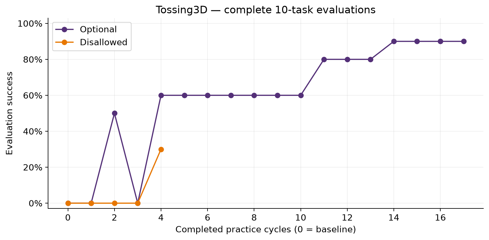

# Tossing3D agentic skills — 50-cycle experiment log

> **STALENESS NOTE (added 2026-10-21, when this log was committed).** Every Tossing3D
> number on this page was measured before kindergarden `0dac89e` (2026-10-19), which
> fixes the bin to the floor once it is placed; before it, a free 0.1 kg bin could be
> tipped by the cube it caught, dragged by picks and pushed by the base. They were also
> measured before the later pick-controller changes. None of them is evidence about the
> current scene. Nothing on this page is edited or recomputed.
>
> **Committed 2026-10-21 from the main checkout's uncommitted files.** Links to
> external sites and private Notion pages were removed (their text is kept), and links
> to paths outside this repository became plain paths. Most `artifacts/` evidence named
> here is not committed; it lives in the main checkout's untracked `artifacts/`
> directory, and the `/tmp` paths no longer exist.



*Figure committed from `artifacts/tossing3d-r9-report/evaluation.png` as produced on 2026-10-06; it predates the project's figure style (percentage axis). Final complete evaluations: optional 9/10 after 17 cycles, disallowed 3/10 after 4.*

Last inspected: **2026-10-03 09:25:50 PM ET**. This is a dated snapshot; consult the live monitor before treating it as current.

## Objective

Test whether repeated practice followed by coding-agent revisions improves Tossing3D performance. Robot skills combine Python policies with natural-language initiation, success-termination, and failure-termination descriptions. Abstract state descriptions and skill-chain transitions support planning. Human skill implementations are supplied by the host, not generated by the coding agent.

This series is an integration/pilot study, not yet a completed agentic-versus-motion-planning A/B experiment. Attempts are separate fresh runs, not one continuous learning curve.

## Current attempt: r9

- Started October 3 at approximately **9:23 PM ET** in persistent tmux.
- Generation running; **0 completed practice cycles**, no complete evaluation yet at the inspection above.
- Preflight passed. Live stream has reported `claude-opus-5-5`; monitor has no stop trigger.
- Josh explicitly authorized unlimited coding turns after r8 exhausted its cap. Runtime uses Robocode's `max_turns: 0` convention. Dollar and wall-clock limits remain in force.
- Two nonterminal broker HTTP 400 events are recorded; the monitor has not classified them as a terminal failure.
- Service: `hitl-agentic-f4dc1befaa4d.service`.
- Tmux: `hitl-tossing3d-claude50-20261003`, window `run-r9`.
- Continuous anomaly monitor polls every 3 seconds; the 30-minute timer queues status reviews into chat.

## Fixed protocol and current configuration

| Item | Setting |
|---|---|
| Environment / seed | Tossing3D / 0 |
| Observations | Object-centric numeric state |
| Provider | Actual Claude Code CLI through shared Robocode Docker transport |
| Model | `claude-opus-5-5` for generation, revision, and numeric judgments |
| Model enforcement | Read-only Docker managed settings restrict child models; actual response models audited |
| Practice cap | 50 cycles, at most 3 actions per practice session |
| Evaluation | 10 tasks at baseline and after each completed cycle |
| Success stop | Three consecutive complete post-practice 10/10 evaluations |
| Practice resets | No automatic reset after initialization; explicit human skills available |
| Costs | Robot action 1; human assistance 5 |
| Coding turn limit | Unlimited in r9; 20 per agent in preceding attempts |
| Coding dollar / time limits | $2 per invocation / 900 seconds |
| Numeric judgment timeout | 90 seconds |
| Process limits | 8 GiB memory; 36-hour run limit |
| Failure handling | Stop on actual bugs/provider errors/invalid revisions; preserve artifacts |

Unknown destination does not suppress a competence update when success/failure was judged explicitly. Unresolved terminal outcome does not become a fabricated success or failure. Revisions can change policies, initiation/failure descriptions, abstract states and graph edges; success meanings remain fixed for comparable accounting.

## Attempt history

“Complete cycles” means practice → accepted revision → full evaluation. Baseline evaluation is not a practice cycle. Earlier rows are reconstructed from saved handoff records; links below provide the underlying artifacts.

| Attempt | Complete cycles | Latest complete evaluation | Result / reason for stopping |
|---|---:|---|---|
| Original | 0 | None | Monitor false-positive on recovered HTTP 400; stopped before practice/evaluation. |
| r2 | 0 | None | Claude stream fragments incorrectly counted as turns. |
| r3 | 0 | None | Generation succeeded; host classification could not locate Claude CLI. Subsequently unified inference in Docker. |
| r4 | 0 | None | Incorrect library argument from supervisor; fixed before robot actions. |
| r5 | 0 | 0/10 baseline | One three-action practice session; child responses incorrectly consumed parent turn budget. No accepted revision. |
| r6 | 3 | 2/10 | Human-reset history caused unresolved classification. Fourth revision finished during shutdown but was not evaluated. Retrospective audit found Sonnet helpers: **mixed-model pilot**, not Opus-only evidence. |
| r7 | 0 | 2/10 baseline | First revision hit a real 21st child turn; child also selected Sonnet. Added enforced model allowlist and actual-model checks. |
| r8 | 2 | 1/10 | Third revision exceeded genuine 20-turn child cap. All observed models Opus. Two accepted policy revisions; no accepted state-definition changes. |
| r9 | 0 at inspection | Pending | Active fresh attempt with unlimited coding turns; all other settings preserved. |

## r8 learning evidence

- Complete evaluations: **0/10 baseline → 1/10 after cycle 1 → 1/10 after cycle 2**.
- Latest evaluation had **10 successful Pick executions out of 10**. That is skill-execution evidence, not 10/10 task success; task success remained 1/10.
- Two accepted revisions changed Pick and Toss code, without changing the manifest/state definitions.
- Initial Pick advanced through timeout-based phases despite poor tracking; it commanded closure far from the cube. Revision added coordinated tracking and safer abort behavior. This was a generated-policy failure, not evidence that the robot API was incorrectly specified.
- Third practice session included a successful Toss, but its subsequent coding revision failed and was not accepted/evaluated.
- Stopping call contained 2 root turns and 21 distinct child turns. This was genuine cap exhaustion, not the previously fixed fragment-counting issue.
- On cap exhaustion, the wrapper kills the coding call, rejects the incomplete revision, and ends the experiment with saved artifacts. It is distinct from the planner choosing STOP.

## Evidence supplied to the learner

The learner receives accepted code and manifest, reproducible task/intake and robot specifications, outcome explanations, source/destination classifications, costs, and complete recorded control-step numerical trajectories as files. This is control-frequency observation/action data, not every internal physics step. The agent chooses which file portions to inspect. Evaluation trajectories are not training feedback.

## r9 change and validation

Only the turn-budget choice changed scientifically: **20 → unlimited**, authorized by Josh. `CodingSettings` was adjusted to accept zero while rejecting negative values; **16 targeted configuration/context tests passed**. Docker preflight passed. No simulator checkpoint resume exists, so r9 starts fresh and must not inherit r8 metrics.

## Artifact index

- Durable handoff/status (`artifacts/handoff-2026-10-03-agentic-claude50/status.json`, not committed)
- Saved r9 runtime (`artifacts/handoff-2026-10-03-agentic-claude50/r9/runtime.json`, not committed)
- Saved r9 launch command (`artifacts/handoff-2026-10-03-agentic-claude50/r9/launch-command.json`, not committed)
- r9 live results (`/tmp/hitl-agentic-tossing3d/artifacts/agentic-claude50-20261003-r9`, a /tmp path that no longer exists)
- r9 monitor (`/tmp/hitl-agentic-tossing3d/artifacts/agentic-claude50-20261003-r9/monitor-status.json`, a /tmp path that no longer exists)
- r9 protocol and preflight (`/tmp/hitl-agentic-tossing3d/artifacts/agentic-claude50-20261003-r9/protocol`, a /tmp path that no longer exists)
- r8 results (`/tmp/hitl-agentic-tossing3d/artifacts/agentic-claude50-20261003-r8`, a /tmp path that no longer exists)
- r8 stopping evidence (`/tmp/hitl-agentic-tossing3d/artifacts/agentic-claude50-20261003-r8/agentic-options/0/stop_reason.json`, a /tmp path that no longer exists)

Live run artifacts reside under `/tmp`; the durable handoff is in the repository workspace. This log is local and has not been published or pushed.

## Next checkpoints

1. Record r9's initial complete evaluation, then each accepted revision and post-practice evaluation.
2. Track policy changes separately from abstract-state/graph changes, competence updates, human interventions, and unresolved classifications.
3. Preserve the early-success and bug-stop rules. Report any new failure with its exact run and evidence; do not merge failed attempts into the current learning curve.
4. After the run stops, summarize its learning curve and assess readiness for the matched motion-planning baseline.

## Status check — October 3, approximately 9:54 PM ET

R9 remains active. Baseline completed at 9:42 PM ET: **1/10**. First practice session executed Pick successfully, then Toss failed with the cube beyond the barrier; planner selected STOP after two actions. One revision accepted: Toss policy and graph edges changed; natural-language cluster/terminal descriptions unchanged. First post-practice evaluation is running, so **0 fully completed practice→revision→evaluation cycles** so far. No terminal failure or monitor stop trigger. All observed coding response models remain Opus 5.5. Next full evaluation estimated in 10–20 minutes; full-run estimate awaits cycle timing.

## Status check — October 3, approximately 10:24 PM ET

R9 stopped at 9:57 PM ET during the first post-practice evaluation: Claude OAuth renewal failed. Latest complete evaluation remains baseline **1/10**, with **0 complete cycles**, one practice session and one accepted Toss/graph revision. STOP.json and stop_reason.json preserve the error. An auth-only diagnostic retry returned HTTP 400; both host and private-broker access credentials were expired. No protocol/model changes or restart performed. Restoring Claude login is required before retrying. The 30-minute timer was stopped to avoid idle notifications.

## Restart — October 4 (r10)

Josh renewed Claude login and authorized continuation. Verified approximately eight hours of remaining token validity and successful trusted broker credential preparation; no host inference performed. No competing experiment was active. Docker preflight passed and r10 launched in persistent tmux window `run-r10`, service `hitl-agentic-d2cf130a9716.service`. This is a fresh attempt because simulator checkpoint resume is unavailable. Unlimited coding turns, $2/900-second per-call limits, 50-cycle cap, 10-task evaluations, and three-perfect-evaluation stop remain unchanged. Continuous monitoring and 30-minute status checks restored. New attempt: 0 completed cycles, baseline pending. Artifacts: `/tmp/hitl-agentic-tossing3d/artifacts/agentic-claude50-20261004-r10`.

## Status check — October 4, approximately 6:47 PM ET

R10 remains active. Baseline evaluation completed at 6:40 PM ET: **0/10**. First practice session: Pick failure → OpenGripper success → Pick failure, ending at the three-action cap. Both Pick failures closed the gripper roughly 14–15 cm from the stationary cube; destinations were resolved. First coding revision is in progress; no accepted code/state revision yet and 0 complete practice→revision→evaluation cycles. No terminal error or stop trigger. Observed coding models remain Opus 5.5. First post-learning evaluation estimated in 20–30 minutes, conditional on successful revision. Timer remains active.

## Status check — October 4, approximately 7:17 PM ET

R10 active: **1/50 complete cycles**. Full evaluation improved from **0/10 baseline to 2/10** at 7:00 PM ET. Second practice session completed OpenGripper, Pick, and Toss successfully. Two revisions accepted: first edited all three robot policies; second edited Pick and Toss. Both manifests unchanged. Second post-practice evaluation underway. No terminal error/stop trigger; observed coding models remain Opus 5.5. Next evaluation estimate 5–15 minutes; full cap roughly 17–25 hours if 20–30-minute cycles persist, subject to early success/failure stops.

## Status check — October 4, approximately 7:48 PM ET

R10 stopped at approximately 7:25 PM ET after third coding invocation exhausted the $2 cap (reported $2.0016254; `error_max_budget_usd`). **2 complete cycles**; full evaluations **0/10 → 2/10 → 2/10**. Third Pick revision was installed because upstream Robocode accepts an existing best-effort output even on budget exhaustion; our monitor saw the terminal coding error and requested a stop. Its evaluation is **partial 0/1**, not a full evaluation or completed cycle. Three policy revisions, manifests unchanged. Third practice action was human reset. No change to budget/acceptance policy or restart made; idle timer stopped pending Josh's decision. This clarifies earlier blanket explanations that any coding error necessarily rejects a revision: upstream Robocode distinguishes valid saved output from missing output.

## Delegation comparison launched — October 4

Josh approved the focused prompt and evidence-provenance change, then requested two simultaneous runs. Both use the same r10 **initial** generated library and seed0, with fresh competence/learning histories. This isolates session-boundary delegation from variation in initial skill generation; it does not compare generation quality.

| Arm | Delegation | Service | Artifact directory |
|---|---|---|---|
| Optional | Root delegation optional; nested delegation prohibited | `hitl-agentic-471596266bde.service` | `/tmp/hitl-agentic-tossing3d/artifacts/agentic-claude50-20261004-ab-optional` |
| Disallowed | Agent/Task denied by managed settings and CLI tool filter | `hitl-agentic-73e87195eeac.service` | `/tmp/hitl-agentic-tossing3d/artifacts/agentic-claude50-20261004-ab-disallowed` |

Shared revised prompt prioritizes new evidence, permits no change, and requests targeted repairs without speculative rewrites. Host labels producing library digest/revision and practice session, recomputes newness/current-library flags for each learner call, and preserves all trajectories. No success criteria or observation changes. Unlimited turns; $2/call and900-second coding limits retained. Each arm retains50-cycle cap,10 evaluation tasks,three consecutive perfect post-practice evaluations early stop, and terminal-error/budget stops.

Validation:66 integrated learner/transport tests and32 monitor tests passed. Live Docker no-subagent smoke exposed only Bash/Edit/Glob/Grep/Read/Write and successfully wrote output. Both experiment Docker preflights passed; both services and continuous monitors running, baselines pending. Joint30-minute timer restored; its prompt explicitly checks both arms. Changed-source snapshot: `artifacts/handoff-2026-10-03-agentic-claude50/delegation-ab-20261004/changed-sources.tar.gz`.

## Paired status — October 4, approximately 11:40 PM ET

Both services/tmux windows and timer verified active. Both baselines **0/10**; first practice sessions and revisions complete, first post-learning evaluations running (0 fully complete cycles each). Optional revised Pick+Toss for **$0.894792** and spawned **0** subagents. Disallowed revised Pick for **$1.0010188** and spawned **0** subagents. Both manifests unchanged. All first-session evidence marked new and matching the producer library. No terminal error/stop trigger; observed coding models Opus5.5. Costs are completed coding calls only, excluding numeric judgments. Next full evaluations estimated10–20minutes. These first calls do not yet demonstrate a delegation-use difference.

## Paired storage failure and repair — October 5, shortly after midnight

Both first comparison attempts exited around00:00:39–42 ET with `OSError122: Disk quota exceeded`. `/tmp` is user-quota-enabled tmpfs; monitor writes also failed, leaving stale running snapshots. Live services/tmux confirmed both stopped. Each completed1 cycle: optional latest full **1/10**, disallowed **0/10**. Both accepted2 policy revisions, no manifest changes;0 subagents. Completed coding costs optional **$1.970486**, disallowed **$2.2448984**, excluding judgments. Second post-learning evaluations incomplete. STOP files now record journal evidence.

Infrastructure repair: losslessly copied112252 artifact files to repository `artifacts/agentic-live-storage`, verified every regular-file SHA256 and symlink before removing tmp copies, and linked the old artifact path to persistent storage. Persistent scratch reached through short `/tmp/hitl-agentic-scratch` symlink supports Unix broker socket paths; TMPDIR and existing broker auth-store path explicitly propagated to systemd workers. Write/socket checks and launcher compilation passed.

Both authorized protocols restarted fresh as `agentic-claude50-20261005-ab-{optional,disallowed}-r2`, with same initial library, seed, prompt, criteria and budgets. Both preflights passed, monitors running, baseline evaluations pending. No simulator resume exists; prior metrics retained separately. Joint30-minute timer remains active.

## Paired r2 status — October5, approximately00:40 ET

Both restarted services/tmux windows and monitor timer active. Baselines **0/10** each, first Pick revisions accepted, first post-learning evaluations running: **0 complete cycles** each. Optional coding cost **$0.8036692**, disallowed **$0.8028346**;0 subagents in both. Manifests unchanged. Practice evidence contains two Pick failures and one OpenGripper success with host producer revision/newness labels. No terminal failure or monitor trigger; persistent storage writes remain healthy. All observed coding response models Opus5.5. Next full evaluations estimated10–20minutes. Costs exclude numeric judgments and previous attempts.

## Paired r2 status — October5, approximately01:12 ET

Optional remains active: **2 complete cycles**, latest full **5/10** (0→0→5). Three learner calls: two changed policies, third returned no change following a human reset. Second revision also changed manifest fields: edges. Coding cost **$2.3663032**,0 subagents.

Disallowed stopped around01:03 ET during second post-practice evaluation: **1 complete cycle**, latest full **0/10**, interrupted evaluation **1/6**. Two policy revisions, no manifest changes, coding cost **$1.9136822**,0 subagents. Numeric judgment79a87daae1b147cf863c0aba1aa566a3 exceeded90-second Docker deadline after successful robot execution. Broker forwarded HTTP400 then200; stream had initialization only, no assistant response, stderr empty. This establishes a provider/CLI deadline failure, not an identified controller or auth defect. STOP artifacts preserved; no blind restart or timeout/retry changes. Optional and joint timer remain active. Costs exclude judgments.

## Paired r2 status — October5, approximately01:40 ET

Optional service/tmux active: **4 complete cycles**; full evaluation series **0→0→5→5→2 /10**. Most recent evaluated change edited Toss policy; performance declined from5/10 to2/10, not a runtime bug by itself. Four accepted learner outputs include one no-change output; one earlier transition-edge revision, no natural-language state changes. Fifth practice session finished and learning is underway. Completed coding calls total **$3.3436994**,0 subagents. Disallowed still stopped:1 complete cycle, latest full0/10, partial1/6, cost$1.9136822. No new work or restart there. Optional has no stop trigger, observed coding models Opus5.5. Timer remains active. Next optional evaluation15–25minutes; full remaining cap roughly13–16hours at recent pace, conditional on no early stop.

## Paired r2 status — October5, approximately02:10 ET

Optional active: **5 complete cycles**, latest full **2/10** (baseline and successive scores0,0,5,5,2,2). Six learner outputs accepted; latest changed Toss only, no new manifest changes. Sixth evaluation running. Completed coding cost **$4.5681918**,0 subagents. No runtime error/stop trigger, observed coding models Opus5.5. Disallowed remains stopped at1 complete cycle, full0/10, partial1/6, cost$1.9136822 due90-second numeric judgment timeout. No restart. Next optional evaluation estimate5–15minutes; roughly13hours to remaining45cycles at current pace, conditional on early stops. Timer active; costs exclude judgments.

## Both r2 arms stopped — October5, approximately02:40 ET

Optional ended around02:13 ET: two numeric judgment calls (f26a909d5bc84872b5eeea1cb5095d5d and ce3d46fc19624d84a54ee0c0252572c5) received repeated **HTTP429** provider responses and each exhausted the90-second Docker deadline. **5complete cycles**, latest full **2/10**, peak5/10; sixth evaluation not completed. Six learner outputs, four policy-changing and two no-change; one transition-edge edit, no state-description changes. Coding total$4.5681918,0subagents. This is provider rate limiting, not a demonstrated robot-policy bug.

Disallowed remains at1complete cycle, full0/10, partial1/6, coding$1.9136822,0subagents after its earlier90-second deadline. Both services inactive and tmux experiment windows gone. Timer stopped to prevent idle notifications. No budgets, retry policy, observation mode, model, or success criteria changed; no restart. Further progress depends on rate-limit/timeout recovery policy decision and provider availability. Logs/artifacts retained.

## Approved recovery implementation — October5

Josh approved bounded retry recovery and relaunch, requesting comparison with Robocode first. Audited upstream `run_with_rate_limit_retry`: quota-reset waits with5.5h wait cap, five transient API retries at60/120/300/600/900s, resumed coding with carried budget. Our numeric adaptation repeats the exact saved request in a fresh tool-free Docker CLI session; never reexecutes robot actions. New configs select6total attempts,90s each, same backoffs,6h total recovery window. Explicit backend rate-reset messages use upstream parsing; auth/model/tool/schema errors remain terminal. Costs retain known/unknown distinctions across attempts; atomic root metadata distinguishes retrying from failure, monitor surfaces active recovery. Coding $2 and900s limits and terminal-budget stops unchanged.

Validation:96 integrated judgment/transport tests and37monitor tests passed. Live smoke was initially delayed by approval-review capacity; retry was approved but failed before inference on `Claude OAuth renewal failed`. **No new experiments launched.** Both r3 launcher/config pairs are ready under pending_comparison_runs in status.json; renewed host login required before live verification/relaunch. Timer remains paused.


## 2026-10-05 — approved Robocode parity and PyBullet integration

Implemented native recovery/auth, unlimited coding turns, no independent coding or judgment deadline, native output/context settings, $2 coding invocation budget, and service defaults without extra memory/runtime caps. Evaluator uses low effort and read-only full episode evidence with explicit prior-session/human boundaries. Improver has isolated PyBullet planning/render tools, no MuJoCo/native skills/live-world access. Policy previews are kinematic only.

Validation: 236 runtime/method tests, 20 bridge tests, and 3 launcher tests passed; disconnected Docker PyBullet smoke passed and verified forbidden simulator/controller packages absent. Image `sha256:28dac9393aea908e327533b5cc48995f5fe73da4a662593e40e87d1cd6914ddd`. Optional/disallowed r4 runtime configs prepared and validated, not launched. No paid Claude end-to-end smoke yet; old auth failure is not asserted fixed. Historical r2 outcomes remain historical.

The requested 15-minute timer delivered this integration check successfully. Integration/local validation completed; timer disabled to avoid idle notifications. No Notion, PR, push or publication.

Josh requested half-system resource use: combined workload budget 12 CPU cores and 30.4 GiB RAM across both arms, including Docker/build/test processes. Apply to future launches; no experiment is running at this update.


### Live validation and resource enforcement
Shared half-system enforcement verified: host6CPU15GiB, at most two Docker containers each3CPU7.5GiB, total12CPU30GiB; 19 focused resource tests pass. Actual container inspection confirmed NanoCpus3000000000 Memory8053063680 Swap8053063680. Live Claude smoke using native auth and opus5.5 hit repeated upstreamHTTP401 before any assistant response. Stopped only smoke service/container; no experiment launched. Artifacts: `artifacts/live-validation-20261005-parity`. Monitoring disabled pending user authentication restoration (`claude auth login`).


### Authentication restored and live smoke passed
Josh supplied CLAUDE_CODE_OAUTH_TOKEN in ~/.bashrc. Loaded literal value only into authorized smoke process; no global service environment import and no secret passed into model container. Actual Claude Code opus5.5 numeric judgment and coding-file tests passed in auth4 artifact directory. Costs: judgment $0.0037444, coding $0.0416612. Earlier auth2 produced correct judgment with extra prose (smoke parser failed); tightened smoke JSON-only prompt. Auth3 exposed resource-slot cleanup case mismatch (`error: no such object`); fixed case-insensitive match, regression test passed. Resource pool limits retained. No robot rollout or experiment launched.


### Both comparison runs launched (r5)
Josh explicitly authorized launch and15-minute monitoring. r4 started then stopped for confirmed evaluator native-recovery log parser bug: append-only retry logs containmultiple resultrecords. Fixed selectionof final result withregressiontest; fresh r5 uses same r10INITIALlibrary seed0,50cycles,10tasks,3consecutivepostpractice10/10 earlystop,optionalvsdisallowed,2USD/codinginvocation. Services hitl-agentic-baf7f7c91216(optional), hitl-agentic-3f59a377a0f4(disallowed); tmux windowsab-optional-r5/ab-disallowed-r5. Bothverifiedrunning with no anomalytrigger, initialevaluationsunderway. Process-scopedauthwrapper reads literaluser ~/.bashrc token withoutglobalimport. Host+Dockershared12CPU30GiB capsactive. Timer hitl-agentic-status-15m active, next12:23:46EDT. No full evaluationyet.


### 15-minute check: r5 format failure and r6 continuation
Bothr5 stoppedbeforepractice on open_gripper judgment ValidationError. Claude returned semanticallyvalid successJSON precededbyprose. Optionalpartialbaseline0/2,disallowed0/1; neitherfull10taskeval. Codingcost0/revisions0/delegations0. Judgmentcostoptional4.8462878USD,disallowed1.8747346USD. Fixedonlypresentationparsing: acceptuniqueJSONobject, strictschema andclusterregistryretained, rejectmultipleobjects. All46savedjudgments validateoffline;105focusedtests passed. Fresh r6sameinitiallibrary/seed/protocol launchedafterconfirmingr5inactive. Timerremainsactive forboth; no protocol/budget/model changes.


### r6 scheduled check — baseline evaluations active
{
  "optional": {
    "status": "running",
    "practice_cycles_completed": 0,
    "latest_complete_evaluation": null,
    "accepted_revisions": 0,
    "coding_cost_usd": 0,
    "judgment_cost_usd": 17.0088766,
    "subagents_spawned": 0,
    "evaluation_skill_records": 36,
    "failure": "none terminal; repeated Pick failures and OpenGripper successes in baseline evaluation",
    "next_action": "continue baseline evaluation unchanged",
    "eta": "first full baseline pending; no measured full-cycle throughput yet"
  },
  "disallowed": {
    "status": "running",
    "practice_cycles_completed": 0,
    "latest_complete_evaluation": null,
    "accepted_revisions": 0,
    "coding_cost_usd": 0,
    "judgment_cost_usd": 22.3491324,
    "subagents_spawned": 0,
    "evaluation_skill_records": 37,
    "failure": "none terminal; repeated Pick failures and OpenGripper successes in baseline evaluation",
    "next_action": "continue baseline evaluation unchanged",
    "eta": "first full baseline pending; no measured full-cycle throughput yet"
  }
}
Both live services/tmux verified; no terminal anomaly. Code libraries unchanged, no learner/delegation calls yet. Judgment costs separate from $2 coding-invocation budget. Timer kept active.

### r6 live check 2026-10-05T16:58:04.522489+00:00

Both services active and tmux windows present. Baselines completed 0/10. Each arm revised Pick and Toss using three practice transitions; state manifest unchanged. No delegation observed, no terminal bug. Optional first complete post-practice evaluation 1/10.

```json
{
  "optional": {
    "status": "running",
    "practice_cycles_completed": 1,
    "latest_complete_evaluation": {
      "num_solved": 1,
      "num_total": 10,
      "post_practice": true
    },
    "accepted_revisions": 1,
    "coding_cost_usd": 0.9220242,
    "aborted_coding_cost_usd": 0,
    "judgment_cost_usd": 36.1157034,
    "subagents_spawned": 0,
    "last_revision": {
      "previous_digest": "14454c129a6c2accefdabb7c2a3cf53fb1b0818bea68f0603f467fbc0c2ac56a",
      "digest": "a259b9cee961479dd02d014d26ef1abf778a71ff3debfbc563f9c6828d5ace17",
      "changed_files": [
        "policies/pick.py",
        "policies/toss.py"
      ],
      "evidence_count": 3,
      "manifest_changed": false
    },
    "failure": null,
    "next_action": "continue next practice cycle",
    "eta": "first measured optional cycle 14.7 minutes; roughly 12 hours for remaining 49 if sustained; early stops may shorten",
    "checked_at": "2026-10-05T16:58:04.522489+00:00"
  },
  "disallowed": {
    "status": "running",
    "practice_cycles_completed": 1,
    "latest_complete_evaluation": {
      "num_solved": 1,
      "num_total": 10,
      "post_practice": true
    },
    "accepted_revisions": 1,
    "coding_cost_usd": 1.2306184,
    "aborted_coding_cost_usd": 0,
    "judgment_cost_usd": 40.3175132,
    "subagents_spawned": 0,
    "last_revision": {
      "previous_digest": "14454c129a6c2accefdabb7c2a3cf53fb1b0818bea68f0603f467fbc0c2ac56a",
      "digest": "78d56d665fa12e0d062fd0b3b7c520fbbd58d66897b959921e93fce115f15ccf",
      "changed_files": [
        "policies/pick.py",
        "policies/toss.py"
      ],
      "evidence_count": 3,
      "manifest_changed": false
    },
    "failure": null,
    "next_action": "finish first post-practice evaluation",
    "eta": "first measured optional cycle 14.7 minutes; roughly 12 hours for remaining 49 if sustained; early stops may shorten",
    "checked_at": "2026-10-05T16:58:04.522489+00:00"
  }
}
```

Resource check: host slice 6 CPU/15 GiB; two Docker containers each 3 CPU/7.5 GiB, no extra swap. Approximately 41 GiB system memory available and load 1.8. Timer active; next check 13:08 EDT. No new launches or protocol changes.

Check completion update: disallowed also completed its first post-practice full evaluation at 1/10 while this check was being recorded. Both now have one complete practice/revision/evaluation cycle; next action for both is the next practice cycle.

### Live status 2026-10-05T17:07:07.800547+00:00

Both r6 arms active, one complete practice/revision/evaluation cycle each (1/10 versus baseline 0/10). Second practice session and second accepted revision complete; latest revision changes Toss only, state manifest unchanged. Second evaluation underway, no terminal anomaly.

```json
{
  "optional": {
    "accepted_revisions": 2,
    "next_action": "complete second post-practice evaluation",
    "subagents_spawned": 0,
    "coding_cost_usd": 2.0026914,
    "judgment_cost_usd": 42.245046
  },
  "disallowed": {
    "accepted_revisions": 2,
    "next_action": "complete second post-practice evaluation",
    "subagents_spawned": 0,
    "coding_cost_usd": 2.2427534,
    "judgment_cost_usd": 46.537651
  }
}
```

ETA remains approximately 12 hours for full cap at first-cycle throughput, subject to early stopping and runtime variability. Monitoring remains active.

### Scheduled r6 health check 2026-10-05T17:09:54.594897+00:00

Both services active; tmux windows live; second post-practice evaluations ongoing. Latest revision in each changes Toss policy only, manifest unchanged. No terminal anomalies or active native recovery.

```json
{
  "optional": {
    "practice_cycles_completed": 1,
    "latest_complete_evaluation": {
      "num_solved": 1,
      "num_total": 10,
      "post_practice": true
    },
    "accepted_revisions": 2,
    "coding_cost_usd": 2.0026914,
    "aborted_coding_cost_usd": 0,
    "judgment_cost_usd": 46.2308338,
    "subagents_spawned": 0,
    "failure": null
  },
  "disallowed": {
    "practice_cycles_completed": 1,
    "latest_complete_evaluation": {
      "num_solved": 1,
      "num_total": 10,
      "post_practice": true
    },
    "accepted_revisions": 2,
    "coding_cost_usd": 2.2427534,
    "aborted_coding_cost_usd": 0,
    "judgment_cost_usd": 50.5000262,
    "subagents_spawned": 0,
    "failure": null
  }
}
```

Shared host slice verified 6 CPU/15 GiB; two Docker slots each 3 CPU/7.5 GiB. Host slice uses 7.2 GiB; system available RAM 41.6 GiB, load 1.97, /tmp free 7.8 GiB. Timer remains active, next check 13:23:48 EDT. No launches, repairs or protocol changes needed. ETA approximately 12 hours for full cap, based on only one complete cycle per arm.

### Scheduled r6 check 2026-10-05T17:24:50.355612+00:00

Both arms running, second full post-practice evaluations still 1/10 (baseline 0/10). Third practice sessions and accepted revisions complete, third evaluations underway. Latest revisions change Toss only, manifest unchanged. Three-action cap remains unchanged pending explicit protocol decision; not a matched non-agentic comparison.

```json
{
  "optional": {
    "practice_cycles_completed": 2,
    "latest_complete_evaluation": {
      "num_solved": 1,
      "num_total": 10,
      "post_practice": true
    },
    "accepted_revisions": 3,
    "coding_cost_usd": 2.96204,
    "aborted_coding_cost_usd": 0,
    "judgment_cost_usd": 62.9122232,
    "subagents_spawned": 0,
    "failure": null
  },
  "disallowed": {
    "practice_cycles_completed": 2,
    "latest_complete_evaluation": {
      "num_solved": 1,
      "num_total": 10,
      "post_practice": true
    },
    "accepted_revisions": 3,
    "coding_cost_usd": 3.9142344,
    "aborted_coding_cost_usd": 0,
    "judgment_cost_usd": 60.4039992,
    "subagents_spawned": 0,
    "failure": null
  }
}
```

No terminal bugs or active recoveries. Monitoring retained. Full-cap ETA approximately 12–13 hours based on 15–16 minutes per cycle.

### User-requested stop and environmental parity audit — 2026-10-05

Both r6 services stopped and verified inactive/dead; no Docker containers remained. STOP.json records user_requested_stop. Disabled only hitl-agentic-status-15m.timer. No relaunch or protocol changes made.

Reference: canonical non-agentic setup recorded in 2026-09-25-tossing3d-exp08-12.md, overview snapshot September 27. This is a source/configuration audit, not proof of bitwise equivalence with historical simulator revisions.

| Component | Canonical non-agentic | Agentic r6 | Assessment |
|---|---|---|---|
| Practice budget | 50 x 20 actions | 50 x 3 actions | Mismatch; 1000 vs 150 maximum slots |
| Objective | Linear cost lambda=3e-6 | Unspecified lambda -> hard budget 20 | Material unintended mismatch |
| Belief inference | Grid | 256 particles | Method-setting mismatch |
| Learning model | A/global or B/local trend | Local trend | Only B is matching family |
| Scene | Barrier, one cube, far-side initial bin | Same shared builders/defaults | Matches by construction |
| Practice initialization | Canonical seed125 | Same | Matches by construction |
| Test scenes | Seed-derived independent test stream | Same builder, seed0 + offset10000 | Same sampling design; historical file hashes not verified |
| Practice resets | Persistent world, paid human reset, selectable side | Same host reset implementation and both side destinations | Physical mechanism matches; applicability now generated |
| Costs | Robot1, human5 | Robot1, human5 | Matches, but objective differs |
| Evaluation | 10 tasks, native goal, four skill slots, no human help | Same problem/task/loop | Scoring and macro action horizon match |
| Evaluation policy | Native predicate/controller deployment | Generated clusters and initiation checks, ordered Toss/Pick/OpenGripper | Intentional method change, not identical planner |
| Policy execution | Native controllers and controller-specific limits | Generated joint controls; initial caps Pick300/Toss400/Open120; bridge arm velocity bound12 | Need explicit controller-budget parity decision |
| Exploration/evidence | epsilon0.5 sampler; non-epsilon competence evidence | No parameter sampler; all resolved code executions evidence | Learner difference, not environmental mismatch |
| Early success stop | Canonical fixed50 cycles | Three consecutive full10/10 | Approved protocol difference |
| Replication | Historical multi-seed results | Seed0 only, same initial generated library | Pilot, not matched full benchmark |

Agentic search depth defaults3; historical production search also has runs using6, so pin exact comparator before claiming search parity. Numeric object observations use same physical world but richer proprioception/history and language judgments than native predicate methods. Both practice and evaluation use MuJoCo; PyBullet-only access applies to coding sandbox planning, not robot rollout physics. No environment changes were applied during audit.

### Approved parity changes — October 5, 2026

Implemented in /tmp/hitl-agentic-tossing3d; no experiment relaunched. Agentic CLI and launcher session defaults now20; SearchConfig/CLI linear lambda default3e-6, launcher forwards explicit setting; new inference-engine setting defaultsgrid and is wired into existing local-trend belief initialization. Grid uses shared25x16 discretization and rho0.9, matching native defaults. Launcher exposes --linear-cost-lambda and --inference-engine. Existing r6 launch records retained unchanged as historical evidence; next-experiment-settings.json records approved future settings.

Early-success stop remains opt-in (general defaultNone), with three complete perfect post-practice evaluations retained only for initial experiments. Generated policy step caps300/400/120 were selected at initial generation; current revision validation freezes them afterward. No cap-validator change made.

Validation: all43 agentic-options tests pass, including grid posterior update/refit and finite linear objective above the old hard budget20. Launcher --help loads successfully; git diff --check clean. Both runs and timer remain stopped.

### Authorized r7 relaunch — 2026-10-05T17:38:02.099793+00:00

Both arms launched in persistent tmux from original r10 INITIAL library, seed0. Fresh learning histories; r6 preserved. Explicit20 action cap, linear lambda3e-6, grid inference, local trend. Unchanged50 cycles,10 eval tasks, optional/disallowed delegation, $2 coding invocation, actual Claude Code Opus5.5, object observations, PyBullet-only improver and initial-experiment three-perfect-eval stop. Both services active; no initial terminal trigger. Monitoring prompt updated to r7.

### Scheduled r7 check 2026-10-05T17:39:56.192082+00:00

Both services active, tmux windows live, baseline evaluations producing new judgment evidence. No completed practice/evaluation cycles, revisions, delegation or coding calls yet. No terminal anomaly or active native recovery. Actual provider provenance Claude Code claude-opus-5-5.

```json
{
  "optional": {
    "practice_cycles_completed": 0,
    "latest_complete_evaluation": null,
    "accepted_revisions": 0,
    "coding_cost_usd": 0,
    "judgment_cost_usd": 3.8228344,
    "failure": null
  },
  "disallowed": {
    "practice_cycles_completed": 0,
    "latest_complete_evaluation": null,
    "accepted_revisions": 0,
    "coding_cost_usd": 0,
    "judgment_cost_usd": 3.4256756,
    "failure": null
  }
}
```

Resource checks: host slice6CPU/15GiB (5.5GiB used), two Docker containers each3CPU/7.5GiB, no additional swap allowance. System available memory41.7GiB, load3.11, /tmp free7.8GiB. Timer active, next13:53EDT. Baseline ETA10–15minutes, full-run estimate deferred until first20-action cycle. No repairs/restarts required.

### Scheduled r7 check 2026-10-05T17:54:26.187742+00:00

Both fresh baselines complete0/10. First20-action practice sessions running, alternating failed Pick and successful OpenGripper so far. No revisions/coding calls/delegations yet; no terminal bug or active recovery.

```json
{
  "optional": {
    "practice_cycles_completed": 0,
    "latest_complete_evaluation": {
      "num_solved": 0,
      "num_total": 10,
      "post_practice": false
    },
    "practice_actions_recorded": 5,
    "accepted_revisions": 0,
    "coding_cost_usd": 0,
    "judgment_cost_usd": 21.3648534,
    "failure": null
  },
  "disallowed": {
    "practice_cycles_completed": 0,
    "latest_complete_evaluation": {
      "num_solved": 0,
      "num_total": 10,
      "post_practice": false
    },
    "practice_actions_recorded": 5,
    "accepted_revisions": 0,
    "coding_cost_usd": 0,
    "judgment_cost_usd": 29.867189,
    "failure": null
  }
}
```

Services active and tmux verified. Host slice6CPU/15GiB, Docker slots3CPU/7.5GiB each remain enforced; host memory8.2GiB, system available41GiB, /tmp free7.8GiB. Timer active, next14:08EDT. First post-practice eval ETA20–30minutes, full-run estimate awaits measured cycle. No repairs/restarts or protocol changes.

### Evaluator cost audit and r7 stop — October5, approximately14:00EDT

Optional193 judgment calls/$21.9726222, disallowed194/$31.1593602. Input/cache tokens dominate: optional4,128,465 cache-creation +2,852,006 cache-read; disallowed6,039,468 creation +980,381 read. Outputs only~38k tokens per arm. No evaluator tool calls. Stored requests average~72KB, include current numeric observation and up to8 physical history samples with repeated action/state specification. Full episode files available on demand were not read.

Both arms stopped at17:58UTC after API429 retries exhausted and synthetic CLI error response was incorrectly treated as a model mismatch by provenance guard. STOP.json already written by anomaly monitors. This is an infrastructure bug, not a robot failure or actual model substitution. Repair remains outstanding; no restart or protocol change performed during cost explanation.

### r7 recovery audit — October5,14:10EDT

Both services inactive/dead, no Docker containers. Completed baseline0/10, seven practice actions each, zero complete practice/revision/full-eval cycles and zero accepted revisions. Fixed transport and monitor to exempt only explicitly marked synthetic API-error messages from real-model provenance checks. Unknown synthetic responses and wrong real models still fail.132 tests+12subtests passed; both saved failing streams replay successfully through guard and monitor.

Native Claude backend recovery recognizes5xx or quota-reset-time regex, not observed generic429. Therefore guard fix alone does not guarantee retry. No new retry policy or restart applied. Both runs require user decision on whether to extend native recovery for429; timer disabled to avoid idle notifications. System available RAM47GiB.

{
  "optional": {
    "coding_cost_usd": 0,
    "aborted_coding_cost_usd": 0,
    "judgment_cost_usd": 21.9726222
  },
  "disallowed": {
    "coding_cost_usd": 0,
    "aborted_coding_cost_usd": 0,
    "judgment_cost_usd": 31.159360200000002
  }
}

### Abstract-state implementation and r8 prelaunch validation — October5

Approved changes implemented: one classification initially and after each actual skill (including final eval action), cached between invocations; initiation and success/failure computed from state references in graph; unknown not failure. Disjoint success/failure destinations validated before library installation. Existing saved r10INITIAL library passes without edits. DeterminizedAStarPlanner100iterations with remaining-action bound replaces expectimax. Grid/localtrend/lambda3e-6/20action settings retained.

Evaluator drops inline recent_observations and action specification; full timestamped physical trajectories remain read-only on demand. On193saved r7requests, mean serialized input falls71987→14852bytes (79.4%, not measured token or dollar saving). New prompt clarifies abstract states and on-demand history. Old JSON cluster keys retained for saved-library compatibility.

Coding retains separate durable session/workspace per arm; explicit prior Claude session resume, restored accepted library, delta-evidence continuation, historical evidence files retained. Tenacity generic429 retry uses30–300second exponential jitter without retry cap/deadline; costs from failed attempts consume original $2 allowance. Other native recovery unchanged. Monitor records active retry waits. Real provider429 reached Tenacity waiting with remainingbudget2.0 and abortedcost0; successful live cross-invocation resume is still unverified because provider is rate limited.

Validation265runtime+method tests passed (including socket boundary tests), plus monitor115tests/12subtests. No new simulator/image/protocol budgets. No publishing.

R8 launched 2026-10-05T18:36:55.937743+00:00 after live smoke retry exposed and fixed non-idempotent delegation configuration. Subsequent targeted tests62pass including resumed evaluator tools. Both r7services verifiedinactive, smoke stopped/cleaned; no duplicates. R8 begins with same saved initial library/seed0, fresh histories, both delegation arms. Monitoring restored. Successful live cross-invocation coding resume still pending first actual revisions; do not claim validated live memory yet.

Live check 2026-10-05T18:40:09.947376+00:00: both r8 systemd services active; provider HTTP 429 before first completed baseline. No completed practice/revision/full-evaluation cycles yet. 15-minute timer enabled. Native recovery and Tenacity backoff remain active. Persistent cross-invocation recall is regression-tested but awaits live revision evidence.

Scheduled live check 2026-10-05T18:41:48.033704+00:00: r8 optional and disallowed services and tmux windows active. Both still at initial evaluation classification, with confirmed generic429 Tenacity retry evidence and no STOP files. Completed cycles 0 each; no complete evaluation, policy/state revision, coding invocation or delegation yet. Recorded aborted retry cost $0. Host slice 6CPU/15GiB and two Docker containers each 3CPU/7.5GiB verified; host slice current memory ~3.77GiB, system available ~43GiB, /tmp free7.8GiB. Timer remains enabled. Next: automatic retries then baseline; ETA depends on provider rate limits.

Scheduled check 2026-10-05T18:55:24.131064+00:00: both r8 services/tmux active; ongoing provider429 with Tenacity outer retries {'optional': 4, 'disallowed': 5}. No progress.jsonl or coding invocation metadata; 0 completed cycles, no complete evaluation/revision/delegation, coding and recorded aborted costs $0. No STOP. Resource limits verified; available memory43GiB, /tmp7.8GiB free. Continue retries and 15-minute monitoring, ETA unavailable pending provider acceptance.

Josh requested waiting until the account reset at 5 PM Eastern October5. Froze both existing r8 systemd services and paused their remaining Docker container630e7472e4e1. Verified transient timer hitl-r8-resume-20261005-1700.timer scheduled17:00EDT to unpause/thaw and restart15-minute monitoring. No experiment restart or protocol change.

2026-10-05T21:01:56.264474+00:00: 5PM thaw succeeded; provider accepts inference. Optional r8 stopped gracefully because monitor mislabeled broker403 incomplete-body (truncated request) as policy denial. Fixed exact transport-reason exception; actual policy denials still terminal; 38 focused tests passed. Broad discovery accidentally imported unrelated kitchen package and failed dependency import; focused suite passed. Preserved r8 partial baseline0/1 (not complete0/10), no practice/revisions. Verified old service inactive; launched optional r8b unchanged, service hitl-agentic-7835c3b765b9.service. Disallowed r8 remains active,12 evaluation skill records, no full eval yet. Both coding$0/delegations0/revisions0. Resources within12CPU30GiB; monitoring remains enabled.

2026-10-05T21:16:48.957810+00:00: Both previous arms ended gracefully after monitor NotADirectoryError on coding-agent/coding-session.json. Fixed both runtime directory scans to skip files;39 focused tests pass. Both baseline0/10, one20-action practice session, one accepted policy-only revision; optional Pick cost$1.0277278, disallowed Pick+Toss cost$1.3004752, no delegation, no complete postpractice eval (only0/1). No live cross-invocation resume yet. Verified both services inactive before launching r9 fresh same initial library/protocol; all old artifacts retained. Both r9 services active; timer updated and remains enabled. Estimated first full postpractice results15–25min if provider healthy, not guaranteed.

2026-10-05T21:31:12.059982+00:00: Live r9 check: {"optional": {"complete_cycles": 1, "complete_evaluation": "0/10", "revisions": 1, "coding_cost": 0.949186, "aborted_cost": 0.0, "delegations": 0}, "disallowed": {"complete_cycles": 0, "complete_evaluation": "0/10", "revisions": 1, "coding_cost": 1.0146292, "aborted_cost": 0.0, "delegations": 0}}. Both services/tmux active, no STOP or terminal trigger; each completed20-action practice and accepted Pick policy revision, state definitions unchanged. Postpractice evaluation ongoing, no full cycle yet. No active429 recovery. Cross-invocation resume not yet exercised. Host memory~6.98GiB, available40GiB; two containers each3CPU7.5GiB, limits intact. Next complete eval expected~3–6min if current throughput persists;15-minute timer active.

Update during this check: optional completed its first full postpractice evaluation at0/10 (one full cycle now complete). Disallowed still evaluating. This supersedes the preceding prose saying neither full cycle complete; the recorded numeric report already reflects optional completion.

2026-10-05T21:46:18.556622+00:00: Live r9 check {"optional": {"cycles": 2, "eval": 5, "raw_coding_sum": 3.6905226000000004, "delegations": 0}, "disallowed": {"cycles": 1, "eval": 0, "raw_coding_sum": 3.8947651999999993, "delegations": 0}}. Both active without STOP/terminal trigger/active429. Two accepted revisions each: Pick then Toss; manifests unchanged. Explicit resume verified matching original session IDs. Resumed CLI dollars2.7413366/2.880136 with --max-budget-usd2; need resolve session dollar accounting before treating raw sum as incremental billing; aborted costs0. Resource limits verified6CPU15GiB host plus max2containers3CPU7.5GiB, available40GiB;15minute monitor active. Next full eval estimate10–15min optional,1–3min disallowed.

2026-10-05T22:01:08.832022+00:00: r9 live {"optional": {"cycles": 3, "eval": 0, "revisions": 4, "coding_session_cost": 6.1519678, "aborted": 0.0, "delegations": 0}, "disallowed": {"cycles": 3, "eval": 0, "revisions": 3, "coding_session_cost": 4.3391356, "aborted": 0.0, "delegations": 0}}. Both services active/noSTOP/noactive429. Optional regressed5/10 to0/10 on third cycle; no proof of infra bug. Both revised clusters+edges, adding near-barrier abstract states; optional fourth revision Toss-only already accepted. Persistent session files explicitly store totalCostUSD history; previous raw dollar sums double-counted resumed session totals. Optional increments0.949186,1.7921506,1.8688696,1.5417616; each below2; latest cumulative6.1519678. Disallowed latest cumulative4.3391356 at three calls; fourth running. Resource budget intact, host8.37GiB, available40GiB. Next full eval estimate3–7min;15minute monitoring active.

2026-10-05T22:15:50.799827+00:00: r9 live {"optional": {"cycles": 5, "latest_eval": 6, "actual_changes": 4, "cost": 7.372803200000001, "aborted": 0.0, "delegations": 0, "stop": null}, "disallowed": {"cycles": 4, "latest_eval": 3, "actual_changes": 4, "cost": 5.923888, "aborted": 0.0, "delegations": 0, "stop": "unresolved_initial_cluster_after_revision"}}. Optional active; last two complete evaluations6/10, fifth revision no-op. Disallowed inactive after unresolved_initial_cluster_after_revision: moving tilted bin, unsettled cube, close pinch site outside generated state coverage. Fifth zero-action session/no-op, partial eval1/1 excluded from full10-task result. STOP preserved; not treating abstract coverage as routine transport failure or changing settling/unknown-state protocol. Both changed policies and near-barrier state definitions earlier. Monitoring remains enabled for surviving optional arm. Resources within12CPU30GiB,43GiB available. Next optional full eval estimated5–10min; disallowed needs design review, no ETA.

2026-10-05T22:30:51.707618+00:00: Live r9 {"optional": {"cycles": 6, "eval": 6, "changes": 6, "cost": 11.101955000000002, "aborted": 0.0, "delegations": 0}, "disallowed": {"cycles": 4, "eval": 3, "changes": 4, "cost": 5.923888, "aborted": 0.0, "delegations": 0}}. Optional active, seventh session/revision complete and evaluation underway; last3 full eval6/10. Latest actual revisions Pick then Toss, state definitions unchanged since earlier near-barrier addition. Disallowed remains stopped unchanged for unknown moving-scene state; no relaunch. No new trigger/active429. Resource limits verified; host8.61GiB,43GiB available; timer active. Next optional full eval~3–6min, full50cycle estimate7–9h if current cadence persists; early stop rules unchanged.

2026-10-05T22:45:47.773987+00:00: Live r9 {"optional": {"cycles": 8, "eval": 6, "changes": 7, "cost": 13.115856800000003, "aborted": 0.0, "delegations": 0}, "disallowed": {"cycles": 4, "eval": 3, "changes": 4, "cost": 5.923888, "aborted": 0.0, "delegations": 0}}. Optional active, five consecutive complete6/10; latest Toss policy revision, no new abstract changes. Eighth coding call reached native$2 budget (~2.0139 incremental), native wrapper recovered valid revision success=true; preserved terminal-budget behavior without increasing budget. No abortedcost/active429/newmonitortrigger. Disallowed remains stopped unchanged for moving-scene unknown state. Limits intact,host9.11GiB,43GiB available,/tmp7.8GiB free;timeractive. Next optional eval~5–10min;cap50roughly7–8h if cadence persists.

2026-10-05T23:01:18.472561+00:00: Live r9 {"optional": {"cycles": 10, "eval": 6, "changes": 9, "cost": 16.8325904, "aborted": 0.0, "delegations": 0}, "disallowed": {"cycles": 4, "eval": 3, "changes": 4, "cost": 5.923888, "aborted": 0.0, "delegations": 0}}. Optional active at10complete cycles, seven consecutive6/10; latest revisions Toss-only, unchanged state definitions. No new trigger or active429. Disallowed stopped unchanged for abstract-state coverage issue. Resource caps verified,host9.18GiB,42GiB available,/tmp7.8GiBfree. Timer remains active. Next optional full result~8–12min,50cyclecap estimate6–8h absent earlystop.

2026-10-05T23:15:54.883496+00:00: Live r9 {"optional": {"cycles": 11, "eval": 8, "changes": 11, "cost": 20.876105399999997, "aborted": 0.0, "delegations": 0}, "disallowed": {"cycles": 4, "eval": 3, "changes": 4, "cost": 5.923888, "aborted": 0.0, "delegations": 0}}. Optional active, improved to8/10 after11complete cycles;12th revision Toss-only accepted, eval underway. No new state changes/terminal trigger/active429. Native budget termination returned valid revision as before, settings unchanged. Disallowed stopped unchanged with3/10 lastcomplete, state coverage decision pending. Resource caps intact,host9.94GiB,42GiBavailable,/tmp7.8GiBfree. Timeractive; next optional eval~3–6min,remaining50cap~6–7h conditional.

2026-10-05T23:30:53.218434+00:00: Live r9 {"optional": {"cycles": 13, "eval": 8, "changes": 12, "cost": 24.639384399999994, "aborted": 0.0, "delegations": 0}, "disallowed": {"cycles": 4, "eval": 3, "changes": 4, "cost": 5.923888, "aborted": 0.0, "delegations": 0}}. Optional active,threeconsecutive8/10,14th session/revision complete and evaluation underway. Recent revision no-op then Toss-only; no new abstract-state changes. No new trigger or active429. Native budget recovery yielded valid output, unchanged settings. Disallowed remains stopped for moving-scene coverage issue. Host10.09GiB,42GiB available,/tmp7.8GiB;resourceswithinlimits,timeractive. Next full eval~3–6min;50cyclecap~5–6h conditional.

2026-10-05T23:45:55.161426+00:00: Live r9 {"optional": {"cycles": 15, "eval": 9, "changes": 12, "cost": 28.421824399999995, "aborted": 0.0, "delegations": 0}, "disallowed": {"cycles": 4, "eval": 3, "changes": 4, "cost": 5.923888, "aborted": 0.0, "delegations": 0}}. Optional active,latest two complete9/10,16th eval underway. Last two coding revisions no-op; no new state changes. No terminal trigger/active429. Disallowed unchanged stopped for unknown moving-scene abstract state. Resources within limits,host10.08GiB,42GiB available,/tmp7.8GiB free. Timeractive. Next optional eval~1–4min;50cap~4–6h unless earlystop.


### Final r9 report — 2026-10-06T00:07:22.175633+00:00

Both services verified inactive. Optional: 17 complete post-practice cycles, latest 9/10; disallowed: 4, latest 3/10. Both stopped on abstract-state coverage gaps. Partial final evaluations excluded. Disabled only hitl-agentic-status-15m.timer. Report with curves, action charts, stitched practice/final evaluation videos, prompts and pipeline: the private Notion page. Reproducible local artifacts: artifacts/tossing3d-r9-report. Extra archive upload rejected by automatic approval review; retained locally. No experiment restarted.

Queued final monitoring check 2026-10-06T00:09:08.069145+00:00: acknowledged pending marker; both r9 services inactive and tmux experiment panes idle bash; timer not-found (disabled/removed). Reverified full evals optional17/9of10, disallowed4/3of10; both unresolved_initial_cluster_after_revision. No active retry or relaunch. Host46GiB available; /tmp7.8GiB free.
