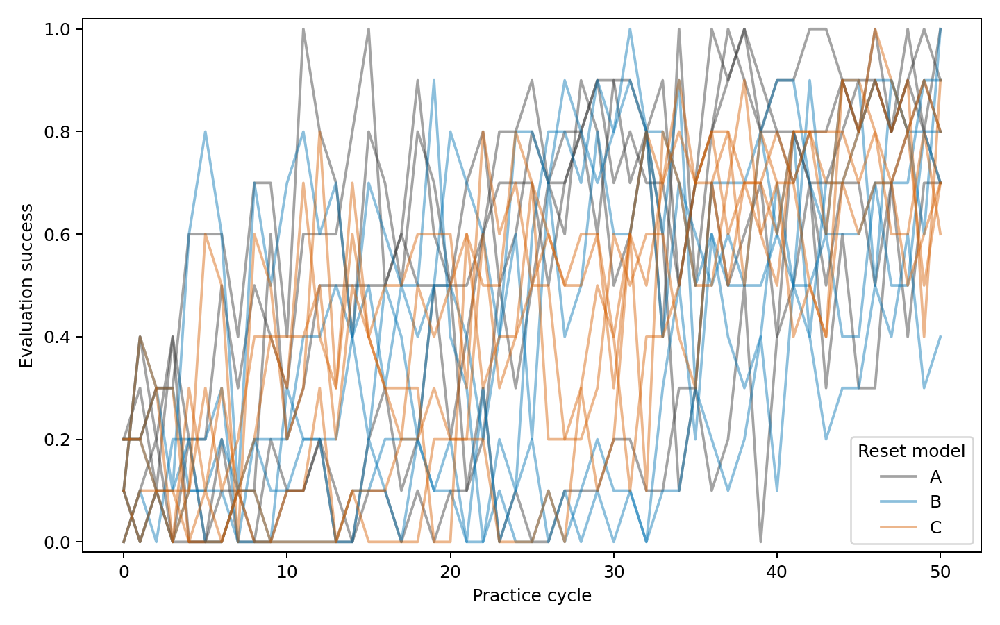

# Human reset model A/B/C ablation

> **STALENESS NOTE (added 2026-10-21, when this log was committed).** Every Tossing3D
> number on this page was measured before kindergarden `0dac89e` (2026-10-19), which
> fixes the bin to the floor once it is placed; before it, a free 0.1 kg bin could be
> tipped by the cube it caught, dragged by picks and pushed by the base. They were also
> measured before the later pick-controller changes. None of them is evidence about the
> current scene. Nothing on this page is edited or recomputed.
>
> **Committed 2026-10-21 from the main checkout's uncommitted files.** Links to
> external sites and private Notion pages were removed (their text is kept), and links
> to paths outside this repository became plain paths. Most `artifacts/` evidence named
> here is not committed; it lives in the main checkout's untracked `artifacts/`
> directory, and the `/tmp` paths no longer exist.

*Figure committed from `artifacts/human-reset-abc-20261006/pddl-results/evaluation-curves.png` as produced; it predates the project's figure style (fraction axis, no counts in the legend). Each line is one seed of 10 tasks.*

Requested October 5 EDT; artifact directory uses the October 6 date. Changes remain local and unpublished.

## Experimental protocol

- PDDL: 15 jobs, conditions A/B/C × seeds 0–4, on Della.
- Agentic: 3 jobs, conditions A/B/C × seed 0, on the workstation. Josh reduced this from five seeds per condition. See [agentic implementation and launch notes](2026-10-06-human-reset-abc-agentic-notes.md).
- A preserves each method's existing human-reset belief semantics. PDDL A assumes successful resets and does not condition the hypothetical reset competence posterior. Agentic A differs; the two are method-specific controls.
- B uses ordinary skill competence and learning-rate inference for human resets.
- C uses B with learning rate pinned to zero while retaining competence uncertainty and competence process noise.
- The physical human-reset implementation is unchanged. No artificial human failures were introduced.
- All conditions exclude successful abstract-state self-loops for every skill. Failed outcomes may retain the current state. PDDL's existing empirical failure model leaves the state unchanged until a failure effect is observed.

Shared settings: 50 practice cycles, 20 actions per session, 10 evaluation tasks, early success after three consecutive complete post-practice 10/10 evaluations. Determinized search uses 100 iterations and the remaining-action bound. Beliefs use the 25×16 grid, local-trend model, linear cost lambda 3e-6, and observation penalty 0. The environment uses the barrier layout with paired seeds. Agentic model, transport and coding budgets remain unchanged.

## Implementation and verification

Added explicit `current`, `ordinary_skill`, and `zero_learning_rate` reset modes, plus an opt-in all-skill success-state-progress filter. The new shared `BayesianSkillBelief.with_zero_learning_rate()` preserves the competence marginal, pins eta to zero, disables eta process noise, and retains competence process noise. Both grid and particle representations are covered by focused tests.

127 local tests passed, including new A/B/C contracts, existing belief-model/inference tests, and CLI tests. Ruff passed on changed files.

Della source is isolated at `/scratch/gpfs/TSILVER/jr2860/experiments/human-reset-abc-20261006/source`. Each job records source hashes, arguments, and job IDs. Reference commits match the local implementation. The shared Conda environment was not modified.

## Launch history

1. Preflight array `15082816` failed before simulator execution: the older Della environment lacked `tenacity`, imported eagerly by the shared CLI's agentic transport. The exact local pure-Python dependency was copied into the isolated source tree.
2. Replacement preflight array `15082892` runs A/B/C for one cycle each. All three passed 91 remote focused tests. Each completed baseline evaluation at 0/10 in approximately 143–151 seconds before proceeding to practice.
3. Measured array `15082956` contains 15 tasks. It is held with an `afterok` dependency on all preflight tasks, so no measured task can run before complete preflight validation.
4. Aggregation job `15082958` depends on completion of the measured array, including failed tasks; missing results remain explicit in its summary.

The earlier 1–2 hour runtime estimate may be optimistic: initial evaluation alone takes roughly 2.5 minutes. Provisional full-run estimate is 2–4 hours plus queue time, to be refined from completed cycles.

## Monitoring

`hitl-human-reset-abc-monitor.timer` initially checked every 10 minutes during implementation and launch. Both job sets are now submitted, so it was switched to every 30 minutes, verified with the next trigger at 21:45 EDT. The monitor uses the existing chat-delivery mechanism, checks actual Slurm/services/tmux and current artifacts, and must not duplicate jobs. Unrelated timers remain untouched.

The workstation's combined budget remains 12 CPUs and 30 GiB RAM. Durable live status is in the artifact directory (`artifacts/human-reset-abc-20261006/`, not committed).

## Preflight completed and measured runs started

All three preflight tasks completed successfully (exit0), including config and output validation. Each executed20practiceactions and a complete post-practice evaluation at1/10. End-to-end preflight duration was approximately5minutes. These are setup results, not measured50-cycle results. Validation/config/test records are saved under `artifacts/human-reset-abc-20261006/pddl-preflight/`.

Measured array15082956 released automatically after validation. At21:19EDT,6tasks were running and9were queued by scheduler priority. No measured failures observed. Monitor remains every30minutes.

### Scheduled check — October 5, 9:45 PM Eastern

All 15 PDDL jobs running; complete cycles A:9,11,9,10,9; B:9,9,8,9,10; C:10,8,8,9,10. Agentic A/B each have 2 complete cycles, latest evaluations 2/10 and 7/10; three accepted revisions each, next evaluation pending. C remains queued. No terminal monitor trigger or active Tenacity wait; nonterminal broker-error records observed and recovery remains monitored. Host slice uses 7.9 GiB under 15 GiB/6 CPU cap; no Docker containers at instant sampled. Existing 30-minute timer verified, next 10:15 PM Eastern. No restarts or new submissions.

### Scheduled check — October 5, 10:15 PM Eastern

All15 PDDL jobsrunning; completecycles A21/24/23/25/20,B22/23/19/21/25,C24/21/20/21/24. Latest evals A5/7/5/0/5,B2/0/9/7/0,C4/6/6/2/4(outof10). AgenticA/B6completecycles,6acceptedrevisions each, latest9/10and7/10;Cqueued. No terminaltrigger oractive429wait. Bhas1unresolvedexecutiondestination but continued learning/evaluation; not an automatic runtimebug. Hostslice9.53GiB withtwoDockercontainers~138MiBtotal, withinapprovedlimits. 30mintimer next22:45EDT. No launch/restart orprotocolchanges.

### Scheduled check — October 5, 10:45 PM Eastern

All 15 PDDL jobs running; complete cycles A:33,35,36,39,33; B:33,38,29,33,39; C:36,34,33,34,37. Agentic A:10 complete cycles,9/10; B:9 complete cycles,7/10, revision10 accepted; C queued. No terminal trigger or active429 wait. B has two unresolved execution destinations cumulatively, learning continues. Local memory near host-slice cap but mostly reclaimable file cache (9.63GB inactive file versus5.54GB anonymous); zero OOM kills and zero current pressure. Limits unchanged. Next check23:15EDT; no duplicate jobs/restarts/publication.

### Scheduled check — October 5, 11:15 PM Eastern

PDDL Slurm:4 completed,11 running,aggregation pending. Complete cycles A45/48/49/50/46;B45/50/41/46/50;C49/47/46/48/50. AgenticA14cycles9/10;B13cycles8/10,revision14 accepted;Cqueued. No terminaltrigger oractive429wait. Resources capped as authorized. Timer30min,next23:45EDT. No new jobs/restarts/publication.

### Scheduled check — October 5, 11:45 PM Eastern

All15 PDDL jobs and aggregation COMPLETED, all validated true,50cycles each. Final evaluation seed0–4: A10/7/8/7/9 (41/50 pooled), B9/8/10/7/4 (38/50), C7/8/9/7/6 (37/50). Summary/CSV/plot retrieved to pddl-results; no significance claim. AgenticA/B17completecycles each, latest9/10and8/10;A18revisions,B17;Cqueued. No terminaltrigger,active429wait,OOMkill orcurrentmemorypressure. Continue30minmonitor next00:15EDT. No restarts/new jobs/publication.

### Scheduled check — October 6, 12:15 AM Eastern

Slurm confirms all15 PDDL jobs plus aggregation COMPLETED. AgenticA/B21 complete cycles each, latest9/10and8/10; accepted revisions22/21, Cqueued. No terminaltrigger oractive429wait; unknown destinations cumulativeA1/B2, runs continue. Localcaps verified, zeroOOMkills/currentpressure. Existing30minmonitor next00:45EDT; no duplicatejobs/restarts/publication.

### Scheduled check — October 6, 12:45 AM Eastern

Slurm reconfirms all15 PDDL jobs plus aggregation COMPLETED. Agentic A/B25 completecycles each, latest8/10both; acceptedrevisions26/25,Cqueued. A latestevaldownfrom9/10; no earlysuccesscriterion met. No terminaltrigger oractive429wait; existingunknowncountsunchanged. Resourceswithinlimits,zeroOOMkills/currentpressure. Keep30minmonitor next01:15EDT. No newjobs/restarts/publication.

### Scheduled check — October 6, 1:15 AM Eastern

Slurm confirms all15 PDDL jobs plus aggregation COMPLETED. Agentic A/B29 complete cycles each, latest8/10both; accepted revisions30/29,Cqueued. No terminal trigger or active429wait; resources within caps, zeroOOMkills/currentpressure. Continue30minmonitor next01:45EDT. No newjobs/restarts/publication.

### Scheduled check — October 6, 1:45 AM Eastern

Agentic A stopped at01:39EDT after33 completecycles,lastfull8/10. STOP verified: unresolved initialstate afterrevision; cubein nearbin, open gripper pinch4.7cm away conflicts with in-binstate >10cm criterion. Final0/1 partialevalexcluded. No restart ordefinitionpatch applied. B32completecycles8/10,revision33accepted,continues. Queue automaticallystartedC(servicehitl-agentic-e75488566798),baseline0/10done,firstpracticeunderway. PDDL all15+aggregate stillcompleted. No OOM/currentpressure oractive429wait. ContinueB/Cmonitor30min,next02:15EDT; userdecisionwouldbeneeded tochangeAprotocol.

### Scheduled check — October 6, 2:15 AM Eastern

A remains stopped after33completecycles8/10, no restart. B36completecycles8/10,37acceptedrevisions; C2completecycles4/10,2acceptedrevisions,thirdpractice underway. Bothservicesactive,tmuxlive. PDDL15+aggregatecompleted. No new terminaltrigger oractive429wait,zeroOOMkills/currentpressure. C ETA7–10hours provisionalbasedfirstcycles, B~2hours. Monitor30minnext02:45EDT.

### Scheduled check — October 6, 2:45 AM Eastern

C stopped02:33EDT after4completecycles,lastfull5/10. STOP is unresolved initial cluster afterrevision: cubeinside nearbin moving0.08m/s exceeds0.05motionlesscondition, binmoving/tilted. Partialevalexcluded; no restart/definitionpatch. A remainsstopped33cycles8/10. B40completecycles8/10,41acceptedrevisions, runningwithoutterminaltrigger/active429wait. PDDL15+aggregationcompleted. Memorywithinlimits,zeroOOM,avg10pressure0(avg60.08). BETA75–90min;continue30mintimer,next03:15EDT.

### Scheduled check — October 6, 3:15 AM Eastern

B44completecycles8/10,44acceptedrevisions,running. A/Cremainstopped33/4cycles,lastfull8/10and5/10,notrestarted. PDDL15+aggregationcompletedverified. No newterminaltrigger/active429wait,zeroOOM/currentpressure. BETA45–55minutes. Continue30minmonitor,next03:45EDT.

### Scheduled check — October 6, 3:45 AM Eastern

B48completecycles8/10,48acceptedrevisions,running. A/Cremainstopped, PDDL15+aggregationcompletedverified. No newterminaltrigger/active429wait,zeroOOMkills; lowmemorypressureavg10.07% underenforcedcap. BETA15–20minutes. Keep30minmonitor untilcompletion,next04:15EDT,then disableifallterminal. No newjobs/restarts/publication.

### Final scheduled check — October 6, 4:15 AM Eastern

All experiments terminal. Bcompleted50cycles,50acceptedrevisions,lastfull8/10 at03:58:33EDT; serviceexitedsuccess. A stoppedafter33cycles8/10;Cafter4cycles5/10, generatedabstractiongaps,partialevaluations excluded. AllPDDL15jobs+aggregatecompleted; finalpooledA41/50,B38/50,C37/50. Alllocalservicesinactive,noDockercontainers,tmuxqueueexitednormally. Disabledonly hitl-human-reset-abc-monitor.timer, unit link removed (is-enabled:not-found), no future timer scheduled. No reruns/protocolchanges/publication. Next scientificdecision: generatedstatecoverage/recovery before newagenticruns; unequalagenticdurationspreclude matched50cyclecomparison.
