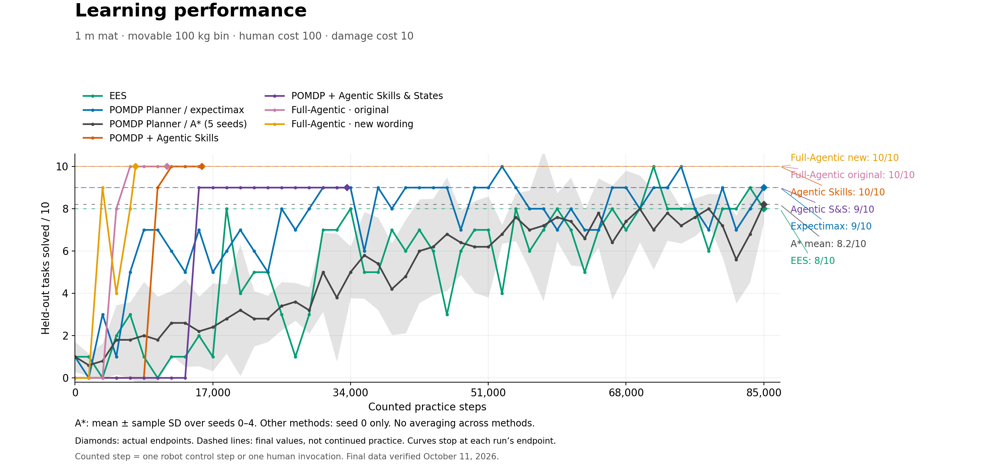

# Fragile Tossing3D — POMDP Planner / determinized A*, five grid seeds

> **Staleness note (2026-10-25, PR #588).** `EesMethod.score_human_skills` now
> defaults to on. Every EES number in this log was produced with it off, or before the
> flag existed: a human reset was treated as an always-successful rescue, priced at
> its fixed cost and never scored. Where this log's domain offers human reset skills,
> an EES run with today's defaults is a different configuration, and these numbers are
> not evidence about it; `--no-ees-score-human-skills` reproduces the old one. Where
> the domain offers none, the flag changes nothing. The numbers below are unchanged.

> **STALENESS NOTE (added 2026-10-21, when this log was committed).** Every Tossing3D
> number on this page was measured before kindergarden `0dac89e` (2026-10-19), which
> fixes the bin to the floor once it is placed; before it, a free 0.1 kg bin could be
> tipped by the cube it caught, dragged by picks and pushed by the base. They were also
> measured before the later pick-controller changes. None of them is evidence about the
> current scene. Nothing on this page is edited or recomputed.
>
> **Fragile Tossing3D was dropped on 2026-10-19.** This variant (1 m mat, movable 100 kg
> bin, damage cost 10) is no longer run; this page is a record, not a live comparison.
> The `mean 82%` below is `41/50` held-out tasks pooled over seeds 0-4 (9+8+7+8+9).
>
> **Committed 2026-10-21 from the main checkout's uncommitted files.** Links to
> external sites and private Notion pages were removed (their text is kept), and links
> to paths outside this repository became plain paths. Most `artifacts/` evidence named
> here is not committed; it lives in the main checkout's untracked `artifacts/`
> directory, and the `/tmp` paths no longer exist.

*Figure committed from `artifacts/fragile-comparison-final-20261011/performance.png` as produced. A\*: mean and sample SD over seeds 0-4; every other method is seed 0 only. Its colours predate the project's method palette.*

User authorized five Della seeds to compare determinized A* with the current fragile
POMDP expectimax result. Seeds are 0–4. These are classical POMDP Planner runs, not
agentic skill/state learners. No agentic run is replaced or relaunched.

## Matched settings

The source and configuration match the completed fragile expectimax seed-0 job
15256891, except for the solver and seed. HITL `eaca501fe39749b0cf9fbdba654be90fc968e994`,
kindergarden `ec4d4eadc877cf944aae49efb366300d7f72138c`, kinder-baselines
`427ad6cdfcc79efb489ebabc8fd39d77e104bb4e`. The latter is the corrected long-range
hand-written controller used in that comparison, not the later pickup-controller draft.
All 360 relevant Python/JSON source files are hash-checked before submission.

- Determinized A*: 100 queue-pop iterations per decision, bounded by remaining
  actions in the 20-action learning session. Shared depth flag 6 is ignored by A*.
- Local-trend Bayesian inference on a 25 × 16 grid; observation penalty 0;
  lambda 3e-6; same competence/process-noise and learning-rate settings.
- Same inherited auxiliary particle count 1024; this does not change grid inference.
- 1 m × 1 m mat, movable 100 kg bin, damage cost 10, each human reset cost 100,
  human duration 1, robot-step cost 1. Wall impacts unchanged.
- 85,000 counted practice steps, measurements every 1,700, ten held-out tasks
  capped at 500 control steps each; stop after three consecutive perfect evaluations.
- Persistent practice, baseline skill/sampler initialization, controller and environment
  observations unchanged. Both human reset destinations retain competence forecasts.
- Two CPUs and 24 GB per seed; CPU/Genoa partition; eight-hour wall limit per job.

## Launch and monitoring

Artifact root: `artifacts/fragile-astar-grid-5seeds-20261010/`.
Remote root: `/scratch/gpfs/TSILVER/jr2860/experiments/fragile-astar-grid-5seeds-20261010/`.
Five independent Slurm submissions allow parallel execution and preserve per-seed
failures. A remote tmux monitor checks every 30 minutes, including if the workstation
is unavailable. Submission receipts, parsed configurations and source validation are
saved in the artifact root. Submitted October 10, 2026, at approximately 16:36 EDT. All five started by approximately 16:37 EDT. Source import checks and the
long-range controller guard passed on every job; no startup error was recorded.

| Seed | Slurm job |
|---|---|
| 0 | 15333874 |
| 1 | 15333875 |
| 2 | 15333876 |
| 3 | 15333877 |
| 4 | 15333878 |

Validation: configuration test first failed without the launch manifest, then passed
with the completed bundle. It checks seeds/output separation and that all scientific
settings other than solver/seed match the prior expectimax configuration. Each actual
remote launch command is parsed with the frozen CLI before any job is submitted.

## Timing and interpretation

The matched expectimax seed took 4:34:55 and EES took 3:19:15. Estimate 3–5 hours
from scheduling for runs that use the full budget; all five run in parallel if resources
are available. The eight-hour allocation is a limit, not an ETA.

Earlier non-fragile A* runs sometimes stopped early after a 100-iteration search chose
STOP; this experiment preserves that algorithm setting. The previous audit's search
budget recommendations are not silently applied here. Record early endpoints honestly.
Only expectimax seed 0 is currently matched by seed; the new five A* seeds alone do
not create a five-versus-five statistical comparison.

## Completed results — verified 2026-10-11

All five Della jobs completed successfully, with 85,000 counted steps and 51
completed evaluations each. No evaluation execution errors. Final scores for
seeds 0–4: 9/10, 8/10, 7/10, 8/10, 9/10; mean 82%, sample SD 8.37 percentage points.
Same/opposite resets: 239/71, 297/79, 255/75, 240/60, 267/69.
Raw-ground contacts: 211, 212, 238, 211, 219.
Runtimes ranged from 3:06:50 to 3:31:07; last completion October 10 at 20:08 EDT.
All reached the practice budget; none met the three-perfect stopping rule.

Final outcome figures and action timelines: artifacts/fragile-comparison-final-20261011/.
Source event counts were checked against every measurement. A* mean ± sample SD
is plotted over five seeds; other methods remain single-seed comparisons.
Updated the private Notion page.

## Reset/ground-contact audit — 2026-10-11

A* averaged 330.4 resets vs expectimax 98; 219.2 of its resets offered a robot
alternative (expectimax: zero). At matched seed-0 decision 8, restored state,
belief and original RNG reproduce a far-reset choice while holding the cube;
expectimax chooses tossing. The reset preference persists with 1,000 expansions
and after matching depth 6 and fully exhausting that sampled tree.
All ground contacts occur during toss-labelled execution. Far-side contacts
account for 66% of the average increase. No code or experiments changed.
Report/evidence: artifacts/fragile-astar-reset-audit-20261011/REPORT.md.
