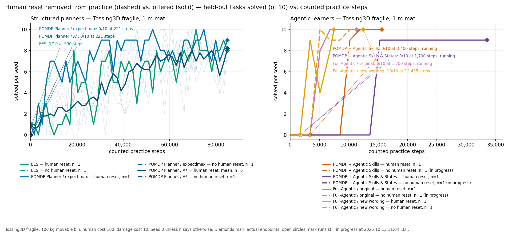
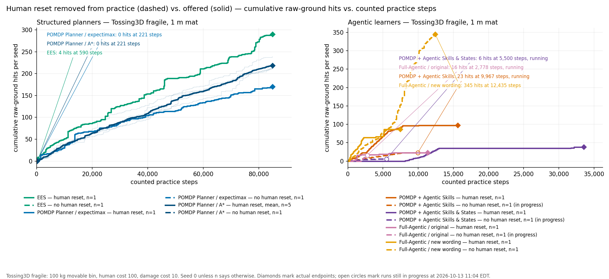

# Fragile Tossing3D without the human reset skill (seed 0)

**TL;DR.** Every completed arm of the fragile Tossing3D comparison was re-run from its own
frozen source with the human reset skill removed from practice (`--no-human-reset`).
The three structured planners stopped almost immediately: EES after 590/85,000 counted
steps (final evaluation 1/10, the same as before any practice), POMDP Planner / expectimax
and POMDP Planner / determinized A* after 221 steps each (0/10, down from 1/10 at step 0).
In each case the robot tossed the cube across the wall and, with nobody to bring it back,
had no admissible practice action left. The agentic arms do not share that failure mode:
Full-Agentic / new wording finished at 12,435 steps with 10/10, practising short near-side
tosses at the price of 345 raw-ground hits (86 with the human). Three agentic arms were
still running when this entry was written; it will be updated when they finish.

## Question / goal

How much of each method's learning on fragile Tossing3D depends on the human reset skill?
The with-human comparison (1 m mat, movable 100 kg bin, human cost 100, damage cost 10,
seed 0, 85,000-step budget) gave every method a human who could put the cube back on the
robot's side for a cost. This entry measures the same methods with that skill withheld
during practice. Evaluation never offered a human in either condition, so the only change
is what the learner can do while practising.

## Background

The bin starts across the wall from the robot. The one trajectory that reaches the goal is
pick on the robot's side, then toss over the wall; the wall is a one-way door, because the
robot cannot cross it. In the with-human runs the human reset was what turned a stranded
cube back into practice material: EES called it 314 times, POMDP Planner / expectimax 98
times, the five A* seeds 300-376 times each, while the agentic learners needed 4-18 calls.

Every arm here is a re-run of a completed with-human arm from its own frozen source
(`hitl` eaca501fe, `kindergarden` ec4d4ead, `kinder-baselines` 427ad6cd for the three
Della arms; `provenance.json` in each artifact directory records the source and the one
flag that changed). The Full-Agentic arms additionally carry PR #421's patch, which removes
the human reset's language and requirement from the full-agentic protocol, and the two
hybrid arms carry PR #422's hybrid-skills patch, which does the same for hybrid runs. A
first POMDP + Agentic Skills attempt was aborted after five minutes because its frozen
task prompt still described both human reset skills and the human-cost hint although the
planner no longer offered them; it is preserved under
`artifacts/fragile-nohuman-lccc-20261013-aborted-prompt-still-described-human/ABORTED.json`
and the relaunch uses the prompt-gating change.

Method-code letters were reordered on 2026-10-13 to planner, estimator, states, skills, so
POMDP + Agentic Skills is CCCL and POMDP + Agentic Skills & States is CCLL in prose. The
artifact directories keep their older names (`lccc`, `llcc`) and are not renamed.

## Hypothesis

With the bin starting across the wall, the first far-side toss strands the cube, so
reset-free practice should learn little. The structured planners should stop early; the
agentic learners might find a way to keep practising without ever committing the cube.

## Guidance given

Re-run each completed arm from its own frozen source with exactly one change,
`--no-human-reset`, the same seed, the same costs and (for the agentic arms) the same
$20 model budget. Do not touch the evaluation protocol. Report actual endpoints; never
extend a curve past the step at which the run stopped. Report counts as `x/y`.

## Methods

| Setting | Value |
| --- | --- |
| Environment | Fragile Tossing3D, barrier layout, 1 m square mat, movable 100 kg bin |
| Seed | 0 (the with-human A* comparator has five seeds, 0-4) |
| Costs | Robot control step 1; raw-ground contact 10; human reset 100 (never offered here) |
| Practice budget | 85,000 counted steps; measurement every 1,700 counted steps |
| Evaluation | 10 held-out episodes of at most 500 control steps, separate frozen process, no human |
| Early stop | Three consecutive complete 10/10 evaluations |
| Step protocol | A run ends when a practice cycle executes zero actions (`no_practice_action`) |
| Structured planners | EES; POMDP Planner with expectimax or determinized A*, depth 6, grid 25 x 16, local-trend beliefs, lambda 3e-6 |
| Agentic learners | POMDP + Agentic Skills; POMDP + Agentic Skills & States; Full-Agentic with the original and the new-wording prompt; Claude Opus 5.5, $20 budget each |
| Where | Della jobs 15486053 (EES), 15486054 (expectimax), 15486055 (A*), submitted 2026-10-13 10:01 EDT; the four agentic arms on the workstation |

With-human comparators are the completed runs already reported: EES and expectimax from
`experiments/fragile-tossing-mat1-fixed-seed0-20261008` on Della, A* from
`fragile-astar-grid-5seeds-20261010`, and the four agentic runs under
`artifacts/hybrid-expectimax-agentic-seed0-20261009-r3/`,
`artifacts/llcc-fragile-seed0-20261010-r2/` and
`artifacts/fragile-tossing-mat1-heavy-20261008/`. Their numbers below were re-read from
those run directories, not copied from the earlier write-ups.

Figures and the data behind them are built by `analysis/fragile_no_human_reset.py`
(tests in `tests/analysis/test_fragile_no_human_reset.py`): it reads each run's
`status.json`, `step_evaluations.json` or `measurements` plus `evaluations/*/results.json`,
and the practice event stream, checks that the damage events sum to the status total, and
writes `curves.json` beside this entry before plotting. The in-progress arms are the
snapshot recorded in that file; re-running the extraction moves them.

## Results

### Final evaluation and practice spent, no human reset vs. with human reset

Robot actions are skill invocations for the planners (control steps are not comparable
for the full-agentic policies, which act at the control level). Human resets are 0 in
every no-human arm by construction.

| Method | No human reset: final eval | Counted steps used (of 85,000) | Robot actions | Raw-ground hits | Endpoint | With human reset: final eval / resets / hits / steps |
| --- | ---: | ---: | ---: | ---: | --- | --- |
| EES | 1/10 | 590 | 6 (3 picks, 3 tosses) | 4 | `no_practice_action` | 8/10 / 314 / 290 / 85,000 |
| POMDP Planner / expectimax (CCCC) | 0/10 | 221 | 2 (1 pick, 1 toss) | 0 | `planner_stop`, then `no_practice_action` | 9/10 / 98 / 170 / 85,000 |
| POMDP Planner / determinized A* | 0/10 | 221 | 2 (1 pick, 1 toss) | 0 | `planner_stop`, then `no_practice_action` | 8.2 +/- 0.84 of 10 (n=5) / 330.4 +/- 29.4 / 218.2 +/- 11.6 / 85,000 |
| POMDP + Agentic Skills (CCCL) | running: 0/10, 0/10, 0/10 at 0, 1,700, 3,400 | 9,967 so far | 59 so far | 23 so far | in progress | 10/10 / 4 / 97 / 15,654 |
| POMDP + Agentic Skills & States (CCLL) | running: 0/10, 0/10 at 0, 1,700 | 5,500 so far | 43 so far | 6 so far | in progress | 9/10 / 11 / 38 / 33,575 |
| Full-Agentic / original | running: 0/10, 0/10 at 0, 1,700 | 2,778 so far | n/a | 16 so far | in progress | 10/10 / 18 / 23 / 11,340 |
| Full-Agentic / new wording | 10/10 | 12,435 | n/a | 345 | `agent_submission` | 10/10 / 7 / 86 / 7,467 |

The A* row's with-human column is the mean and sample standard deviation over seeds 0-4
(final evaluations 9, 8, 7, 8, 9 of 10; resets 310, 376, 330, 300, 336; hits 211, 212,
238, 211, 219). The no-human A* arm is seed 0 only. The in-progress rows are the state at
2026-10-13 11:04 EDT, the time `curves.json` was written; see "Still in progress" below.

Dashed lines are the no-human arms, solid the with-human comparators, in each method's
colour; the five with-human A* seeds are the faint traces under the bold mean. Diamonds
are actual endpoints; open circles are runs still in progress at the snapshot time. The
no-human structured arms are the three short dashed segments in the bottom-left corner
of the left panels, labelled individually because they are otherwise invisible at the
85,000-step scale.

### The robot strands itself

All three structured no-human runs end the same way, and the videos show it directly.

- **EES** picked and tossed three times; every action is labelled `random:` in
  `step_events.jsonl`, the `--reproduce-predicators-random-when-stranded` behaviour
  its arguments select. The first
  two tosses hit bare ground near the robot's side (impacts at counted steps 209, 210
  and 404) and the cube could be picked up again; the third toss (impact at step 582)
  left the cube beyond the wall. The next practice cycle executed zero actions and the
  run ended at 590 counted steps, 593 s of wall-clock.
- **POMDP Planner / expectimax** picked once and tossed once with parameters
  `[2.18, 382.65, 438.20]` (action vector `[1.0, 2.1809, 0.0, 382.6463, 438.1985]`). The
  toss registered no raw-ground contact, so the cube came to rest across the wall on the
  mat or in the bin; either way the robot could not reach it. The planner stopped the
  session (`planner_stop`), the next cycle had no action, and the run ended at 221 steps.
- **POMDP Planner / determinized A*** made the identical two decisions with identical
  parameters and identical step counts, because the same seed produced the same first
  decision and the solver difference never got a chance to matter. Its evaluation
  policy snapshots have the same SHA-256 as expectimax's at both measurements, so the
  two 0/10 results are the same evaluation run twice.

Both videos end their practice segment with the robot parked on the near side of the
wall and the cube out of reach:
[EES, practice at 5x then the endpoint evaluation at 1x](2026-10-13-fragile-no-human-reset/ees-no-human-reset-practice-and-final-eval.mp4),
[POMDP Planner / expectimax](2026-10-13-fragile-no-human-reset/expectimax-no-human-reset-practice-and-final-eval.mp4),
[POMDP Planner / determinized A*](2026-10-13-fragile-no-human-reset/astar-no-human-reset-practice-and-final-eval.mp4).
The videos are the Della renders (`artifacts/fragile-nohuman-20261013/videos/`, same
pipeline as the with-human page), copied here byte for byte.

### Step-0 versus endpoint evaluation

The step-0 evaluation is the untrained policy. EES scored 1/10 at step 0 and 1/10 at its
endpoint; one learning update over six actions did not change what the evaluation policy
could do. Both POMDP Planner arms scored 1/10 at step 0 and 0/10 at the endpoint: the
single stranded toss updated the competence belief and the refit toss parameters, and the
one task the untrained policy had solved (task 0, in 226 control steps) was no longer
solved by the refit policy, which reported `no_plan` on all 10 tasks. With one seed and one evaluation each, a 1/10 to 0/10 change is
within what the evaluation's own variability can produce; no inference is supported beyond
"no improvement".

### Full-Agentic / new wording learned without a human

This arm finished while the entry was being written (service inactive, `Result=success`,
`endpoint: agent_submission`, 12,435 counted steps, model cost $4.54 of the $20 budget).
Its evaluations were 0/10, 0/10, 0/10 at 0, 1,700 and 3,400 steps, then 10/10 at 5,100,
9/10 at 6,800, 9/10 at 8,500 and 10/10 at 10,200, 11,900 and 12,435. It got there by
practising short tosses on its own side of the wall and never committing the cube across:
345 raw-ground hits by the endpoint against 86 for the same prompt with the human, 80 of
them before the first 10/10. That is a different trade from the one the with-human run
made (7 human resets, 86 hits, 7,467 steps). Whether the learned controller generalises
the way the with-human one did is what the endpoint evaluation measures, and it measured
10/10; the hypothesis that reset-free practice learns little is contradicted for this arm.

### Still in progress

Three arms were running when this entry was written, and it will be updated when they
finish. Service start times are from `systemctl`; the receipts in each artifact
directory agree.

| Arm | Started (EDT) | Counted steps at 11:04 EDT | Evaluations so far | Raw-ground hits so far | Notes |
| --- | --- | ---: | --- | ---: | --- |
| Full-Agentic / original | 10:26 | 2,778 | 0/10 at 0; 0/10 at 1,700 | 16 | `artifacts/fragile-nohuman-fullagentic-20261013/original/run/` |
| POMDP + Agentic Skills (CCCL) | 10:33 | 9,967 | 0/10 at 0, 1,700, 3,400; 6,800 pending | 23 | 59 skill invocations, 2 learning updates, $2.87 spent at 10:57 EDT; `artifacts/fragile-nohuman-lccc-20261013/` |
| POMDP + Agentic Skills & States (CCLL) | 10:32 | 5,500 | 0/10 at 0, 1,700; 3,400 pending | 6 | 43 skill invocations, 1 learning update, $4.31 adaptation spend at 10:57 EDT; `artifacts/fragile-nohuman-llcc-20261013/` |

Note: the two hybrid arms end their learning sessions on `session_action_cap`, not on a
planner stop, so unlike the structured arms they are still choosing actions; the figures
show their partial curves ending in open circles.

## Recommendation

The structured planners' dependence on the human reset is total in this scene: without it
they execute one or three toss attempts and then have nothing admissible to do, so the
with-human results for EES and the POMDP Planner should be read as results about the
reset budget as much as about the planner. A planner that could learn to toss short on
purpose, as the Full-Agentic new-wording policy did, would have had 84,000 more steps to
use; that is a model gap to report, not a constraint to add. Treat the Full-Agentic
new-wording result as one seed: its with-human counterpart also finished on an agent
submission rather than three perfect evaluations, so a second seed of both conditions is
the cheapest next check. Update this entry when the three in-progress arms finish, and
re-run the extraction so the figures carry their actual endpoints.
