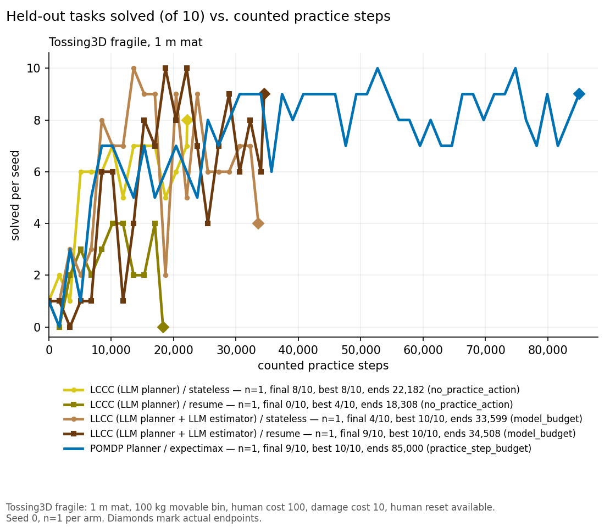
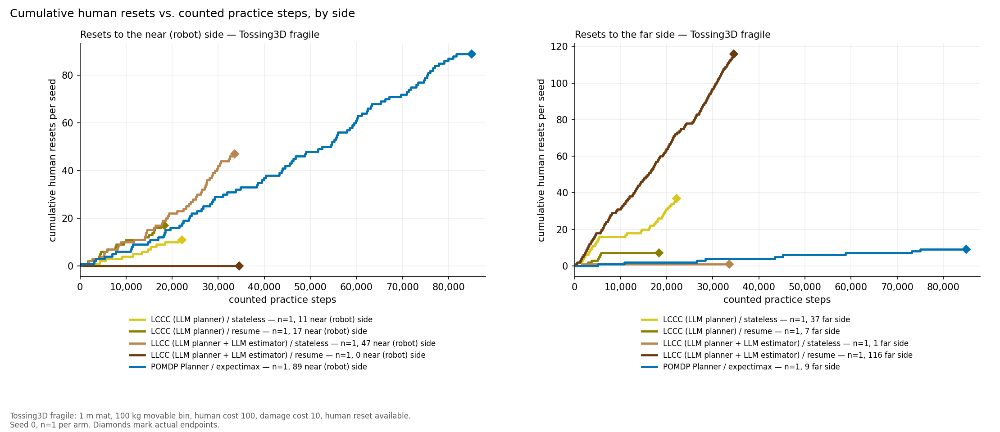
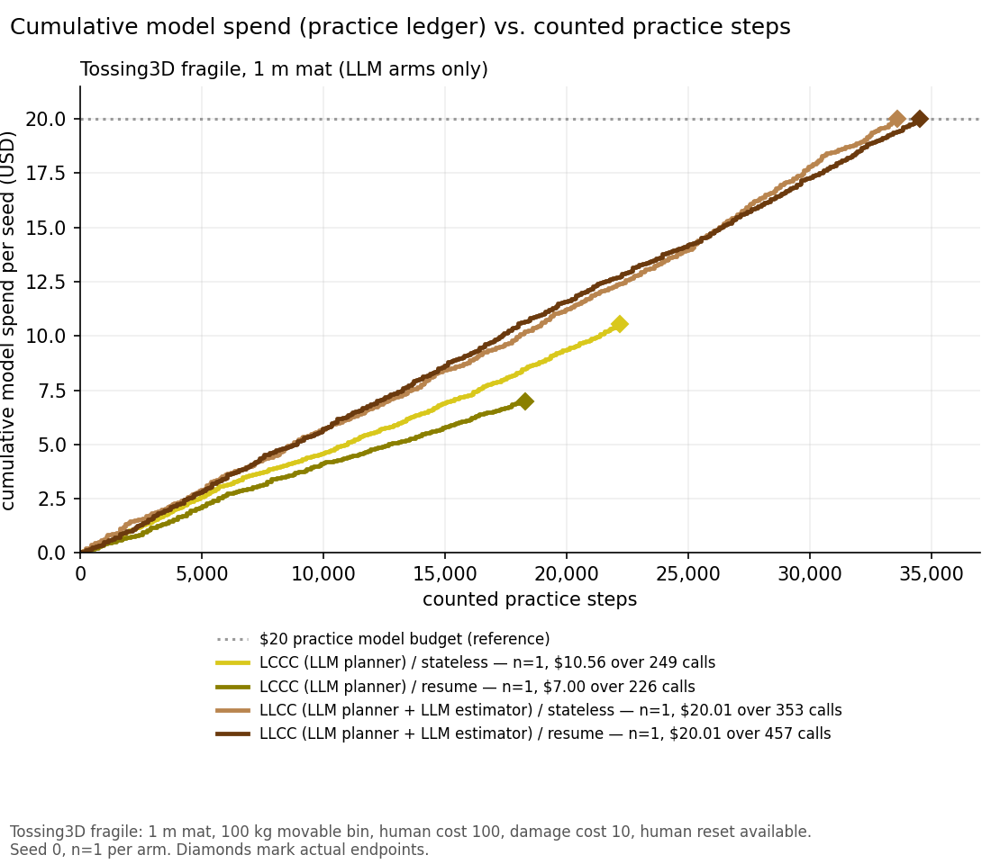
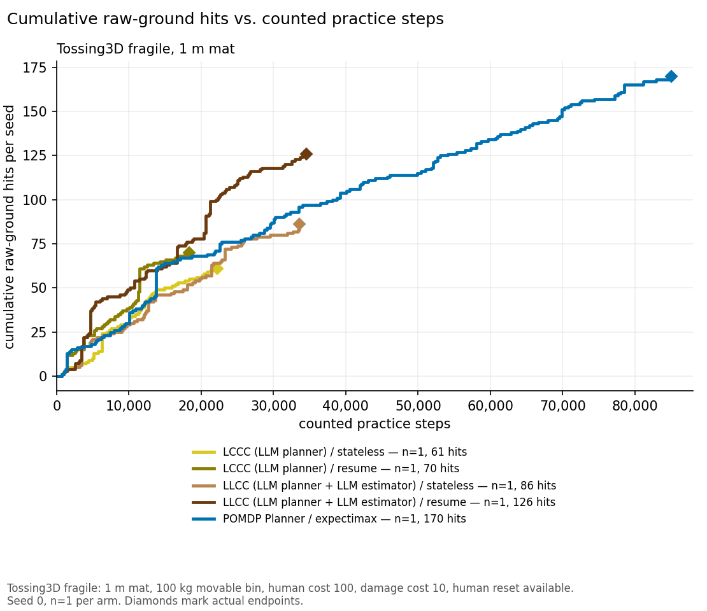

# LLM practice planner on fragile Tossing3D (seed 0, human reset available)

**TL;DR.** Four single-seed runs replaced the POMDP Planner's expectimax search with an
LLM (Claude Opus 5.5, low effort, $20 practice-only model budget), with the Bayesian
competence estimator (LCCC) and with the LLM also estimating competence and cost (LLCC),
each with a stateless and a resumed planner session. Final evaluations were LCCC stateless
8/10, LCCC resume 0/10, LLCC stateless 4/10 and LLCC resume 9/10. No run used more than
34,508 of its 85,000 counted steps. Both LCCC runs ended at the step protocol's
`no_practice_action` rule: the LLM's first decision of a new session was STOP. Both LLCC
runs ended when the $20 model budget ran out. Both LLCC runs reached 10/10 at least once,
but scores swing by up to 7 points between consecutive measurements, so a final score from
one seed is weak evidence. The with-human expectimax comparator ended at 9/10 after
85,000 steps. Every arm here is n=1, so no inference is supported.

## Question / goal

Can an LLM stand in for the belief-space search at the POMDP Planner's decision seam on
fragile Tossing3D? The question has two parts: does it practise well enough to learn the
task, and what does it spend in human resets, raw-ground hits and model dollars on the
way? A second axis asks whether keeping one resumed model session across decisions
(`resume`) behaves differently from a fresh call per decision (`stateless`).

## Background

The POMDP Planner chooses each practice action (a robot skill, a human reset to either
side of the wall, or STOP) by searching over a belief about per-skill competence and
learning rate. On the fragile layout (1 m mat, movable 100 kg bin, human cost 100,
raw-ground contact 10) that planner with expectimax reached 9/10 after the full
85,000-step budget, calling the human reset 98 times. PR #426 (`db27fe422`) puts an LLM
at that same decision seam: each decision sends it the candidate actions, the belief
summary and the costs, and it returns one candidate plus a one-sentence reason. PR #427
(`09df97137`) additionally lets the LLM estimate competence and cost in place of the
Bayesian estimator.

Method codes follow the planner-first order adopted on 2026-10-13 (planner, estimator,
states, skills; L = LLM, C = classical). **LCCC** is the LLM planner over the Bayesian
estimator; **LLCC** is the LLM planner that is also the estimator. The agentic-skills
hybrids reported earlier are **CCCL** (POMDP + Agentic Skills) and **CCLL** (POMDP +
Agentic Skills & States). The artifact directories for those earlier runs keep their old
names and are not renamed.

Two pieces of the step protocol matter below. A practice session holds at most 20 actions,
and **a run ends when a session executes zero actions** (`no_practice_action`). This rule
predates the LLM planner. With expectimax it fired only when the search found nothing
worth doing. With an LLM it fires whenever the model's first decision in a session is
STOP. The objective prices a human reset at `lambda x 100 = 3e-6 x 100 = 0.0003` in
objective units, so the objective puts almost no price on human time.

## Hypothesis

If the LLM can read the belief summary as well as expectimax uses it, LCCC should learn at
a rate similar to expectimax with fewer wasted resets. LLCC should do no worse. Resume
should be cheaper per decision than stateless, because the context is cached.

## Guidance given

Run LCCC and LLCC, stateless and resume, from frozen sources (`hitl` `db27fe422` for LCCC,
`09df97137` for LLCC; KINDER from the fragile expectimax freeze, `kindergarden`
`ec4d4ead`, `kinder-baselines` `427ad6cd`), with the human reset available, seed 0, and
the fragile expectimax arguments otherwise unchanged. The $20 budget covers practice only;
evaluation never calls the model. Report actual endpoints and never extend a curve.
Treat the STOP-ends-the-run interaction as a protocol finding to flag, not to fix.

## Methods

| Setting | Value |
| --- | --- |
| Environment | Fragile Tossing3D, barrier layout, 1 m square mat, movable 100 kg bin |
| Seed | 0, one run per arm |
| Costs | Robot control step 1; raw-ground contact 10; human reset 100 (either side); lambda 3e-6 |
| Practice budget | 85,000 counted steps; measurement every 1,700 counted steps; at most 20 actions per session |
| Evaluation | 10 held-out episodes of at most 500 control steps, separate frozen process, no human, no model calls |
| Early stop | Three consecutive complete 10/10 evaluations (never triggered here) |
| Planner | Claude Opus 5.5 (`claude-opus-5-5`), effort low, through the Docker Claude CLI; `stateless` = a fresh session per decision, `resume` = one resumed session per practice session |
| Model budget | $20 per run, practice ledger only (`model_budget.json`) |
| Comparator | POMDP Planner / expectimax with the human reset, `artifacts/fragile-mat-comparison-notion-20261009/report/expectimax` |

Run directories (main checkout, read-only):
`artifacts/llm-planner-lccc-20261013/{stateless,resume}/results/pomdp/0/` and
`artifacts/llm-planner-llcc-20261013/{stateless,resume}/results/pomdp/0/`. The smoke
runs that came before each launch are in `smoke-stateless/` and `smoke-resume/` (each
completed about 500-600 steps with one human reset). Two earlier LCCC smokes,
`smoke-stateless-aborted-429/` and `smoke-resume-aborted-429/`, were abandoned at step 0
during an account-wide rate-limit outage (their broker logs show repeated HTTP 429
`rate_limit` retries). They have no results and are kept only for the record.

Figures and the data behind them come from `analysis/llm_practice_planner.py` (tests in
`tests/analysis/test_llm_practice_planner.py`). The script reads each run's `status.json`,
`step_evaluations.json`, `step_events.jsonl`, `model_budget.json`, `planner_calls/` and
`pomdp_decisions.jsonl`. It refuses to plot unless several totals reconcile: the damage
events must sum to the status total, the human events by side must match
`human_resets_by_destination`, and the per-decision model costs must not exceed the
ledger. It writes `curves.json` beside this entry. Reset-reason keywords are counted with
the regular expressions in `LlmPracticePlanner.REASON_PATTERNS`.

## Results

### Endpoints

| Arm | Final eval | Best | Mean of last three | Counted steps (of 85,000) | Human resets (near / far) | Raw-ground hits | Physical cost | Model $ (of 20) | Model calls | Endpoint |
| --- | ---: | ---: | ---: | ---: | --- | ---: | ---: | ---: | ---: | --- |
| LCCC / stateless | 8/10 | 8/10 | 7.0 | 22,182 | 48 (11 / 37) | 61 | 27,544 | 10.56 | 249 | `no_practice_action` after LLM STOP |
| LCCC / resume | 0/10 | 4/10 | 2.0 | 18,308 | 24 (17 / 7) | 70 | 21,384 | 7.00 | 226 | `no_practice_action` after LLM STOP |
| LLCC / stateless | 4/10 | 10/10 | 6.0 | 33,599 | 48 (47 / 1) | 86 | 39,211 | 20.01 | 353 | `model_budget` |
| LLCC / resume | 9/10 | 10/10 | 7.7 | 34,508 | 116 (0 / 116) | 126 | 47,252 | 20.01 | 457 | `model_budget` |
| POMDP Planner / expectimax (comparator) | 9/10 | 10/10 | 8.0 | 85,000 | 98 (89 / 9) | 170 | 96,402 | n/a | n/a | step budget |

Every evaluation, in order (one every 1,700 counted steps plus the endpoint):

| Arm | Solved (of 10) |
| --- | --- |
| LCCC / stateless | 1, 2, 1, 6, 6, 6, 7, 5, 7, 7, 7, 5, 6, 7, 8 |
| LCCC / resume | 1, 0, 2, 3, 2, 3, 4, 4, 2, 2, 4, 0 |
| LLCC / stateless | 1, 1, 3, 2, 3, 8, 7, 7, 10, 9, 9, 2, 9, 5, 9, 6, 6, 6, 7, 7, 4 |
| LLCC / resume | 1, 1, 0, 1, 1, 6, 6, 1, 4, 8, 7, 10, 8, 10, 7, 4, 7, 9, 6, 8, 6, 9 |

The largest swing between consecutive measurements is 7 (LLCC stateless, 9/10 then 2/10
at 18,700 steps), and the other arms swing by 4-5. A single final score therefore tells
little about a run. That is why best and mean-of-last-three sit beside it. LLCC stateless
went from a best of 10/10 to a final 4/10 without its policy obviously changing course.

With-human comparators from the fragile comparison, for context (final eval / human
resets / counted steps): POMDP Planner / expectimax 9/10 / 98 / 85,000 (170 hits);
POMDP Planner / determinized A* 8.2 +/- 0.84 of 10 (n=5) / 330.4 +/- 29.4 / 85,000;
POMDP + Agentic Skills (CCCL) 10/10 / 4 / 15,654; POMDP + Agentic Skills & States (CCLL)
9/10 / 11 / 33,575; Full-Agentic original 10/10 / 18 / 11,340; Full-Agentic new wording
10/10 / 7 / 7,467. I re-read the expectimax row from its run directory, and it matches.
The others come from the fragile no-human-reset log (branch
`codex/fragile-no-human-reset-log`) and were not re-read here.

### Why both LCCC runs ended early

In each LCCC run the last session ended with a STOP. The next session's first decision
was STOP again, so that session executed zero actions and the step protocol ended the run
(`no_practice_action`). The final reasons, quoted from `pomdp_decisions.jsonl`
(`llm_reason`):

- LCCC stateless, at 22,182 steps: "Each practice attempt barely improves the skill
  (learning rate about 0.003), so it costs more than it gains."
- LCCC resume, at 18,308 steps: "A reset costs 100 and leads only to toss practice that
  keeps failing with little learning, so it is not worth more than stopping now."

These session-opening STOPs are different from STOP used to end a session early. LCCC
resume chose STOP 36 times in total and LCCC stateless 8 times. Every one before the last
ended a session that had already acted. Under expectimax a session-opening STOP meant the
search judged further practice worthless. An LLM can say the same thing for a reason
that reflects one bad session, and that one decision ends the run. **This is a
protocol interaction, flagged here and not fixed.** Neither LLCC run ever opened a
session with STOP (8 and 27 STOPs, all mid-session). Both LLCC runs ran until the model
budget was spent. The last LLCC stateless call was refused by the budget ($0.030 charged,
no decision), which is why its 353 calls produced 352 decisions.

### Human resets: where and why

The two LLCC runs settled on opposite reset sides. Stateless sent the cube near (robot
side) in 47/48 resets, and resume sent it far in 116/116. Both reached 10/10. Expectimax
went near in 89/98. LLCC resume used 116 resets in 34,508 steps, 2.4x the rate of LLCC
stateless. Expectimax used 98 resets in 85,000 steps.

What the reset decisions cite (counts of reset decisions whose `llm_reason` matches):

| Arm | Reset decisions | Practice | Step budget | Actions left in session | Cost (`cost`, `cheap`, `100`) | The human |
| --- | ---: | ---: | ---: | ---: | ---: | ---: |
| LCCC / stateless | 48 | 47/48 | 37/48 | 5/48 | 5/48 | 0/48 |
| LCCC / resume | 24 | 23/24 | 15/24 | 1/24 | 9/24 | 0/24 |
| LLCC / stateless | 48 | 48/48 | 0/48 | 0/48 | 1/48 | 0/48 |
| LLCC / resume | 116 | 106/116 | 10/116 | 42/116 | 1/116 | 0/116 |

Nearly every reset is justified by the practice it enables. The LCCC reasons mostly weigh
it against the remaining step budget. The LLCC reasons cite the weak toss and, for resume,
the actions left in the session. Cost appears in 16/236 reset reasons and the human
in none. Some cost mentions argue the reset is cheap, for example "at lambda=3e-6 the cost
barely lowers the objective". That reading is correct: at lambda = 3e-6 a reset is worth
0.0003. The LLM is pricing human time as the objective tells it to. If human time should
count, the objective has to price it.

### Model spend

| Arm | Decisions | Median $ per decision (p10-p90) | $ per 1,000 counted steps |
| --- | ---: | --- | ---: |
| LCCC / stateless | 249 | 0.042 (0.039-0.045) | 0.48 |
| LCCC / resume | 226 | 0.030 (0.024-0.042) | 0.38 |
| LLCC / stateless | 352 | 0.055 (0.051-0.064) | 0.60 |
| LLCC / resume | 457 | 0.043 (0.036-0.053) | 0.58 |

Resume cut the median cost of a decision by 29% for LCCC and 23% for LLCC. Per counted
step it saved 20% for LCCC but only 3% for LLCC, because LLCC resume made more decisions
per step: 116 one-step resets against 48. LLCC costs more per decision than LCCC because
it also returns estimates.

### Raw-ground hits

Per counted step, every LLM arm hit the raw ground more often than expectimax:
61-126 hits in 18,308-34,508 steps (2.6-3.8 per 1,000) against expectimax's 170 in
85,000 (2.0 per 1,000). The two resume arms hit most often per step (LCCC 3.8, LLCC 3.7
per 1,000), and LLCC resume has the most hits in total (126).

### What these runs do and do not show

Each arm is one seed. Every figure has n=1 per arm, and no test is computed or supported.
The orderings above (LLCC above LCCC, stateless against resume) describe these four runs,
not the methods. Given the 7-point swings, a second seed could reverse any of them.

## Recommendation

1. **Decide the `no_practice_action` rule before more LLM-planner runs.** Both LCCC runs
   ended at 18-22k of 85k steps because one session-opening STOP is final. Options are to
   require STOP on two consecutive session openings, or to treat a session-opening STOP
   as a hand-back that the run confirms. Either changes the protocol for every method, so
   it is Josh's call, and expectimax would need re-running under it for comparison.
2. **Do not compare LCCC with LLCC on these runs yet.** The arms ended for different
   reasons (STOP against budget) and at different step counts, and the evaluations are
   noisy. A fair comparison needs at least 3 seeds per arm and the protocol fixed first.
3. **If human time should matter, price it in the objective.** With lambda = 3e-6 the
   LLM correctly treats a reset as nearly free. LLCC resume called 116 resets, more than
   expectimax's 98 over 2.5x the steps.
4. **Prefer resume for cost.** It was cheaper per decision in both families. The saving per
   step depends on how many one-step decisions the planner makes.
