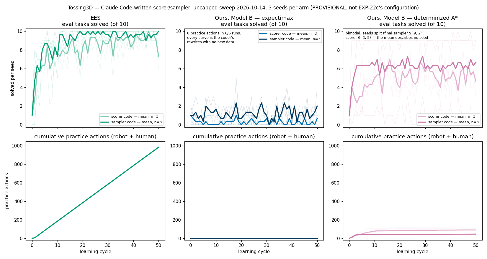

# 2026-10-14 — Tossing3D: a Claude Code-written skill sampler (uncapped overnight sweep)

> **PROVISIONAL — read this before any number below.**
>
> 1. **This sweep does not reproduce EXP-22c's configuration**, although its launcher
>    said it did. Against EXP-22c-della gpoff (commit `767323315f`) it omitted four flags:
>    `--evaluation-layout barrier`, `--pomdp-num-particles 1024` (it ran the default
>    20000), `--pomdp-observation-probability-weight 0.0` (it ran the default 0.1), and
>    `--no-ees-reset-gate` on the two POMDP arms. The EES arm also rendered in-run where
>    EXP-22c's deferred. **None of these numbers is comparable to EXP-22c.** The full
>    diff is in [Flag diff against EXP-22c](#flag-diff-against-exp-22c).
> 2. **Expectimax never practised: it chose STOP at the first decision of all 50 cycles,
>    in 6/6 runs.** A diagnosis is in progress. The observation-probability weight is the
>    leading suspect, but **the cause is not known** and nothing here establishes it.
> 3. **Cost correction (2026-10-15).** The overnight summary reported about $3,270 for
>    the sweep. That figure double-counts: `coded_sampler_refits.jsonl`'s
>    `coder.cost_usd` is Claude Code's `total_cost_usd`, which is **cumulative over the
>    resumed session**, so summing it over refits overcounts. The real spend is each
>    run's final refit value: **$127.60 for all 18 runs**, $1.77–21.13 per run. The
>    $3,270 figure is wrong and is not used anywhere below.
> 4. **Three follow-up runs are pending** — see [Pending](#pending). They are what turns
>    this into a comparison.

## TL;DR

- **Question:** can a Claude Code coding agent stand in for the MLP skill sampler in
  Tossing3D, rewriting a per-skill scorer or sampler from the practice history at every
  cycle?
- **EES with written sampler code reached 10/10 at the final evaluation in 3/3 seeds.**
  EES with written scorer code finished at 6/10, 7/10 and 9/10, but every one of its
  seeds reached 10/10 at some evaluation.
- **Expectimax practised 0 actions in 6/6 runs.** Its evaluation curve, 0–5/10, comes only
  from the agent rewriting code with no new skill data. It is not learning.
- **Determinized A\* practised 41–121 actions per run (20–52 by the robot), against EES's
  982–986.** It still reached 9/10 at the end in 2/3 sampler seeds, after **1 successful
  toss in practice** in each of those runs. So most of what A\* shows is the coding
  agent's prior, not practice.
- **No inference is supported.** With n = 3 seeds, the most extreme paired outcome has
  an exact two-sided sign-test p = 0.25. No effect is claimed. The comparisons that
  matter, against an MLP sampler on the same flags and on EXP-22c's flags, are pending.

## Question / goal

Can a Claude Code coding agent stand in for the learned MLP skill sampler? At each
cycle's refit the agent writes code that proposes the toss's continuous parameters. That
code is then used during practice and frozen for evaluation. If the agent can do this,
does it change how much each practice-selection method (EES, expectimax, determinized
A\*) improves?

## Background

- **The skill sampler.** Each parameterized skill draws its continuous parameters from a
  learned sampler. In Tossing3D the skill that matters is `MoveToTossLocationAndToss`,
  with standoff, speed and release. Until this branch the only sampler was an MLP
  trained on practice outcomes. With probability ε = 0.5 the parameters are drawn
  uniformly instead (ε-random exploration), and that is unchanged here.
- **The coded sampler** (`--sampler claude_code`; branch `claude/tossing3d-coded-sampler`,
  draft PR #458). It has two modes:
  - `scorer`: the agent writes a function that scores candidate parameter vectors.
    The method samples candidates and keeps the best.
  - `sampler`: the agent writes a function that returns parameter vectors directly.

  How it runs:
  - Each run has one Claude Code session, resumed at every refit (claude-opus-5-5, high
    effort).
  - The agent sees the full trajectory history, plus descriptions of the input vector
    and the task that are generated from code.
  - Its code may import only numpy, scipy and sklearn. This is enforced, and every
    violation is logged; there were 0/900 here.
  - Evaluation uses the frozen version of the code from that cycle.
  - Evaluation outcomes never enter the history; only practice outcomes do.
  - This sweep had **no budget cap**. A $20-per-run cap was added afterwards, at
    `0175fdf30`.
- **The practice-selection methods.**
  - **EES**, with the predicators-reproduction flags.
  - **Ours, Model B** (`local_trend` competence model, grid engine, `non_epsilon`
    evidence, λ = 0), with two solvers: **expectimax** at depth 6, and
    **determinized A\***.
- **Why expectimax was expected to STOP.** A dry run before launch (DECISIONS.md,
  2026-10-14 23:25) found that on this branch expectimax at λ = 0 and depth 6 chooses
  STOP at its first practice decision, with the MLP sampler too. EXP-22c's expectimax
  had practised. The arm was launched unchanged, so as not to alter the setup. The
  launcher's claim to be EXP-22c's configuration was only checked against the config
  snapshots the next morning.

## Hypothesis

A coding agent that sees the full practice history can write a toss sampler at least as
good as the MLP's. EES, which practises the most, should benefit most. This sweep
cannot test that hypothesis: it has no MLP arm at matching flags, and the POMDP arms
barely practised. The MLP baselines in [Pending](#pending) are what test it.

## Guidance given

Josh, 2026-10-14 ~23:00 (DECISIONS.md):

- One coding session per run, resumed across refits, writing one module per skill.
- Claude Opus 5.5 at high effort. Generated code imports only numpy, scipy and sklearn,
  enforced and logged.
- Up to 3 seeds of each arm overnight, queued seed-first.
- Make no decision that changes the experimental setup. This is why the expectimax arm
  ran unchanged after the dry run predicted STOP.

Josh, 2026-10-15:

- Put a $20 cap on each run's model spend. The overnight results stay as they are,
  labelled "uncapped".
- Diagnose before rerunning.
- Run an MLP baseline on Della.
- Run the MLP again with EXP-22c's exact defaults.

## Methods

- **Code.** Commit `f6eb0e3d4` (`git_dirty` false in all 18 `config_snapshot.json`
  files). KINDER pins: kindergarden `64ce45c`, kinder-models `427ad6c`.
- **Arms.** {EES, expectimax, determinized A\*} × {`scorer`, `sampler`}, seeds 0–2, so
  18 runs. Runs were driven by `scripts/run_sweep.py`, 9 at a time, seed-first.
- **Configuration.** 50 cycles × 20 practice actions; ε = 0.5; 10 test tasks; human
  reset cost 5; practice reset policy `never`; goal-pursuit horizon 0; barrier layout;
  lab2 scene.
- **Evaluation.**
  - Each run has 51 evaluations: one before practice and one after each cycle.
  - Eval runs on the barrier layout in every run. `--evaluation-layout` was omitted,
    and at this commit an omitted evaluation layout falls back to the practice layout,
    which is `barrier` (`Tossing3DCli.build_evaluation_problem`).
  - The traces confirm the bin starts beyond the barrier at evaluation.
  - So in this sweep the missing flag did not change the evaluation layout. The other
    three flags did change behaviour.
- **Analysis.**
  - Read back from each run's `stats.json`, `coded_sampler_refits.jsonl`,
    `pomdp_decisions.jsonl` and `episode_traces.jsonl`.
  - Model cost is the last refit's cumulative `coder.cost_usd`. It increases
    monotonically in 18/18 runs, each of which has one session id.
  - Coder wall-clock is the sum of the per-refit `wall_seconds`, which are not
    cumulative.
- **Videos.**
  - Everything is in the lab2 scene.
  - **EES** clips are cut from each run's own in-run `period_videos/`.
  - The **POMDP** runs deferred rendering, so their clips are re-rendered from
    `tossing3d_state_log.jsonl`. The renderer is the repo's playback renderer from #434
    (`Tossing3DReplayRenderer` + `RecordingReplayer`), at 4× for practice.
  - The legacy state log has no phases, so a small driver attaches them by timestamp.
    Practice windows and outcomes come from `pomdp_decisions.jsonl`, evaluation
    episodes from `episode_traces.jsonl`.
  - The driver, the figure script and the encode script are kept beside the results, in
    `hitl-pmp-results/coded-sampler-20261014/`.

### Flag diff against EXP-22c

The resolved `config_snapshot.json` args were compared: EXP-22c-della gpoff
(`767323315f`, kindergarden `f0d554b`) against this sweep (`f6eb0e3d4`, kindergarden
`64ce45c`). Rows for keys that did not exist at `767323315f` are omitted. Each of those
keys resolves to the old behaviour (checked in DECISIONS.md, 2026-10-15, EXP-22c-flags
entry).

| key | EXP-22c | this sweep | arms affected |
|---|---|---|---|
| `evaluation_layout` | `barrier` | unset, so it falls back to the practice layout `barrier` | all; in effect none (see Methods) |
| `pomdp_num_particles` | 1024 | 20000 (default) | expectimax, A\* |
| `pomdp_observation_probability_weight` | 0.0 | 0.1 (default) | expectimax, A\* |
| `ees_reset_gate` | False (`--no-ees-reset-gate`) | True (default) | expectimax, A\* |
| `defer_rendering` | True | False | EES |
| kindergarden pin | `f0d554b` | `64ce45c` | all |

- The kindergarden range `f0d554b..64ce45c` only adds SweepOffShelf3D, so the Tossing3D
  scene is unchanged (DECISIONS.md, 2026-10-15).
- The code also moved by about 30 commits between the two, in the belief-space and EES
  modules among others. So even with identical flags, the numbers need not match
  EXP-22c's.
- EXP-22c had no determinized A\* arm.

## Results

### Every run

Notes on the columns:

- Evaluation counts are tasks solved out of 10.
- "Practice actions" counts robot and human actions together; the robot's share is the
  next column.
- "True model cost" is the final cumulative value (see the correction at the top).

| arm | seed | eval: cycle 0 | eval: final | eval: best | practice actions (robot + human) | robot practice actions | toss practice successes | human resets | true model cost (USD) | coder wall-clock (h) | run wall-clock (h) |
|---|---|---|---|---|---|---|---|---|---|---|---|
| ees-scorer | 0 | 0/10 | 6/10 | 10/10 | 982 | 665 | 143/336 | 284 | 16.24 | 1.26 | 3.01 |
| ees-scorer | 1 | 2/10 | 7/10 | 10/10 | 986 | 666 | 145/339 | 289 | 9.45 | 2.40 | 4.88 |
| ees-scorer | 2 | 1/10 | 9/10 | 10/10 | 986 | 663 | 126/327 | 290 | 21.13 | 2.97 | 4.65 |
| ees-sampler | 0 | 0/10 | 10/10 | 10/10 | 982 | 655 | 167/333 | 291 | 14.34 | 0.91 | 2.64 |
| ees-sampler | 1 | 2/10 | 10/10 | 10/10 | 986 | 675 | 152/335 | 282 | 11.86 | 0.85 | 2.63 |
| ees-sampler | 2 | 1/10 | 10/10 | 10/10 | 986 | 676 | 152/338 | 274 | 15.73 | 1.36 | 3.05 |
| expectimax-scorer | 0 | 0/10 | 1/10 | 2/10 | 0 | 0 | 0/0 | 0 | 2.11 | 0.14 | 1.35 |
| expectimax-scorer | 1 | 2/10 | 0/10 | 2/10 | 0 | 0 | 0/0 | 0 | 2.73 | 0.16 | 1.46 |
| expectimax-scorer | 2 | 1/10 | 1/10 | 2/10 | 0 | 0 | 0/0 | 0 | 2.40 | 0.15 | 1.47 |
| expectimax-sampler | 0 | 0/10 | 1/10 | 4/10 | 0 | 0 | 0/0 | 0 | 2.44 | 0.14 | 1.12 |
| expectimax-sampler | 1 | 2/10 | 1/10 | 3/10 | 0 | 0 | 0/0 | 0 | 1.77 | 0.12 | 1.10 |
| expectimax-sampler | 2 | 1/10 | 4/10 | 5/10 | 0 | 0 | 0/0 | 0 | 1.95 | 0.16 | 1.12 |
| astar-scorer | 0 | 0/10 | 6/10 | 9/10 | 121 | 52 | 1/17 | 69 | 6.01 | 0.47 | 1.34 |
| astar-scorer | 1 | 2/10 | 3/10 | 8/10 | 41 | 24 | 2/7 | 17 | 2.78 | 0.15 | 0.97 |
| astar-scorer | 2 | 1/10 | 5/10 | 8/10 | 108 | 46 | 1/9 | 62 | 5.83 | 0.23 | 1.07 |
| astar-sampler | 0 | 0/10 | 9/10 | 10/10 | 45 | 20 | 1/6 | 25 | 4.00 | 0.23 | 0.99 |
| astar-sampler | 1 | 2/10 | 9/10 | 9/10 | 43 | 26 | 1/8 | 17 | 3.18 | 0.17 | 0.94 |
| astar-sampler | 2 | 1/10 | 2/10 | 3/10 | 48 | 24 | 1/8 | 24 | 3.65 | 0.21 | 1.07 |

- **True model cost is $127.60 for all 18 runs.** By arm: ees-scorer $46.82,
  ees-sampler $41.93, astar-scorer $14.62, astar-sampler $10.83, expectimax-scorer
  $7.24, expectimax-sampler $6.16.
- Only 1/18 runs would have exceeded the $20 cap added later: ees-scorer seed 2, at
  $21.13.
- All 900 refits succeeded (50 per run), and 0/900 had an import violation.

### What the figure shows

- **EES learns.**
  - In sampler mode, evaluations rise from 0–2/10 at cycle 0 to a first 10/10 at
    cycles 11, 9 and 6 (seeds 0, 1, 2). After that they never fall below 7/10, and
    they end at 10/10 in all three seeds.
  - Scorer mode climbs more slowly and is noisier late, ending at 6, 7 and 9 out of 10.
  - Both modes practise the same amount: 982–986 actions, of which 655–676 are by the
    robot. Tosses succeed in practice at 126/327–167/333 per run, with ε = 0.5 still
    applied.
  - Whether sampler beats scorer cannot be decided at n = 3 (see below).
- **Expectimax never practises.**
  - Every one of its 300 practice decisions (6 runs × 50 cycles) is STOP. In
    expectimax-sampler seed 0, the first decision has value 0.536, and every
    improvement potential is negative.
  - Its coder therefore receives only period start/end bookkeeping, 3 history events
    per cycle, and never a skill attempt. It still rewrites the code at every refit,
    for about $2 per run.
  - The evaluation curve wanders between 0/10 and 5/10. That is the spread of code the
    agent writes from the task description alone. It is not learning, and it should not
    be read as a trend.
- **Determinized A\* practises a little, then stops.**
  - Nearly all of its practice falls in the first 2–3 cycles. After that it mostly
    chooses STOP: it practised in only 3–18 of 50 cycles per run, for 41–121 actions
    in total, about half of them human resets.
  - Sampler seed 1 was at 9/10 or better from the cycle-1 evaluation onward, after
    one cycle of practice.
  - Its seeds are **bimodal**. Final sampler-mode evaluations are 9, 9 and 2 out of 10,
    so the mean in the figure describes none of the seeds.
  - The two good sampler seeds got there after **1/6 and 1/8 successful practice
    tosses**. Whatever their written code knows, it learned mostly from the prompt, not
    from practice.

### Statistics

The arms share seeds, so the test is paired by seed. With 3 pairs, the most extreme
outcome possible, 3/3 pairs in one direction, gives an exact two-sided sign-test (and
Wilcoxon) p of 0.25. So no comparison in this sweep can reach significance, and **no
effect is asserted**.

- EES sampler vs EES scorer at the final evaluation: 3/3 pairs favour the sampler
  (10 vs 6, 10 vs 7, 10 vs 9), p = 0.25.
- A\* sampler vs A\* scorer at the final evaluation: 2/3 pairs favour the sampler.

These are raw counts only.

### Videos

All clips are seed 0, in the lab2 scene. The POMDP clips are re-renders from the state log.

Practice clips play at 4×. "Final evaluation" means checkpoint 50.

| arm | clip | what to look at |
|---|---|---|
| ees-sampler | [practice, cycle 1](2026-10-14-tossing3d-coded-sampler-ees-sampler-s0-practice-c01.mp4) | Early practice: 0/6 tosses land. Human resets put the cube and bin back between attempts. |
| ees-sampler | [practice, cycle 33](2026-10-14-tossing3d-coded-sampler-ees-sampler-s0-practice-c33.mp4) | Late practice: 6/6 tosses land. |
| ees-sampler | [final evaluation, 2× speed](2026-10-14-tossing3d-coded-sampler-ees-sampler-s0-eval50-x2.mp4) | 10/10 solved. |
| ees-scorer | [practice, cycle 4](2026-10-14-tossing3d-coded-sampler-ees-scorer-s0-practice-c04.mp4) | 0/7 tosses land. |
| ees-scorer | [practice, cycle 34](2026-10-14-tossing3d-coded-sampler-ees-scorer-s0-practice-c34.mp4) | 6/7 tosses land. |
| ees-scorer | [final evaluation, 2× speed](2026-10-14-tossing3d-coded-sampler-ees-scorer-s0-eval50-x2.mp4) | 6/10 solved. Tasks 0, 3, 5 and 7 fail. It had been at 9/10 one evaluation earlier. |
| astar-sampler | [all practice, cycles 0–49](2026-10-14-tossing3d-coded-sampler-astar-sampler-s0-practice.mp4) (46 s) | All 45 practice actions fall in cycles 0–2. From 0:18 to 0:26, 8 human resets run back to back with no robot action between them. The run's only successful practice toss is at 0:45. From cycle 3 on it chose STOP every time. |
| astar-scorer | [all practice, cycles 0–49](2026-10-14-tossing3d-coded-sampler-astar-scorer-s0-practice.mp4) (1:43) | Practice is spread thinly over 18/50 cycles, and 16 of its 17 tosses fail. The one success, at 1:42 (cycle 42), was an ε-random draw, not the written code. |
| expectimax-sampler | [final evaluation, task 1, solved](2026-10-14-tossing3d-coded-sampler-expectimax-sampler-s0-eval50-task1.mp4) | Expectimax never practised, so these are evaluation episodes. Pick, then one toss that lands. |
| expectimax-sampler | [final evaluation, task 0, not solved](2026-10-14-tossing3d-coded-sampler-expectimax-sampler-s0-eval50-task0.mp4) | The toss (standoff 1.41, speed 177) falls short and stops against the barrier on the robot's side. The planner then finds no plan, and the last 2 steps are no-ops. |
| expectimax-scorer | [final evaluation, task 9, solved](2026-10-14-tossing3d-coded-sampler-expectimax-scorer-s0-eval50-task9.mp4) | Its only solved task at the final evaluation, 1/10. |
| expectimax-scorer | [final evaluation, task 0, not solved](2026-10-14-tossing3d-coded-sampler-expectimax-scorer-s0-eval50-task0.mp4) | A miss, then no-ops. |

Limitations of the re-rendered clips:

- The legacy state log carries no record of what a human reset moved. So the "moved
  nothing" caption on a reset is an artefact of the re-render, not an observation.
- Resets with no tick logged after them appear only in the skill history.
- The driver aligned 45/45 of astar-sampler's practice actions, but only 116/121 of
  astar-scorer's. The 5 missing are human resets at the end of a window, and all 52 of
  its robot actions are present.
- The tosses in cycle 0 come before the first refit, so no code written by the agent
  had run yet. That is why astar-sampler and astar-scorer seed 0 show identical
  parameters there.

## Pending

Each of the following is a separate run. None has results yet. When one lands, its
numbers go in a dated note here, and nothing above is edited.

1. **MLP baseline on the coded sweep's own flags.** Della job **15616488**.
   - Runs `--sampler mlp` at `f6eb0e3d4`, with this sweep's flags minus the sampler
     flags: 3 arms (EES, expectimax, determinized A\*) × seeds 0–2, so 9 runs, paired
     with this sweep by seed.
   - **Tests:** whether the written code beats the MLP *in this configuration*. It is
     the only like-for-like comparison for the table above.
   - Results:
     `della:/scratch/gpfs/TSILVER/jr2860/results/coded-sampler-baseline-20261015/`.
     Status: running.
2. **MLP on EXP-22c's exact args.** Della job **15617328**.
   - Runs `--sampler mlp` at branch head `0175fdf30`, with args taken verbatim from
     EXP-22c's seed-matched config snapshots: barrier evaluation layout, 1024 particles,
     observation weight 0, `--no-ees-reset-gate` on the POMDP arms, and deferred
     rendering for EES. A\* reuses the expectimax args with only the solver changed.
     That makes 9 runs.
   - **Tests:** whether today's code with EXP-22c's flags reproduces EXP-22c, and in
     particular whether expectimax practises again. Read against job 15616488, it also
     separates the effect of the flags from the effect of about 30 commits of code
     change.
   - Results: `$S/results/exp22c-flags-mlp-20261015/`. The argv diffs are in
     DECISIONS.md, 2026-10-15. Status: running.
3. **A $20-capped coded-sampler rerun on EXP-22c flags**, on agni.
   - The 18 runs of this sweep again, each capped at $20, on EXP-22c's flags.
   - **Tests:** the question this log could not answer: does written code help each
     method when the planner actually practises?
   - Status: **planned, not launched.** It waits on the expectimax diagnosis and on
     Josh's go.

## Recommendation

- **Treat every number above as provisional.** Compare nothing here against EXP-22c.
- **Do not read the expectimax arm as a result about coded samplers.** It never
  practised, so it says nothing about them. Wait for the diagnosis and for job
  15617328, which shows whether expectimax practises on EXP-22c's flags.
- **The one positive signal is EES with sampler-mode code: 10/10 at the final
  evaluation in 3/3 seeds,** for $11.86–15.73 per run. Whether that beats the MLP is
  exactly what job 15616488 answers. Do not claim it until that job lands.
- **The A\* result says more about the coding agent's prior than about practice.**
  The two good sampler seeds reached 9/10 after 1 successful practice toss each. A
  zero-practice control (code written from the task description alone, never refit)
  would measure that prior directly. That control is worth considering before the
  capped rerun.
- **Launch the capped rerun (3) on EXP-22c's flags, not on this launcher's.**
