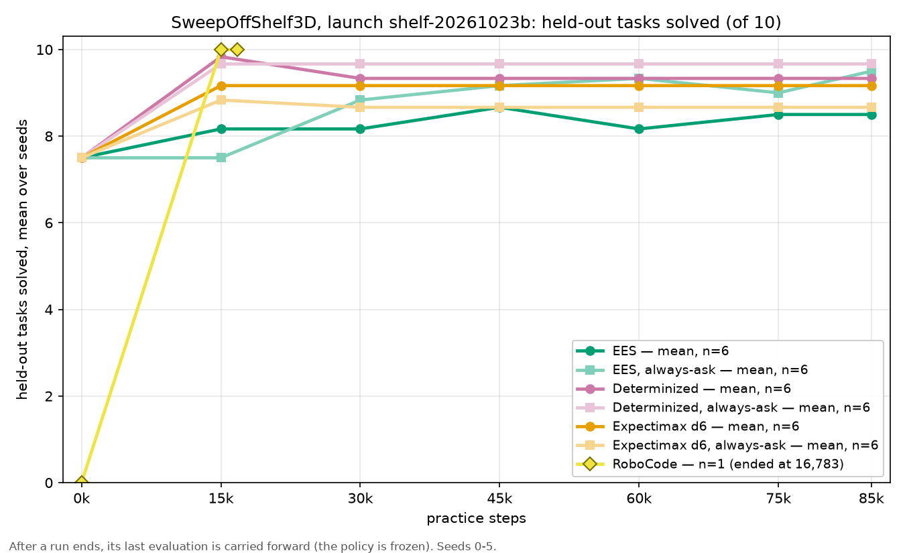
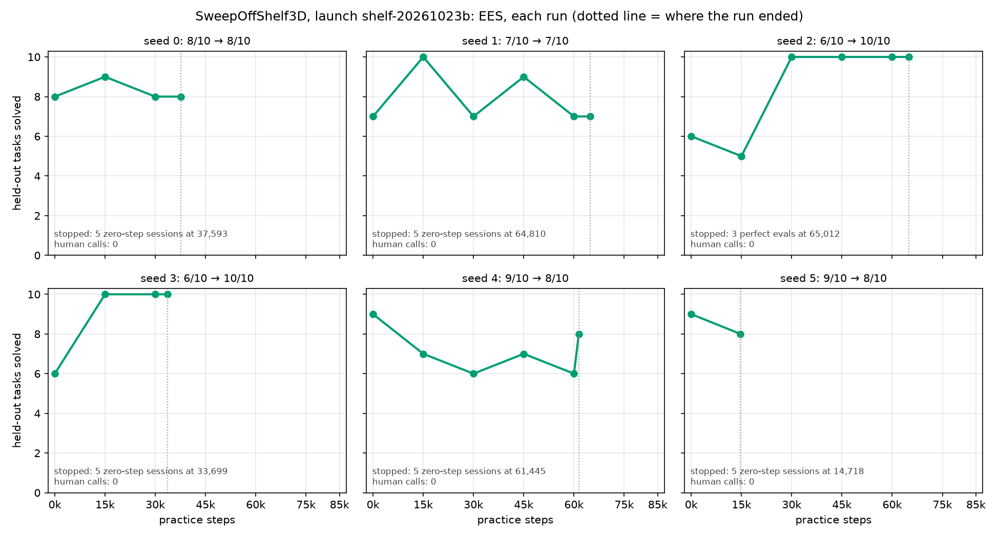
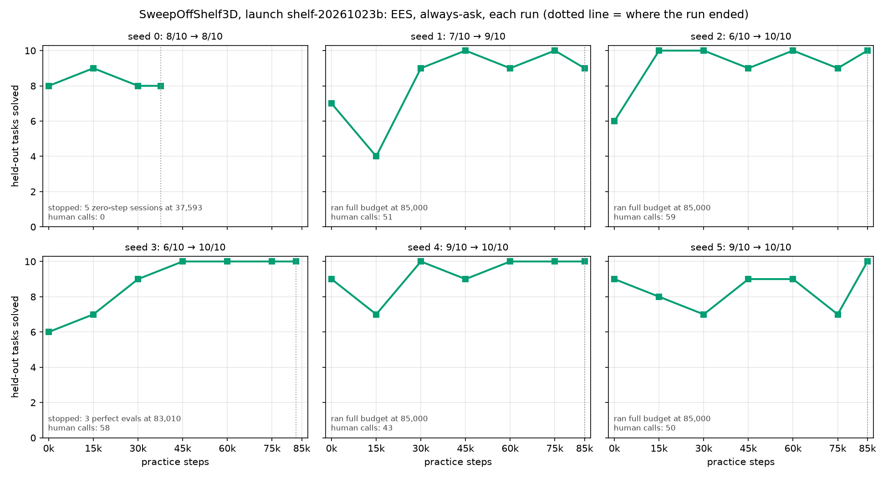
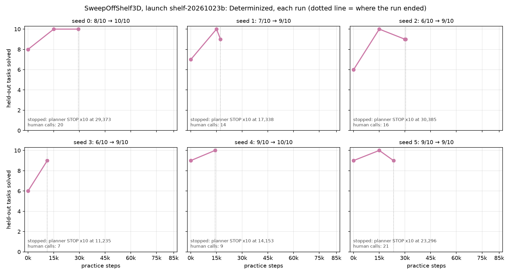
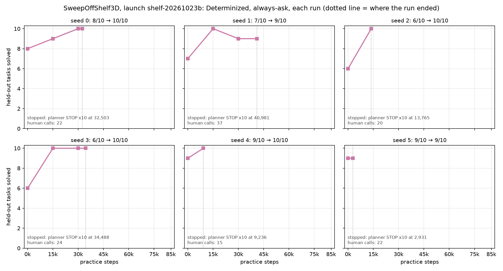
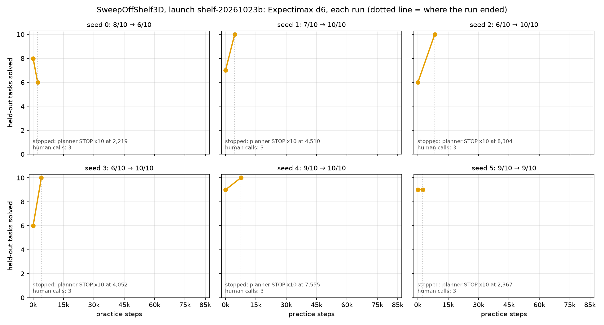
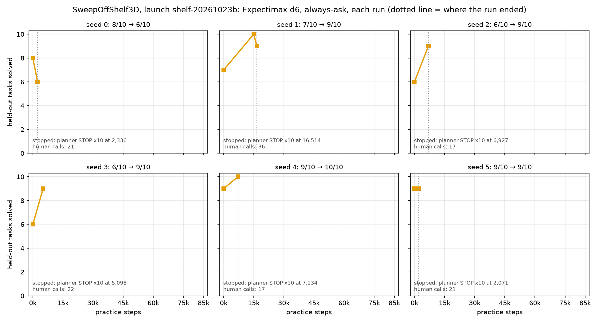
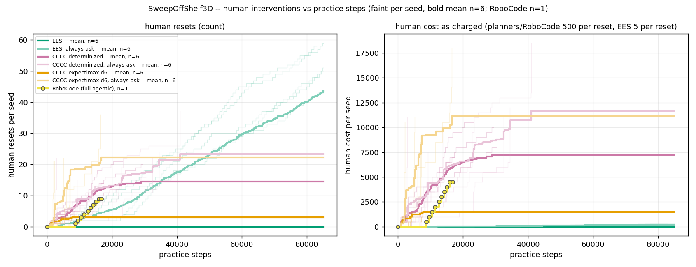
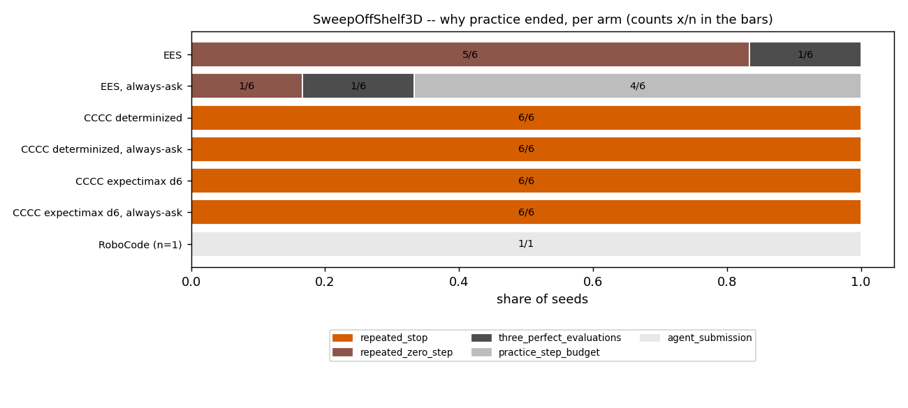
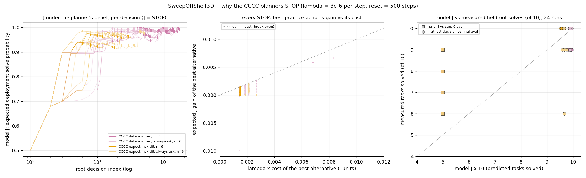

# SweepOffShelf3D launch shelf-20261023b-1f209df65 (2026-10-22/23)

> **CAVEATS (written 2026-10-23, when this log was committed).**
>
> - **The PickCubeFromShelf gate was lowered on purpose, to 72/100.** The launch commit
>   measured 75/100, under the earlier 95/100 gate. Josh lowered it on 2026-10-22 so the
>   launch could go ahead with that day's controllers (#553), while the shelf-pick fix
>   was built in the background.
> - **The benchmark's success label does not check neighbour shoves.** A pick that moves
>   a neighbouring cube by 5 mm or more still counts as a success.
> - **These numbers predate #556.** #556 (fix (b): a shelf grasp that the neighbour
>   sweep refused is offered again, shifted off centre) merged on 2026-10-23, after this
>   launch. On the skill benchmark it took PickCubeFromShelf from 75/100 to 88/100 on the
>   integration tree (13 gained, 0 lost, p = 0.00024) and from 78/100 to 89/100 on main. None of the runs here had it.
> - **RoboCode is n=1**, so no test of it is possible.
> - **The 36 paired tests below are uncorrected** for multiple comparisons.
> - **The launch was not made from a main commit.** It ran from an integration-branch
>   commit whose tree was main plus PRs that were still open. The check that this tree
>   equals main over `src/`, configs, scripts, benchmarks and reference pins is still
>   PENDING. It waits on #551, #553 and stack #544 (#516, #530, #536, #546) merging. The
>   expected verdict is "launch = main minus #556, which merged after the launch". Any
>   difference beyond that will be noted here; this text will not be rewritten.
>
> **Launch-equivalence verdict (2026-10-23, after #551, #553 and #516/#530/#536/#546
> merged): equivalent to main `73284f19a` minus #556.** `git diff 1f209df65 73284f19a`
> over `src/`, `configs/`, `scripts/` and `benchmarks/` touches one file,
> `src/hitl_pmp/environments/sweepoffshelf3d/kinder_skills.py`, and its +/- lines are
> identical to #556's own `src/` diff (169 diff lines each). Both reference pins are
> equal (kindergarden `490831fa5`, kinder-baselines `1a081f28`). The rest of the tree
> difference is tests and CI only. No other difference was found.

## TL;DR

- **All 36 Della runs completed** (6 arms × seeds 0–5), with no crashes.
- **Every arm started near the ceiling.** The step-0 policy already solved 6–9 of 10
  held-out tasks (median 7.5/10), which leaves about 2.5 tasks of headroom.
- **Final solved: no arm differs from another.** Every pair has p ≥ 0.125, and no arm's
  final-minus-initial gain is significant (best p = 0.0625, n=6). **No inference is
  supported on final performance.**
- **Practice steps and human invocations do differ**, at p = 0.03125, the floor for six
  pairs. Those differences follow from how the arms are built.
- **How the runs ended:**
  - all 24 planner runs ended on `repeated_stop`;
  - EES ended on `repeated_zero_step` in 5/6;
  - EES always-ask hit the 85,000-step budget in 4/6.
- **Why the planners STOP early is model calibration**, not a code bug or a units
  mismatch. Their deployment model retries failed skills for free, so the planner's
  estimate of deployment success, J, saturates at about 0.93–0.99 after one or two
  successes. They also believe human resets succeed 0.44–0.58 of the time, while the
  environment makes them succeed every time.
- **RoboCode** (an LLM agent, n=1, run on agni) reached 10/10 at 16,783 practice steps
  with 9 human resets.

## Question / goal

On the SweepOffShelf3D scene (#530's: the wiper's home is the top of the cupboard), does
a planner that chooses its own practice improve on the step-0 policy, or on EES, within
85,000 practice steps? And at what human-reset cost does it do so? Each arm runs with and
without the always-ask human reset. RoboCode is the all-LLM reference, with one seed.

## Background

- **The relaunch.** The 2026-10-20 shelf launch was cancelled on 2026-10-21 after a
  livelock. The relaunch first waited on a stack of fixes:
  - #511, the `repeated_zero_step` safety net: practice ends after K=5 sessions with zero
    control steps;
  - #514, always-ask's STOP-only reset;
  - #513 and #515, shelf grasps and box drops;
  - #537, #538 and #539, the shelf-pick fixes (#539 refuses grasps whose pad sweep hits
    a neighbour);
  - #540 and #541, SweepShelf bugs A and B;
  - #549, the follower gain dropped from 2 to 1, which removed a 5 Hz arm limit cycle;
  - #551, Fix A: PickWiper retracts the arm first;
  - the ReturnWiper stack #516 → #530 → #536 (wiper margin 6 mm) → #546 (Fix B).
- **How the planner arms stop.** They end practice on `repeated_stop`, after
  `REPEATED_STOP_LIMIT` = 10 consecutive root STOP decisions (#444, `step_protocol.py`).
  EES ends on `repeated_zero_step` (#511).
- **The gate.** Josh's launch gate requires the skill benchmark to pass at the exact
  launch commit. PickCubeFromShelf measured 75/100 there. On 2026-10-22 Josh lowered its
  gate from 95/100 to 72/100 (measured − 3) as a deliberate, documented lowering, because
  #539's neighbour refusals were turning away about a quarter of shelf picks while fix
  (b) was still being built. That fix became #556.

## Hypothesis

- The planner arms (determinized A\*, expectimax d6) will reach 10/10 with fewer practice
  steps than EES.
- Always-ask will cost more human invocations without a matching gain.
- This was not pre-registered with a numeric threshold. The comparison was planned as a
  paired test on shared seeds 0–5.

## Guidance given

Every item below is a decision Josh made on 2026-10-22, from the decision log.

- **Seeds:** 6 per classical arm, seeds 0–5. Josh corrected an earlier choice of 5,
  because 5 pairs cannot reach two-sided p < 0.05. RoboCode gets 1 seed on agni.
- **d6** runs uncapped, and its STOP behaviour is accepted until it is re-measured.
- **Launch tonight**, with gates set at that day's controllers:
  - PickCubeFromShelf at least 72/100;
  - box return at least 5/8 harvested;
  - both floor skills at 11/11.
- **What to launch from:** a commit whose tree is main plus the open PRs (#541, #551,
  #544 at 6 mm, #553, #554, and the Tossing3D launcher #552). After everything merges,
  diff the launch commit against main.
- **The final submit:** Josh's "You can submit", at 23:33 EDT.

## Methods

**Code.**

- **Commit:** hitl-pmp `1f209df652576d1f6f52afd30b2def4ef840495a`, branch
  `integration/shelf-launch-20261023b-1f209df65`.
- **Pins:** kindergarden `490831fa5`, kinder-baselines `1a081f28` (the near-wall pick,
  kinder-baselines #187).
- **Composition:** main `87e126c6f`, plus
  - #541;
  - #551;
  - stack #516 → #530 → #536 (6 mm margin) → #546;
  - #553;
  - #552;
  - #554's gitlink.

**Gate.**

- **Report:** the skill-benchmark report at the launch commit, sha256
  `3ee87121a7b1d1c355cf8cb76d098d8e64f6539faacb32c27821569ff1b5d9db`, with
  `git_dirty` False, both pins matching, 339 cases and 0 invalid.
- **Results:**

| skill | passed | gate |
|---|---|---|
| PickWiper | 60/60 | every state |
| SweepShelf | 66/120 | some setting per state |
| ReturnWiper | 10/10 | every state |
| PickCubeFromShelf | 75/100 | ≥ 72/100 (lowered deliberately) |
| PickCubeFromFloor | 11/11 | ≥ 11/11 |
| PlaceCubeInBox | 6/6 | every state |
| ReturnCubeToShelfFromBox | 6/8 harvested | ≥ 5/8 of harvested |
| ReturnCubeToShelfFromFloor | 11/11 | ≥ 11/11 |

**Runs.**

- **Della jobs:** expectimax 16054963, EES 16054964, determinized 16054965, with 12 tasks
  each (one arm with and without always-ask, × seeds 0–5). All 36/36 COMPLETED.
- **Budget:** 85,000 practice steps. A held-out evaluation every 15,000 steps, of 10
  tasks with 3,000 control steps each.
- **Prices:** a human reset costs 500 for the planner arms and 5 for EES; λ = 3e-6 per
  step.
- **RoboCode** ran 1 seed on agni from the same commit, with a $20 budget and 6 hours,
  on the same 10 evaluation task seeds.

**Analysis.**

- Post-run only. Paired exact two-sided sign-flip test and sign test on shared seeds 0–5.
- With 6 pairs the smallest attainable p is 2/64 = 0.03125, and only when all 6
  differences share a sign.
- The STOP diagnosis reads the planners' logged root decisions back. Its "free reset
  would flip" counts are arithmetic on the logged Q values, not re-runs.

## Results

*The first figure shows arm means, n=6; the per-run figures show one panel per seed, with a dotted line where the run ended and why. After a seed's run ends,
its last value is carried forward, because the policy is frozen. Colour carries the
method in every figure (EES `#009E73`, determinized `#CC79A7`, expectimax d6 `#E69F00`,
RoboCode `#F0E442`), and each always-ask arm is a lighter shade of its method's
colour.*

### Per arm (n=6; RoboCode n=1)

| arm | final solved, seeds 0–5 | at 10/10 | median practice steps | median human invocations | end reasons |
|---|---|---|---|---|---|
| EES | 8, 7, 10, 10, 8, 8 | 2/6 | 49,519 | 0 | repeated_zero_step 5/6, three_perfect 1/6 |
| EES always-ask | 8, 9, 10, 10, 10, 10 | 4/6 | 85,000 | 50.5 | budget 4/6, zero_step 1/6, three_perfect 1/6 |
| determinized | 10, 9, 9, 9, 10, 9 | 2/6 | 20,317 | 15 | repeated_stop 6/6 |
| determinized always-ask | 10, 9, 10, 10, 10, 9 | 4/6 | 23,134 | 22 | repeated_stop 6/6 |
| expectimax d6 | 6, 10, 10, 10, 10, 9 | 4/6 | 4,281 | 3 | repeated_stop 6/6 |
| d6 always-ask | 6, 9, 9, 9, 10, 9 | 1/6 | 6,012 | 21 | repeated_stop 6/6 |
| RoboCode | 10 (seed 0) | 1/1 | 16,783 | 9 | agent_submission |

- Every arm's median initial score was 7.5/10. The per-seed initial scores, seeds 0–5,
  were 8, 7, 6, 6, 9 and 9 out of 10.
- Human cost is charged at 5 per reset for EES and 500 for every other arm, so compare
  EES with the others by invocation counts.

### Paired tests on shared seeds 0–5 (A − B; uncorrected)

| A | B | metric | A>B / A<B / tie | sign-flip p | sign-test p |
|---|---|---|---|---|---|
| EES | EES always-ask | final solved | 0/3/3 | 0.2500 | 0.2500 |
| EES | EES always-ask | practice steps | 0/5/1 | 0.0625 | 0.0625 |
| EES | EES always-ask | human invocations | 0/5/1 | 0.0625 | 0.0625 |
| determinized | det. always-ask | final solved | 0/2/4 | 0.5000 | 0.5000 |
| determinized | det. always-ask | practice steps | 3/3/0 | 0.7812 | 1.0000 |
| determinized | det. always-ask | human invocations | 0/6/0 | 0.0312 | 0.0312 |
| d6 | d6 always-ask | final solved | 3/0/3 | 0.2500 | 0.2500 |
| d6 | d6 always-ask | practice steps | 3/3/0 | 0.7188 | 1.0000 |
| d6 | d6 always-ask | human invocations | 0/6/0 | 0.0312 | 0.0312 |
| EES | determinized | final solved | 2/4/0 | 0.3125 | 0.6875 |
| EES | determinized | practice steps | 5/1/0 | 0.0938 | 0.2188 |
| EES | determinized | human invocations | 0/6/0 | 0.0312 | 0.0312 |
| EES | d6 | final solved | 1/3/2 | 0.5000 | 0.6250 |
| EES | d6 | practice steps | 6/0/0 | 0.0312 | 0.0312 |
| EES | d6 | human invocations | 0/6/0 | 0.0312 | 0.0312 |
| determinized | d6 | final solved | 1/3/2 | 1.0000 | 0.6250 |
| determinized | d6 | practice steps | 6/0/0 | 0.0312 | 0.0312 |
| determinized | d6 | human invocations | 6/0/0 | 0.0312 | 0.0312 |
| EES always-ask | det. always-ask | final solved | 1/1/4 | 1.0000 | 1.0000 |
| EES always-ask | det. always-ask | practice steps | 6/0/0 | 0.0312 | 0.0312 |
| EES always-ask | det. always-ask | human invocations | 5/1/0 | 0.0938 | 0.2188 |
| EES always-ask | d6 always-ask | final solved | 4/0/2 | 0.1250 | 0.1250 |
| EES always-ask | d6 always-ask | practice steps | 6/0/0 | 0.0312 | 0.0312 |
| EES always-ask | d6 always-ask | human invocations | 5/1/0 | 0.0938 | 0.2188 |
| det. always-ask | d6 always-ask | final solved | 3/0/3 | 0.2500 | 0.2500 |
| det. always-ask | d6 always-ask | practice steps | 6/0/0 | 0.0312 | 0.0312 |
| det. always-ask | d6 always-ask | human invocations | 5/1/0 | 0.2812 | 0.2188 |

- The analysis also tested human cost as charged. Those rows are omitted here: within
  an arm family they track invocations, and across EES and the planners they compare
  prices of 5 and 500.
- **Final solved: null result for every pair.**
- The practice-step and invocation differences at p = 0.0312 are each at the six-pair
  floor and uncorrected. They follow from how the arms are built: always-ask forces a
  reset, and the planners STOP early. They are not evidence that one method learns
  better.

### Why the planners STOP early

- **J saturates.** J is the planner's estimate of the probability that a deployment
  succeeds. After one or two successes it reaches about 0.93–0.99.
- **So practice cannot move it.** The deployment model retries failed skills for free,
  so any single practice outcome moves J by at most about 0.0014. At λ = 3e-6, that is
  worth less than the cost of any action.
- **The reset belief is wrong.** The planner believed a human reset succeeds 0.44–0.58
  of the time, from a Beta(1,3) prior. In the environment it always succeeds (1.0).
- **What the reset cost explains.** A reset cost of 500 explains most d6 STOPs (see
  the per-seed "free reset would flip" column). It explains none of the always-ask
  STOPs: that column is 0 in every always-ask run.

| arm | seed | STOP / root decisions | J at first STOP | best alternative | Q(alt) − STOP | λ·c(alt) [reset part] | STOPs a free reset would flip | J at last decision | measured final |
|---|---|---|---|---|---|---|---|---|---|
| determinized | 0 | 67/169 | 0.9852 | reset_cubes | -0.00150 | 0.00150 [0.0015] | 23/67 | 0.993 | 10/10 |
| determinized | 1 | 37/104 | 0.9487 | reset_wiper | -0.00150 | 0.00150 [0.0015] | 4/37 | 0.993 | 9/10 |
| determinized | 2 | 46/141 | 0.9436 | PickCubeFromShelf | -0.00113 | 0.00187 [0.0000] | 3/46 | 0.992 | 9/10 |
| determinized | 3 | 25/50 | 0.9835 | PickCubeFromShelf | -0.00173 | 0.00187 [0.0000] | 4/25 | 0.995 | 9/10 |
| determinized | 4 | 16/54 | 0.9455 | PickCubeFromShelf | -0.00177 | 0.00187 [0.0000] | 1/16 | 0.990 | 10/10 |
| determinized | 5 | 59/142 | 0.9857 | reset_cubes | -0.00150 | 0.00150 [0.0015] | 12/59 | 0.983 | 9/10 |
| det. always-ask | 0 | 29/102 | 0.9852 | ReturnWiper | -0.00268 | 0.00268 [0.0000] | 0/29 | 0.987 | 10/10 |
| det. always-ask | 1 | 48/162 | 0.9545 | PickCubeFromShelf | -0.00111 | 0.00187 [0.0000] | 0/48 | 0.990 | 9/10 |
| det. always-ask | 2 | 20/44 | 0.9558 | ReturnWiper | -0.00268 | 0.00268 [0.0000] | 0/20 | 0.991 | 10/10 |
| det. always-ask | 3 | 29/111 | 0.9544 | PickCubeFromShelf | -0.00186 | 0.00187 [0.0000] | 0/29 | 0.995 | 10/10 |
| det. always-ask | 4 | 11/27 | 0.9936 | PickWiper | -0.00156 | 0.00210 [0.0000] | 0/11 | 0.987 | 10/10 |
| det. always-ask | 5 | 22/36 | 0.9852 | ReturnWiper | -0.00268 | 0.00268 [0.0000] | 0/22 | 0.987 | 9/10 |
| d6 | 0 | 16/24 | 0.9757 | reset_wiper | -0.00097 | 0.00150 [0.0015] | 11/16 | 0.966 | 6/10 |
| d6 | 1 | 16/26 | 0.9682 | reset_wiper | -0.00078 | 0.00150 [0.0015] | 11/16 | 0.954 | 10/10 |
| d6 | 2 | 21/32 | 0.9311 | reset_wiper | -0.00023 | 0.00150 [0.0015] | 21/21 | 0.958 | 10/10 |
| d6 | 3 | 16/25 | 0.9719 | reset_wiper | -0.00085 | 0.00150 [0.0015] | 10/16 | 0.959 | 10/10 |
| d6 | 4 | 15/25 | 0.9355 | reset_cubes | -0.00026 | 0.00150 [0.0015] | 10/15 | 0.955 | 10/10 |
| d6 | 5 | 16/24 | 0.9757 | reset_wiper | -0.00097 | 0.00150 [0.0015] | 11/16 | 0.966 | 9/10 |
| d6 always-ask | 0 | 21/27 | 0.9852 | ReturnWiper | -0.00268 | 0.00268 [0.0000] | 0/21 | 0.967 | 6/10 |
| d6 always-ask | 1 | 33/51 | 0.9453 | PickWiper | -0.00069 | 0.00210 [0.0000] | 0/33 | 0.976 | 9/10 |
| d6 always-ask | 2 | 15/23 | 0.9453 | PickWiper | -0.00069 | 0.00210 [0.0000] | 0/15 | 0.967 | 9/10 |
| d6 always-ask | 3 | 21/28 | 0.9818 | PickWiper | -0.00113 | 0.00210 [0.0000] | 0/21 | 0.959 | 9/10 |
| d6 always-ask | 4 | 15/23 | 0.9453 | PickWiper | -0.00069 | 0.00210 [0.0000] | 0/15 | 0.967 | 10/10 |
| d6 always-ask | 5 | 21/27 | 0.9852 | ReturnWiper | -0.00268 | 0.00268 [0.0000] | 0/21 | 0.967 | 9/10 |

Notes on this table:

- In every run the first STOP comes in the first cycle, except det. always-ask seed 4,
  where it comes in cycle 1.
- The `reset_cubes` alternative carries all of the cube and box arguments. They are
  shortened here; the full table is in the analysis output.

### EES

- **EES never asked for a human reset unless it was forced to.** It made 0 resets in
  6/6 runs.
- **5/6 runs ended on zero-step refusals.** They retried "no grasp on cube_k planned"
  for PickCubeFromShelf and ReturnCubeToShelfFromBox until `repeated_zero_step` ended
  them. By our premise, that is a controller gap.
- **The docstring disagrees with this launch.** `EESMethod`'s docstring says shelf runs
  enable `score_human_skills`; every EES run here had it set to False.
- **EES always-ask seed 0 duplicates EES seed 0.** Always-ask fires only after a
  continuous-parameter skill, and that seed never ran SweepShelf.

### RoboCode (LLM agent, n=1)

- **Result:** final 10/10 at 16,783 practice steps (16,774 robot steps). The 15,000-step
  checkpoint was also 10/10, and the step-0 score was 0/10, because no controller had
  been written yet.
- **Help and cost:**
  - 9 `reset_cubes` requests, at a human cost of 4,500; `reset_wiper` was never used;
  - $4.29 over 76 turns.
- **How it ended:** the agent submitted on its own (`agent_submission`). That was after
  2 of the 3 consecutive perfect evaluations the early stop needs.
- **Every solve was clean:** the replay shows each cube released in the box.
- **Practice by category, out of 16,774 robot steps:**

| category | robot steps |
|---|---|
| robot only | 13,499 |
| cube into box | 2,958 |
| shelf → shelf | 247 |
| pushed | 55 |
| dropped | 15 |

- **What it did:** it carried the cubes one at a time (48 shelf → box carries) and never
  used the wiper.
- **What this supports:** with one seed, no test is possible. It is a single
  observation, not a comparison.

## Recommendation

- **Do not read any method comparison into final performance.** This launch shows a
  null result on final solved, and a benchmark with about 2.5 tasks of headroom.
- **There are four decisions for Josh before another shelf launch:**
  1. **Benchmark headroom.** The tasks are mostly solved at step 0, so make them harder,
     or count a measure other than final solved.
  2. **The planner's deployment model.** Its free retries saturate J, and its Beta(1,3)
     reset prior sits far from the true value of 1.0. Also check λ.
  3. **EES `score_human_skills`.** Make the docstring and the config agree, and decide
     which value the next launch uses.
  4. **The zero-step refusals.** #556 fixes most of the shelf pick, and the box return
     remains.
- **Re-gate the shelf pick before relaunching.** #556 has merged, so the 72/100
  lowering should not carry into the next launch.
- **The launch-equivalence verdict** is recorded at the top: main `73284f19a` minus #556.

Data: `hitl-pmp-results/shelf-launch-20261023b-results/` (`REPORT.md`,
`analysis/table.md`, `analysis/tests.md`, `analysis/stop_diagnosis.md`,
`analysis/summary.json`). The launch record is
`hitl-pmp-results/shelf-launch-20261022-della/shelf-20261023b-1f209df65/LAUNCH.md`.
RoboCode's files are in `hitl-pmp-results/robocode-shelf-20261023/`. None of these is
committed.
