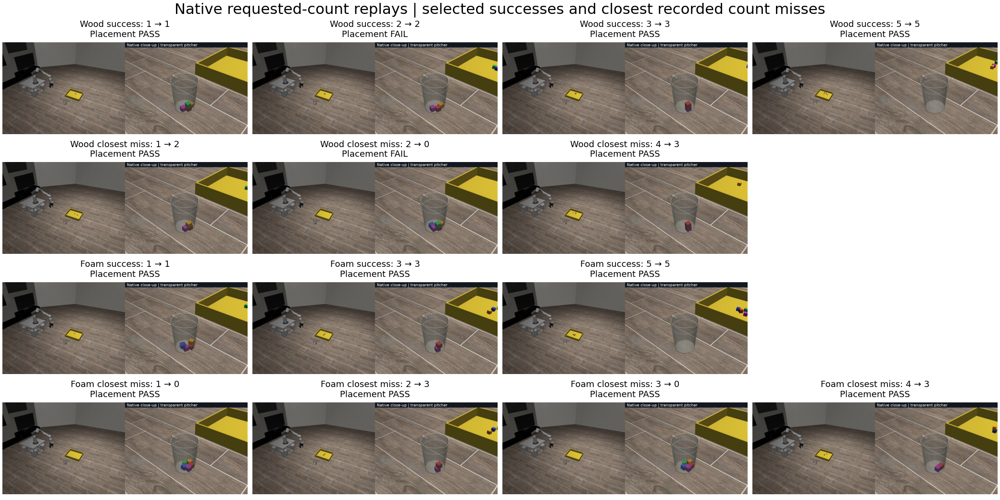

# Native videos of successful pours and closest count misses

These videos illustrate the [requested-count recheck](2026-10-26-pouring-wiggle-counts.md)
using the same centered two-parameter controller, approved material profiles,
clear pitcher, and five cubes. They are actual native KinDER motor executions.
The controller, contact parameters, and success criteria are unchanged.

## Rendered compilations



## Wood Success
[Play the native compilation](../figures/pouring3d-wood-success.mp4)

| Start | Target → delivered | Pour | Placement |
| --- | --- | --- | --- |
| 0:00 | 1 → 1 | PASS | PASS |
| 0:55 | 2 → 2 | PASS | FAIL |
| 1:49 | 3 → 3 | PASS | PASS |
| 2:45 | 5 → 5 | PASS | PASS |

## Wood Failure
[Play the native compilation](../figures/pouring3d-wood-failure.mp4)

| Start | Target → delivered | Pour | Placement |
| --- | --- | --- | --- |
| 0:00 | 1 → 2 | FAIL | PASS |
| 0:55 | 2 → 0 | FAIL | FAIL |
| 1:49 | 4 → 3 | FAIL | PASS |

## Foam Success
[Play the native compilation](../figures/pouring3d-foam-success.mp4)

| Start | Target → delivered | Pour | Placement |
| --- | --- | --- | --- |
| 0:00 | 1 → 1 | PASS | PASS |
| 0:56 | 3 → 3 | PASS | PASS |
| 1:52 | 5 → 5 | PASS | PASS |

## Foam Failure
[Play the native compilation](../figures/pouring3d-foam-failure.mp4)

| Start | Target → delivered | Pour | Placement |
| --- | --- | --- | --- |
| 0:00 | 1 → 0 | FAIL | PASS |
| 0:56 | 2 → 3 | FAIL | PASS |
| 1:52 | 3 → 0 | FAIL | PASS |
| 2:48 | 4 → 3 | FAIL | PASS |

The fourteen selected replays match their original motor-step traces (time,
phase, locations, and qpos hashes), in addition to the boundary-state checks
below. The added wood target-4 placement passes; its Pour still delivers three
while requesting four. Chapter times are approximate seconds for seeking.

Machine-readable [media manifest and audit](data/pouring3d-count-videos.json).

## Selection and presentation

Select one successful Pour for each material/request where one was recorded.
Prefer a complete successful sequence and recorded placement, then the lowest
seed and shortest duration. Wood target 2 has a successful Pour but failed
placement; its end card explicitly reports that distinction.

For each material/request with recorded count failures, select the smallest
absolute tray-count error. Ties prefer fewer delivered cubes, then successful
recorded placement, a recorded placement attempt, lower seed, and shorter
duration. Candidates retain their original requested count. A trajectory from
an incidental count under a different request is never relabeled as success.
There is no failure clip for a request without a recorded count failure.

The success reels contain wood targets 1, 2, 3, and 5 and foam targets 1, 3, and 5.
The closest-count-miss reels contain wood targets 1, 2, and 4 and foam targets
1, 2, 3, and 4. Success/failure here refers to Pour; placement is scored
separately in every clip. These selected illustrations do not estimate
reliability or change the earlier study's published success counts.

Every clip starts with all five cubes in the pitcher in a fresh seeded trial.
Pickup and placement play at 4x; the entire Pour macro plays at 1x. A two-second
chapter card identifies each independent trial, and a three-second final card
reports the Pour count, placement result, and final tray/pitcher counts. There
is no claimed physical reset trajectory between clips.

## Provenance checks

Each replay must exactly match its original initial and post-Pour qpos, qvel,
control, time, locations, settling, and goal values. End states must also match
when the original trial included placement. Source hashes verify unchanged
native/task/legacy-controller/wiggle-controller code; renderer changes only
add captions and final-result frames.

Wood's closest target-4 miss comes from a discovery trial that ended after
Pour. Its replay matches through Pour, then adds physical placement for the
video. That additional placement is identified in the replay audit rather
than presented as an earlier measured result.

The compilation checks every input's frame count against its native trace and
explicit result-card frames, verifies 40 fps, and checks the output frame count
and 1280-by-576 resolution. Per-clip and reel hashes and chapter times are saved
in the media manifest.

## Reproduction

Run from the review checkout, using the original recheck directory as input and
a new output directory. The launcher selects recorded attempts, saves a fixed
protocol/source snapshot, and queues native workers through `SweepRunner` and
`run-heavy` with at most two running at once.

```bash
scripts/with_env.sh python -m scripts.pouring3d_video_reels --source-root /tmp/pouring-wiggle-counts --root /tmp/pouring-count-videos
```

Focused tests check that the closest-miss selection retains the original
request and that equal count outcomes cannot hide different physical states.
