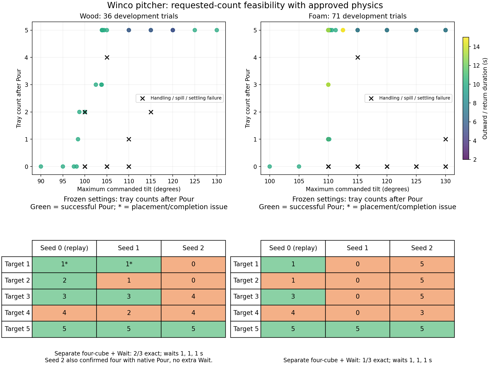

# Requested-count pouring with the approved material profiles

Wood demonstrated all requested counts 1–5 in native KinDER. Foam demonstrated
1, 3, and 5 with the existing Pour macro, and 4 with one additional stationary
Wait. A settled two-cube foam outcome was not found in this bounded search.
The selected partial-pour recipes vary substantially across starting seeds.

Follow-up on 2026-10-26: the subsequent [centered wiggle diagnostic](2026-10-26-pouring-tilt-wiggle.md)
found a settled foam two-cube result with its stationary control: 107 degrees,
10 s outward/return, and a 2 s hold at seed 0, followed by successful placement.
That follow-up permits 2–10 s settling and is separate from the earlier bounded
search and frozen checks below. Their published counts remain unchanged.



## Setup and success criteria

Both approved wood/foam profiles, the approximate clear Winco PMCP-100 pitcher,
five 20 mm cubes, tray, native handle grasp, and robot controller stayed fixed.
The native task configuration is `PitcherPour3D-o5-winco.json`; the pitcher
reference is [Amazon B00C0N8098](https://www.amazon.com/dp/B00C0N8098).

Every trial starts with five cubes in the pitcher and uses physical pickup,
motor-driven pouring, and placement. A successful native Pour requires exactly
k whole cubes settled in the tray, 5−k retained and settled in the pitcher, and
no spills. The existing containment and velocity thresholds are unchanged.
Placement additionally checks the floor home within 25 mm and 5 degrees.

There were 36 wood and 71 foam development parameter trials at seed 0: initial
bounded searches of 35/55 trials, followed by 1/16 targeted refinements between
observed counts. Centered x/y offsets stayed zero; angle, outward/return
duration, and hold varied. Each chosen recipe was then frozen for explicit
requests k=1–5 at seeds 0, 1, and 2. Seed 0 replays development; the other seeds
test small initialization variations rather than general reset arrangements.

## Frozen recipes: actual tray counts

The sequences below are seeds 0, 1, and 2. Success counts refer to the native
Pour boundary, including settling and the retained remainder.

| Target | Wood counts | Wood Pour successes | Foam counts | Foam Pour successes |
| --- | --- | --- | --- | --- |
| 1 | 1, 1, 0 | 2/3 | 1, 0, 5 | 1/3 |
| 2 | 2, 1, 0 | 1/3 | 1, 0, 5 | 0/3 |
| 3 | 3, 3, 4 | 2/3 | 3, 0, 5 | 1/3 |
| 4 | 4, 2, 4 | 0/3 | 4, 0, 3 | 0/3 |
| 5 | 5, 5, 5 | 3/3 | 5, 5, 5 | 3/3 |

All selected target-4 trials were still moving when Pour ended, so even an
observed count of four fails. The two successful wood target-1 pours both
failed the subsequent placement home-orientation check. All other successful
frozen Pour checks also completed placement successfully.

## Commanded parameters

Durations are seconds. Tilt duration applies to both outward tilt and upright
return; controller commands run at 10 Hz. These are selected diagnostic settings,
with no learned sampler or count-dependent stopping controller.

| Material | Target | Angle (degrees) | Outward / return duration | Hold |
| --- | --- | --- | --- | --- |
| Wood | 1 | 98.4375 | 10 | 0.2 |
| Wood | 2 | 98.75 | 10 | 0.2 |
| Wood | 3 | 102.5 | 10 | 0.2 |
| Wood | 4 | 105 | 5 | 1 |
| Wood | 5 | 130 | 10 | 0.2 |
| Foam | 1 | 110 | 10 | 0.2 |
| Foam | 2 | 110 | 10 | 0.2 |
| Foam | 3 | 110 | 15 | 0.2 |
| Foam | 4 | 115 | 5 | 1 |
| Foam | 5 | 130 | 10 | 0.2 |

Foam target 2 uses the closest stable observed recipe because an exact candidate
was not found. Its row is a failed check, not a successful two-cube recipe.

## Four-cube confirmations

For the selected target-4 recipes, the existing stationary Wait skill was applied
until settling, bounded at ten one-second calls. Every tested start settled after
one call. Wood then achieved the exact four/one split and placement in 2/3 starts;
foam in 1/3. Counts after waiting were respectively (4, 2, 4) and (4, 0, 3).
The original Pour failures remain recorded; the wait is a separate skill.

Wood also produced a settled four-cube split while requesting three at seed 2.
A fresh explicit target-4 confirmation used **102.5 degrees, 10 s outward and
return, 0.2 s hold, seed 2**. Pickup, native Pour, and placement all succeeded,
with no extra Wait: four settled in the tray and one retained in the pitcher.
This is a selected confirmation, separate from the frozen target-4 recipe above.

## Interpretation and verification

Parameters affect success: for example, at centered 110-degree foam pours with
0.2 s hold, the selected seed-0 10 s and 15 s settings deliver one and three cubes.
Always emptying the pitcher fails partial requests. These observations do not
establish that every exposed parameter needs learning or that practice improves
performance. Missing counts in a finite search are not proven infeasible.

Two controller issues surfaced: the fixed two-second settling pause is too short
for the selected fast four-cube recipes, and placement with retained contents can
miss the home orientation. These need attention before persistent reset/practice
benchmarking. The approved physical profiles were preserved throughout.

There are 144 trial records: 107 development trials, 30 explicit request checks,
six stationary-wait checks, and one explicit four-cube confirmation. The audit
checked goal semantics on 566 snapshots, verified the unchanged native/task/
controller hashes, and matched all ten seed-0 request replays exactly in qpos and
qvel to their selected development trials. The explicit four-cube confirmation
matches the discovered physical state. Targeted Ruff, formatting, mypy, and the
architecture import contract pass. These are diagnostic counts, with no
statistical reliability or material-effect inference.

Physical core: native `fdfeb9733ae54a264e63194282a7259c071a65e8`; unchanged parent
controller from `0e211d980127882aa030b9315f354598e4b52481`.

Machine-readable results: [summary](data/pouring3d-material-feasibility.json).

## Reproduction

Run from the review checkout. Launchers use `SweepRunner` and queue each native
worker through `run-heavy`; the launcher itself does not hold a heavy-job slot.
Use the same result directory for every phase.

```bash
scripts/with_env.sh python -m scripts.pouring3d_feasibility --material wood --budget 35 --output-dir /tmp/pour-check
scripts/with_env.sh python -m scripts.pouring3d_feasibility --material foam --budget 55 --output-dir /tmp/pour-check
scripts/with_env.sh python -m scripts.pouring3d_refine --material wood --budget 16 --root /tmp/pour-check
scripts/with_env.sh python -m scripts.pouring3d_refine --material foam --budget 16 --root /tmp/pour-check
scripts/with_env.sh python -m scripts.pouring3d_settling_check --material wood --root /tmp/pour-check
scripts/with_env.sh python -m scripts.pouring3d_settling_check --material foam --root /tmp/pour-check
scripts/with_env.sh python -m scripts.pouring3d_feasibility_report --root /tmp/pour-check
scripts/with_env.sh python -m scripts.pouring3d_feasibility_report --root /tmp/pour-check --confirm-wood-four
scripts/with_env.sh python -m scripts.pouring3d_feasibility_report --root /tmp/pour-check --plot-only
```

JSONL traces retain all goal failures and physical snapshots. Each trial uses a
fresh harness initialization; these checks do not evaluate persistent practice
or robot/human reset-produced cube arrangements. Earlier results for the ACCUPOUR
shape remain historical and are not pooled with this study.
