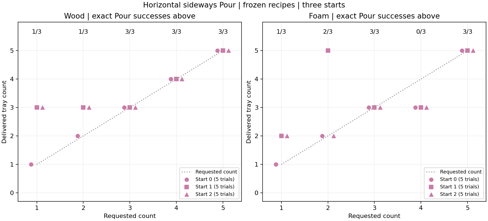

# Requested counts 1–5 with horizontal sideways Pour

**Follow-up:** [wood region mapping and fixed placement repair](2026-10-27-pouring-wood-regions.md)
repairs the supporting pitcher return and tests new settings and local margins
for counts one and two. The frozen-recipe numbers below remain unchanged.

Wood produces every requested count in seed-zero discovery. Foam discovery
produces one, two, three, and five; four remains unresolved by the frozen
recipes. The three-start checks also expose low-count overshoots on new
arrangements and pitcher-placement failures after some correct wood pours.

This follows the [target-two sideways diagnostic](2026-10-26-pouring-sideways-skill.md).
The [older pitch-wiggle study](2026-10-26-pouring-wiggle-counts.md) uses a different
motion and remains a historical reference; its results are not updated here.

## Controller and protocol

The actual native Pour skill uses `LateralPouringEnvironment`. The two practiced
parameters are held tilt angle (0–150 degrees) and sideways wiggle duration
(0–20 seconds at native 0.1-second resolution). Aim stays centered. The commanded
world-x translation is perpendicular to the world-+y pour direction and parallel
to the ground: fixed 15 mm amplitude, 1 Hz, and smooth 0.5-second ramps. Commanded
wrist rotation and world y/z stay constant during that stage. Actual native
motor travel is smaller than the commanded amplitude.

The controller retains ten-second outward/return tilts, one second to stabilize
before nonzero wiggling, and two to ten seconds of post-return settling. It does
not stop wiggling from a count observation. Native geometry, approved wood/foam
contact profiles, physical handle grasp, and whole-cube settled goal scoring
are unchanged from the target-two diagnostic. The goal is exactly k whole
settled cubes in the tray, 5-k in the pitcher, and no spills.

Each material first receives five explicit target attempts on seed 0, followed
by bounded refinement up to eighteen discovery executions in total. Refinement
bisects observed count gaps along a shared tilt or duration, then uses a finite
boundary grid if no unused midpoint is available. This is a search heuristic,
not an assumption that the physical outcome is monotone. Wood needs five
discovery executions; foam uses all eighteen. No discovery trial includes
pitcher placement.

For each target, the frozen recipe minimizes settled contained count error,
then duration, then tilt. A missing exact recipe keeps the closest observed
candidate and is reported as unresolved. Each recipe is explicitly checked on
seeds 0, 1, and 2, including physical pickup, Pour, and pitcher placement: thirty
validation executions. Seed 0 overlaps discovery; seeds 1 and 2 are new starts.
The recipes are not retuned on those starts. Every trial starts fresh with
five cubes in the pitcher.

Six additional foam seed-zero probes were planned separately to examine the
missing counts and duration sensitivity. They do not change the frozen recipes
or their thirty-trial results. Discovery, frozen validation, extra probes,
and rendered replays are separate categories.

## Frozen recipes and three-start results

| Material | Target | Tilt | Wiggle duration | Settled tray counts, seeds 0/1/2 | Exact Pour | Complete sequence |
| --- | --- | --- | --- | --- | --- | --- |
| Wood | 1 | 95.5° | 2.5 s | 1 / 3 / 3 | 1/3 | 0/3 |
| Wood | 2 | 95.5° | 12 s | 2 / 3 / 3 | 1/3 | 1/3 |
| Wood | 3 | 97° | 2 s | 3 / 3 / 3 | 3/3 | 2/3 |
| Wood | 4 | 97° | 6 s | 4 / 4 / 4 | 3/3 | 3/3 |
| Wood | 5 | 97° | 12 s | 5 / 5 / 5 | 3/3 | 3/3 |
| Foam | 1 | 104.8281° | 12 s | 1 / 2 / 2 | 1/3 | 1/3 |
| Foam | 2 | 104.7148° | 12 s | 2 / 5 / 2 | 2/3 | 2/3 |
| Foam | 3 | 106° | 12 s | 3 / 3 / 3 | 3/3 | 3/3 |
| Foam | 4 | 106° | 12 s | 3 / 3 / 3 | 0/3 | 0/3 |
| Foam | 5 | 107° | 12 s | 5 / 5 / 5 | 3/3 | 3/3 |



Exact Pour requires the native settled-count goal and no controller error.
Complete sequence additionally requires successful physical pitcher placement
and the final count goal. Wood target one, seed 0, pours exactly one but fails
placement; wood target three, seed 1, pours exactly three but fails placement.
Those are separate from the count overshoots. The logs retain the native
placement outcomes. Wood target two, seed 1, also fails placement after
overpouring three cubes.

The seed-zero wood trials provide concrete parameter contrasts: at 95.5°,
2.5 seconds yields one cube and twelve seconds yields two; at 97°, two, six,
and twelve seconds yield three, four, and five. The foam release boundary is
irregular: nearby tilts can produce different counts, and lower angle does not
guarantee a smaller count. These are raw outcomes, with no statistical inference
or claim of a cross-material advantage. Three starts, including the discovery
start, do not establish general reliability or rule out unobserved recipes.

## Separate foam follow-ups

| Explicit target | Tilt | Wiggle duration | Settled tray count | Exact Pour |
| --- | --- | --- | --- | --- |
| 4 | 106.75° | 12 s | 3 | 0/1 |
| 1 | 105° | 4 s | 0 | 0/1 |
| 1 | 105° | 8 s | 0 | 0/1 |
| 1 | 105° | 10 s | 2 | 0/1 |
| 1 | 104.75° | 20 s | 2 | 0/1 |
| 4 | 106.75° | 20 s | 3 | 0/1 |

All six use seed 0 and include placement. None satisfies its requested count.
Foam four remains unfound in this bounded study, rather than proved impossible.
At 105°, the additional duration probes yield zero at four/eight seconds and
two at ten seconds; the earlier twelve-second diagnostic also yielded two.
Longer wiggling does not establish one-at-a-time release.

There are 59 non-video native executions: 23 discovery, 30 frozen checks, and
six extra probes. Every Pour finishes error-free, settled, and contained; count
misses and placement failures are still failures for their respective metrics.

## Native videos and reproduction

[Wood: best explicit attempts for targets 1–5](../figures/pouring3d-sideways-counts-wood.mp4).

[Foam: best explicit attempts for targets 1–5](../figures/pouring3d-sideways-counts-foam.mp4).

Each chapter is an independent native trial with five cubes initially in the
pitcher. Selection considers the three frozen checks and the extra probes for
that explicit target, preferring exact Pour, contained count error, successful
full sequence, then seed. Closest misses and placement failures keep their
result labels. Pickup and placement play at 4x; the entire Pour plays at 1x.
Chapter/result cards mark the fresh starts and final outcomes. The video frames
come from the actual simulator, with its overview and transparent-pitcher
close-up.

All ten selected chapters use seed 0; they show the best recorded explicit
attempts, rather than typical performance on new starts. Wood shows all five
exact pours, with placement failure retained for target one. Foam shows exact
one, two, three, and five, and a labeled closest miss of three for target four.
The compilations last 308.875 seconds (wood) and 333.175 seconds (foam).

```bash
scripts/with_env.sh python -m scripts.pouring3d_lateral_counts --root /tmp/pouring-sideways-counts
scripts/with_env.sh python -m scripts.pouring3d_sideways_probes --root /tmp/pouring-sideways-counts
scripts/with_env.sh python -m scripts.pouring3d_lateral_counts --root /tmp/pouring-sideways-counts --report-only
scripts/with_env.sh python -m scripts.pouring3d_sideways_reels --root /tmp/pouring-sideways-counts
```

Use a new result directory. Launchers use `SweepRunner` and `run-heavy`; the
machine-wide two-slot limit applies to simulation and rendering. A phase can
be queued while another runs, but report/render reads require their inputs to
be complete. `--material wood` or `--material foam` renders one material.

The portable [result extract](data/pouring3d-sideways-counts.json) retains the
protocol, recipes, all thirty per-start checks, discovery and probe outcomes,
native source hashes, and selected-video manifests. Full snapshots, motor
traces, phase-specific source archives, and timing files remain in the local
artifact directory. The initial driver archive predates a type annotation and
the optional probe-aware video-selection extension; the discovery and frozen
validation algorithms are unchanged by those later driver edits.

## Verification

All ten rendered replays exactly match their selected recorded attempts at the
initial, post-Pour, and final physical states, including positions, velocities,
controls, time, cube locations, settling, and goal. Their complete motor traces
also match: 10,587 native motor-step rows. Rendering adds ten executions, for
69 native executions total; these replays are not independent validation trials.

Source-hash auditing verifies identical native task, contact configuration, base
controller, and sideways controller across discovery, validation, probes, and
replays. All 603 inspected non-video goal snapshots, including wiggle-stage
boundaries, agree with the requested whole settled count. The standard
before/after-event audit covers 308 of those snapshots.

Five recipe/refinement/selection tests pass. Focused Ruff, repository formatting
(625 files), type checks on all three new drivers, and the import contract pass.
Repository-wide Ruff still reports 38 pre-existing import-order findings in 36
untouched files byte-identical to HEAD. Committed documentation links pass.
