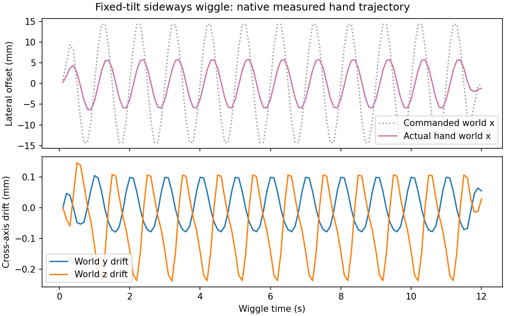

# Sideways wiggle motion preview

**Follow-up:** the approved motion is now wired into the actual Pour macro.
See the [full skill diagnostic and videos](2026-10-26-pouring-sideways-skill.md)
for the subsequent target-two trials. Results below describe the earlier
motion-only preview.

The requested strategy holds the pitcher at a modest release tilt and translates
it sideways, perpendicular to the pour direction and parallel to the ground.
This replaces the earlier pitch oscillation in the new controller prototype.
The earlier controller and requested-count results remain historical references.

The native pour direction is world +y; the commanded wiggle is world x, with
constant world y/z and a constant wrist orientation throughout the wiggle stage.
Its center stays above the tray. Fixed settings are 15 mm amplitude at 1 Hz,
with 0.5 s smooth ramps and ten-second outward/return tilts. The two practiced
parameters remain tilt angle and wiggle duration, now allowing 0–20 seconds.
No count observation terminates the wiggle early.

The preview uses five foam cubes, seed 0, a 103-degree commanded tilt, and twelve
seconds of wiggling. Pickup and tilt setup occur off camera; only the sideways
stage is shown at normal speed. The front camera looks along the pour direction
and stays fixed in the world so the horizontal motion is visible. Its offscreen
buffer size is a rendering setting; physical assets and contact profiles are
unchanged.

This is a motion demonstration, not a requested-count feasibility check or
evidence that feeding is slow/reliable. Minimal useful tilt still needs testing.
The new controller is available explicitly as `LateralPouringController` with
`LateralPourParameters`; the earlier controller remains unchanged for replay.

```bash
scripts/with_env.sh python -m scripts.pouring3d_lateral_preview --root /tmp/pouring-sideways-preview
```

The launcher uses `SweepRunner` and one `run-heavy` worker. The native run checks
actual back-and-forth hand displacement and retained grasp, while focused tests
check the horizontal/perpendicular command path and two-parameter contract.

[Play just the native sideways motion](../figures/pouring3d-sideways-only.mp4).



The commanded amplitude is 15 mm each way; measured hand travel is about
12 mm peak-to-peak in this preview. Cross-axis travel is below 0.4 mm. Native
tracking attenuates the requested displacement. All five foam cubes remain
in the pitcher after the complete demonstration; no count-feasibility claim
is made. Two focused tests and the native motion/grasp checks pass.
