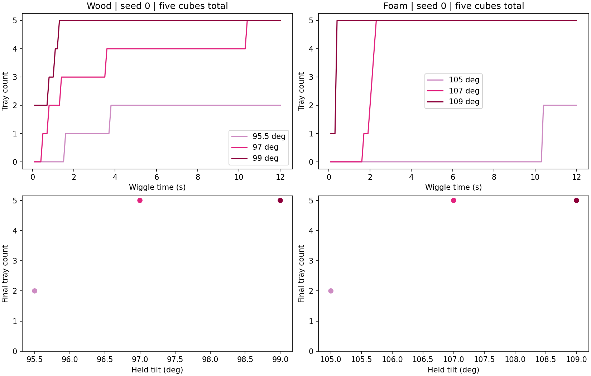

# Sideways wiggle in the actual Pour skill

**Follow-up:** the [requested-count 1–5 study](2026-10-26-pouring-sideways-counts.md)
checks frozen recipes on three starts per material and includes full native
videos. The target-two results below remain the earlier diagnostic.

The approved horizontal motion now runs inside the native Pour macro, between
the outward tilt and upright return. In the selected seed-0 attempt for each
material, all five cubes remain in the pitcher until the sideways stage starts;
two reach the tray during that stage, and three remain in the pitcher. Both
rendered sequences also complete physical placement of the pitcher at home.

This is a bounded feeding diagnostic for requested count two, not a full
requested-count feasibility study or a reliability estimate. It follows the
[motion-only preview](2026-10-26-pouring-sideways-motion.md) and preserves the
[historical pitch-wiggle study](2026-10-26-pouring-wiggle-counts.md).

## Skill interface

`LateralPouringEnvironment` exposes four-component macro actions:
`[skill ID, cube ID, tilt_angle, wiggle_seconds]`. Only the last two components
are continuous practiced Pour parameters:

| Parameter | Bounds | Meaning |
| --- | --- | --- |
| `tilt_angle` | 0–150 degrees | Commanded tilt held throughout the sideways stage |
| `wiggle_seconds` | 0–20 seconds | Duration of horizontal oscillation, rounded to the native 0.1 s action interval |

Aim stays centered over the tray. Sideways commands translate along world x,
perpendicular to the world +y pour direction, with world y/z and wrist rotation
held constant. Amplitude is fixed at 15 mm each way, frequency at 1 Hz, and
smooth startup/shutdown ramps at 0.5 s. Native motors determine actual travel;
the command amplitude is not a claim about measured displacement.

Outward tilt and upright return each take ten seconds. A one-second pause
stabilizes the tilt before a nonzero sideways stage. After the return, bounded
settling lasts two to ten seconds. The controller never stops wiggling based
on a count observation. Duration zero omits both stabilization and wiggle.
Pickup, handle contact, physical cube reset skills, and human-oracle cube
respawn retain their existing implementations.

The native pitcher geometry, contact profiles, and scoring are unchanged.
The two materials retain the previously approved rigid-cube wood and foam
approximations. The goal remains exactly k whole settled cubes in the tray,
5-k whole settled cubes in the pitcher, and no spills. The sideways controller
is opt-in, leaving historical controller replay available.

## Bounded protocol and results

Three angles per material were tried with seed 0, target two, and twelve
seconds of wiggling. Each discovery trial starts fresh with five cubes in the
pitcher, physically picks the handle, and executes Pour. The protocol allowed
at most two angle bisections per material if no partial count was found; none
were needed. No discovery trial includes pitcher placement.

| Material | Tilt | In pitcher at wiggle start | In tray at wiggle start | Settled final tray count | Target-two Pour |
| --- | --- | --- | --- | --- | --- |
| Wood | 95.5° | 5 | 0 | 2 | 1/1 |
| Wood | 97° | 5 | 0 | 5 | 0/1 |
| Wood | 99° | 3 | 1 | 5 | 0/1 |
| Foam | 105° | 5 | 0 | 2 | 1/1 |
| Foam | 107° | 5 | 0 | 5 | 0/1 |
| Foam | 109° | 2 | 0 | 5 | 0/1 |

At wiggle start, wood 99° also has one airborne cube, and foam 109° has three.
Tray count alone therefore does not establish that the outward tilt retained
all cubes. The two selected partial attempts do retain all five until wiggling.



For wood 95.5°, the location classifier first records one cube in the tray at
wiggle time 1.6 s and two at 3.8 s. For foam 105°, it records two together at
10.4 s. These are arrival times, not claims of instantaneous settled success.
The full post-return settled goal passes in both selected attempts. The foam
example does not demonstrate one-at-a-time release.

The selected angle per material minimizes distance to target two among nonempty
contained outcomes, breaking ties toward lower tilt. Each was rerun with native
rendering and extended through physical pitcher placement. Initial and
post-Pour `qpos`, `qvel`, controls, cube locations, settling, and goal exactly
match the selected discovery run. Rendered Pick, Pour, and Place each pass;
each sequence ends with two cubes in the tray and three retained, no spills,
and the pitcher released at home. These deterministic replays
are not independent success trials.

The complete discovery motor trace also exactly matches the corresponding
rendered prefix: 811 rows per material, 1,622 matching rows total.

[Wood: full target-two sequence](../figures/pouring3d-sideways-wood.mp4).

[Foam: full target-two sequence](../figures/pouring3d-sideways-foam.mp4).

Videos are native simulator frames with an overview and pitcher close-up.
Pickup and placement play at 4x; all of Pour, including the wiggle and return,
plays at 1x. Each 64.65 s video includes a three-second result card. The six
discovery trials plus two rendered replays make eight diagnostic executions.

The observed count depends on tilt in these starts. Duration was fixed across
this diagnostic, so its independent effect has not been measured here. No
statistical inference or cross-material advantage is supported by these data.
Feasibility for every target in {1, 2, 3, 4, 5}, repeated starts, and reliably
slow feeding remain untested for this sideways controller.

## Reproduction and validation

```bash
scripts/with_env.sh python -m scripts.pouring3d_lateral_pour_demo --root /tmp/pouring-sideways-skill
```

Use a new output directory. The launcher uses two `SweepRunner` workers through
`run-heavy`, finite per-material budgets, and fixed seed 0. Full snapshots,
native motor traces, source hashes, and upload receipts remain in the local
artifact directory. A portable [result extract](data/pouring3d-sideways-skill.json)
contains per-trial parameters, stage counts, native sideways traces, source
hashes, selected video hashes, and final event results.

Three focused tests pass, including actual Pick and six-second sideways Pour
through the environment action interface, constant commanded y/z and tilt,
retained handle grasp, native event/cost accounting, and rejection of human reset
as a robot action. Focused Ruff, repository formatting (620 files), type checks
(243 library files plus four touched implementation/driver files), import
contracts, and committed documentation link checks pass. Repository-wide Ruff
reports 38 pre-existing import-order findings in 36 files byte-identical to HEAD;
none are in touched files. Source-hash auditing verifies unchanged native
task geometry, contact configuration, and base controller across all eight
diagnostic executions.
