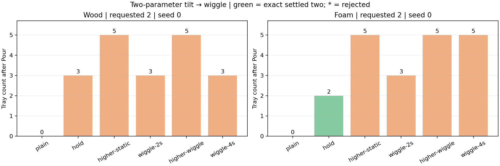

# Centered tilt-then-wiggle prototype

Follow-up: the [explicit requested-count 1–5 recheck](2026-10-26-pouring-wiggle-counts.md)
adds a new parameter search, frozen recipes, and three-start checks for both
materials. The original target-2 comparison below remains unchanged.

The opt-in `TiltWigglePouringEnvironment` exposes two continuous Pour controls:
`tilt_angle` (degrees, 0–146) and `wiggle_seconds` (seconds, 0–4). The requested
cube count remains a discrete task input. The macro action is
`[skill_id, cube_id, tilt_angle, wiggle_seconds]`; cube ID is ignored by Pour.

The wrist pivot always aims above the tray center, with zero x/y offsets.
Pickup, transport, handle grasp, and placement use the existing native motor
controller. The sequence is tilt, wiggle about that inclination, then return
upright. Outward and return tilts each take ten seconds. Nominal wiggle amplitude
is four degrees at 1 Hz about the same fore–aft axis as pouring. A smooth
`sin(pi*t/T)^2` envelope starts and finishes at the base angle. Duration is
rounded to the nearest 0.1 s command interval; zero duration gives a plain pour.
The short-duration envelope can attenuate the nominal amplitude substantially.

All cubes must settle after return: a two-second minimum pause followed by
one-second waits, bounded at ten seconds total. This completion condition is
independent of the requested count. The controller never stops a wiggle or
return when a desired count is observed. It has no cube-count feedback.

This prototype preserves the native Winco geometry, five 20 mm cubes, approved
wood/foam contact profiles, and native containment/velocity thresholds. It adds
no welds, cube relocation, or pitcher pose assignment. Human reset retains the
existing oracle respawn hook. The older seven-component environment remains
available; the reduced prototype is selected explicitly by its class.



## Observed outcomes

All twelve diagnostic pours completed without a motion/grasp error, with all
five cubes contained and settled. Each table cell is the delivered count in one
seed-0 trial requesting two; only foam's stationary hold succeeded at that goal.

| Case | Angle relative to base | Duration | Wood tray count | Foam tray count |
| --- | --- | --- | --- | --- |
| Plain, no dwell | 0 | 0 s | 0 | 0 |
| Stationary hold | 0 | 2 s | 3 | 2 |
| Higher stationary hold | +4 degrees | 2 s | 5 | 5 |
| Wiggle | 0 | 2 s | 3 | 3 |
| Higher wiggle | +3 degrees | 2 s | 5 | 5 |
| Longer wiggle | 0 | 4 s | 3 | 5 |

Angle and wiggle duration can change the delivered count: foam's 107-degree
two-second wiggle delivered three, versus five at either four seconds or
110 degrees. This does not establish that both parameters need learning.
The six wiggle cases achieved the requested two in 0/6 trials. They do not
demonstrate an improvement over the stationary hold, which achieved two with
foam at 107 degrees and completed placement successfully in its single check.
That diagnostic control is not a separate mode in the two-parameter action.

The centered two-second native wiggle videos below delivered three and therefore
fail their requested-two goals. Both exactly replay their discovery trial's
initial, post-Pour, and final qpos, qvel, and control arrays. Pickup and placement
play at 4x; the complete Pour macro, including transport/return, plays at 1x.

- [Wood native wiggle: three delivered, target two](../figures/pouring3d-wiggle-wood.mp4)
- [Foam native wiggle: three delivered, target two](../figures/pouring3d-wiggle-foam.mp4)

Machine-readable [results and audit](data/pouring3d-wiggle.json) retain all twelve
cases. An independent count/settling audit checks 72 event snapshots and verifies
the unchanged native physics, task, and legacy controller hashes. The two video
replays are additional executions, separate from the twelve diagnostic trials.

## Diagnostic protocol

The bounded diagnostic requests exactly two cubes, starting with five in the
pitcher. Each case uses a fresh seed-0 harness initialization, physical pickup,
Pour, and placement. It is not a persistent practice or reset evaluation.
The same initialization is used within each material. No learner is trained.

Wood's base inclination is 97 degrees and foam's is 107 degrees. Six cases per
material compare zero-duration plain pouring; a two-second stationary hold;
a two-second stationary hold at base plus four degrees; a two-second wiggle;
a two-second wiggle at base plus three degrees; and a four-second wiggle.
The stationary controls use the same trajectory and settling condition with
wiggle amplitude zero. They test whether a longer dwell or larger tilt can
already produce the result. The two-second wiggle and matched hold differ only
in their commanded oscillation.

Success requires exactly two whole settled cubes in the tray, three retained
and settled in the pitcher, no spills, and no motion/grasp error. Full-sequence
success additionally requires placement at home and the native goal afterward.
These are diagnostic outcomes, not statistical reliability estimates or evidence
that practice improves performance. The extra settling allowance differs from
the older feasibility controller's fixed two seconds; its published results
remain separate.

## Reproduction and validation

```bash
scripts/with_env.sh python -m scripts.pouring3d_wiggle_demo --root /tmp/pouring-wiggle
```

The launcher uses `SweepRunner` with at most two native workers, each through
`run-heavy`. Per-case results include physical before/after snapshots, errors,
wiggle commands and measured pitcher inclinations, source hashes, and a native
motor-step trace. Raw records are saved outside the source checkout.

The targeted tests verify the reduced action contract, valid/no-op action
shapes, actual pitcher oscillation, retained handle grasp, and native goal
semantics. Both tests pass. Targeted Ruff, formatting, and mypy checks pass.
