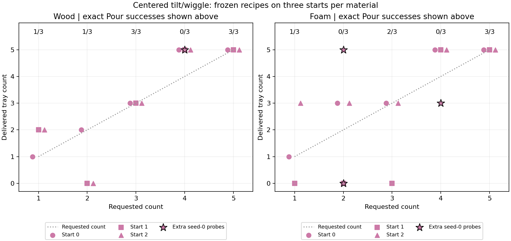

# Requested counts 1–5 with the centered two-parameter controller

Representative [native success and closest-miss videos](2026-10-26-pouring-count-videos.md)
replay this study's recorded attempts, with separate Pour and placement labels.

This follow-up explicitly retries requested counts 1–5 for both approved wood
and foam profiles. The earlier [wiggle comparison](2026-10-26-pouring-tilt-wiggle.md)
only requested two; its six wiggle cases and stationary controls remain a
separate diagnostic. No previous published counts are replaced.

The native Winco geometry, five 20 mm cubes, handle grasp, contact profiles,
and success thresholds remain fixed. Only `tilt_angle` and `wiggle_seconds`
vary. The wrist always aims over the tray center. Wiggle amplitude is nominally
four degrees at 1 Hz, outward and return tilts each take ten seconds, and
settling is bounded at 2–10 seconds independently of the requested count.
Zero wiggle duration gives immediate return after tilting. No cube-count
feedback stops a Pour early.

## Results

The reduced controller demonstrated exact requests 1, 2, 3, and 5 for wood, and
1, 3, and 5 for foam, on at least one validation start. Four was not found for
either material, nor two for foam, in this bounded diagnostic. These missing
counts are unresolved, not proven impossible.



Counts below are seeds 0, 1, and 2. Pour and full-sequence columns are successful
trials out of three. Every validation Pour ended with all five cubes contained
and settled; failed requests delivered the wrong count.

| Target | Wood counts | Wood Pour | Wood full sequence | Foam counts | Foam Pour | Foam full sequence |
| --- | --- | --- | --- | --- | --- | --- |
| 1 | 1, 2, 2 | 1/3 | 1/3 | 1, 0, 3 | 1/3 | 1/3 |
| 2 | 2, 0, 0 | 1/3 | 0/3 | 3, 0, 3 | 0/3 | 0/3 |
| 3 | 3, 3, 3 | 3/3 | 2/3 | 3, 0, 3 | 2/3 | 2/3 |
| 4 | 5, 5, 5 | 0/3 | 0/3 | 5, 5, 5 | 0/3 | 0/3 |
| 5 | 5, 5, 5 | 3/3 | 3/3 | 5, 5, 5 | 3/3 | 3/3 |

The successful wood target-2 Pour and the seed-0 wood target-3 Pour both failed
the subsequent placement home check. Wood target 3 succeeded through placement
at seeds 1 and 2. All other successful pours also completed placement.

### Frozen parameters

| Material | Target | Tilt (degrees) | Wiggle (s) | Exact discovery candidate? |
| --- | --- | --- | --- | --- |
| Wood | 1 | 95.5 | 2 | Yes |
| Wood | 2 | 97 | 0.5 | Yes |
| Wood | 3 | 97 | 2 | Yes |
| Wood | 4 | 130 | 0 | No; closest miss |
| Wood | 5 | 130 | 0 | Yes |
| Foam | 1 | 107 | 3 | Yes |
| Foam | 2 | 107 | 2 | No; closest miss |
| Foam | 3 | 107 | 2 | Yes |
| Foam | 4 | 130 | 0 | No; closest miss |
| Foam | 5 | 130 | 0 | Yes |

For unresolved targets, the frozen row repeats the closest discovery miss;
it is not a claimed recipe for that target. In particular, both target-4
fallbacks empty all five. The four-cube search failures and targeted attempts
below are the relevant evidence about that gap.

### Additional targeted probes

| Material | Target | Tilt (degrees) | Wiggle (s) | Delivered | Exact Pour |
| --- | --- | --- | --- | --- | --- |
| Foam | 2 | 107 | 1.6 | 0 | 0/1 |
| Foam | 2 | 107 | 2.8 | 5 | 0/1 |
| Foam | 4 | 107.375 | 2 | 3 | 0/1 |
| Wood | 4 | 98.875 | 2 | 5 | 0/1 |

All four additional probes missed their requested counts (0/4). They are
separate from the frozen three-start checks; stars in the figure show their
actual delivered counts. The earlier stationary foam hold that delivered two
remains valid, but that amplitude-zero control is not selectable in the reduced
two-parameter wiggle interface.

### Verification

There are 50 native executions: 16 discovery trials, 30 frozen checks, and
four targeted probes. The audit verifies explicit requested counts and native
goal semantics on 268 event snapshots, finite physical state arrays, identical
per-trial source hashes, and unchanged approved native physics/task/legacy
controller hashes. Source snapshots preserve the executed discovery driver;
subsequent typing and report edits preserve its worker/selection semantics.

Two focused selection/proposal tests pass, along with targeted Ruff, formatting,
mypy, import contracts, and document links. These observations do not establish
that practice improves performance or that both exposed parameters are needed.

Machine-readable [results and audit](data/pouring3d-wiggle-counts.json) retain
all discovery outcomes, frozen checks, selected parameters, and targeted probes.

## Protocol

Each trial uses a fresh seeded harness initialization with five cubes inside
the pitcher, followed by physical handle pickup and motor-driven pouring.
These are independent feasibility checks, not persistent practice or human/
robot reset evaluations. The seeds introduce small initialization variations;
they do not cover arbitrary payload arrangements.

Discovery uses seed 0 and at most eight trials per material. The initial five
trials request counts 1–5, using respectively 0.5, 1, 2, and 3 seconds of wiggle
at 97 degrees for wood or 107 degrees for foam, then a 130-degree zero-wiggle
pour for five. At most three further proposals target missing delivered counts
by refining durations or adjusting tilt. Between-trial choices can observe
prior outcomes; each physical Pour remains open loop. Discovery ends after
Pour and does not test placement.

For each requested count, the closest settled, contained, error-free discovery
outcome supplies a frozen recipe. Ties prefer shorter wiggle duration, then
lower angle. If no exact candidate exists, the closest miss is still replayed
and the missing candidate is explicitly labeled. This is a bounded search, not
a proof that a missing count is physically impossible.

Each of the five frozen recipes is then tested with its explicit requested
count at seeds 0, 1, and 2, for 30 validation trials. Seed 0 reuses the tuning
initialization; seeds 1 and 2 were not used to choose recipes. Validation always
attempts placement after an error-free Pour, including failed requested counts.

Pour success requires exactly the requested number of whole cubes settled in
the tray, the remaining cubes retained and settled in the pitcher, no spills,
and no motion error. Full-sequence success additionally requires placement at
home and the native count goal afterward. Counts and placement results are
reported separately. No learning or statistical reliability inference is made.

After discovery left gaps, four additional seed-0 probes were planned and
queued: wood target 4 at 98.875 degrees / 2 s; foam target 2 at 107 degrees /
1.6 s and 2.8 s; and foam target 4 at 107.375 degrees / 2 s. They test settings
between previously observed outcomes and include physical placement. These
probes are reported separately from the frozen validation and do not change
its recipes or success denominators. Their parameters were fixed before their
executions; they are not a replay of a previously successful setting.

## Reproduction

```bash
scripts/with_env.sh python -m scripts.pouring3d_wiggle_counts --root /tmp/pouring-wiggle-counts
scripts/with_env.sh python -m scripts.pouring3d_wiggle_counts --root /tmp/pouring-wiggle-counts --probes
scripts/with_env.sh python -m scripts.pouring3d_wiggle_counts --root /tmp/pouring-wiggle-counts --report-only
```

Use a new output root. The launcher refuses to overwrite an existing experiment,
archives its protocol and source snapshots, and uses `SweepRunner` with at most
two workers through `run-heavy`. Full physical records and traces are retained
per trial. A report-only invocation reads saved results without rerunning physics:

```bash
scripts/with_env.sh python -m scripts.pouring3d_wiggle_counts --root /tmp/pouring-wiggle-counts --report-only
```
