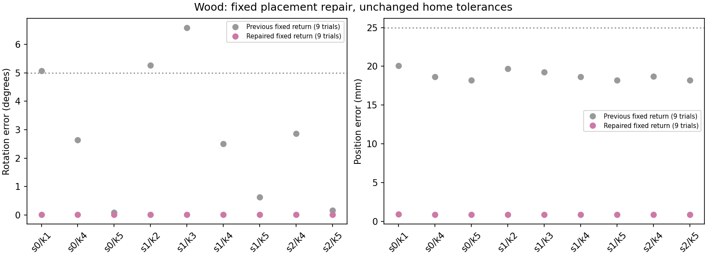
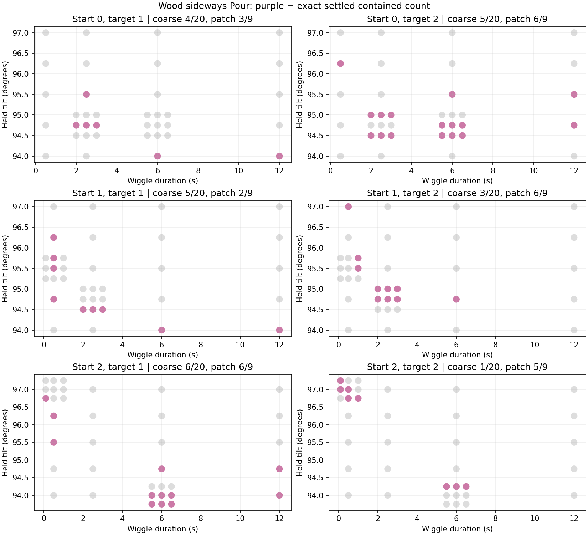
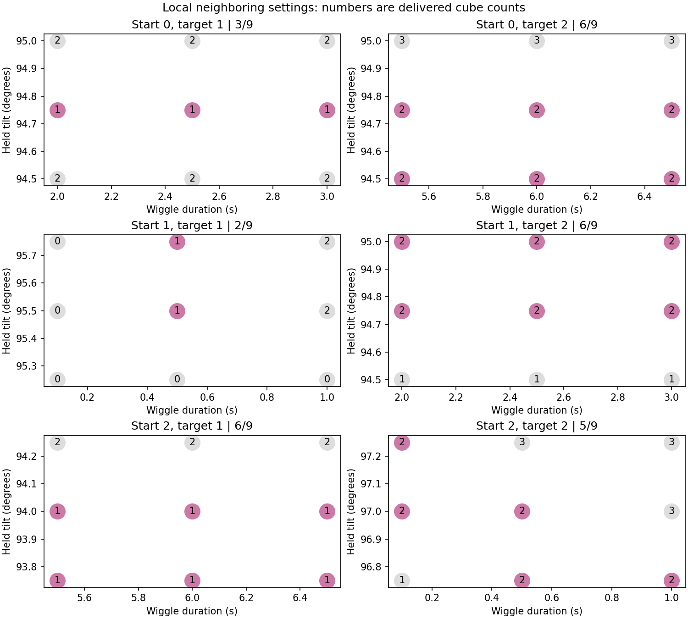
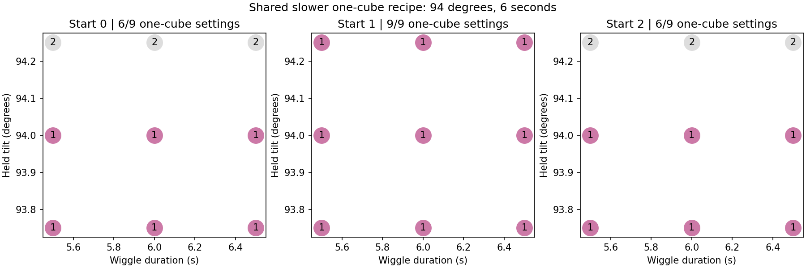

# Wood one/two-cube regions and fixed placement repair

This follows the [three-start 1–5 checks](2026-10-26-pouring-sideways-counts.md).
The user requested two next steps: repair the fixed pitcher-return controller,
then investigate whether wood targets one and two have usable tilt/duration
regions for each start. This is a parameter map, not a learning experiment.

## Fixed placement

Placement remains a supporting skill with no practiced parameters. The previous
controller estimated the contact grasp before transport and released the vessel
after a fixed lowering motion. A native regression reproduces the wood
seed-zero one-cube failure: the pour succeeds, but the final pitcher rotation
is about 5.1 degrees against the unchanged five-degree home tolerance.

The sideways controller now adds a bounded four-second correction immediately
before release. Each native control step measures the current vessel-to-hand
transform, corrects the vessel toward its existing home pose through the robot
motors, and approaches a one-millimeter floor clearance over two seconds.
The remaining two seconds continue the same correction. The controller then
uses the existing release, withdrawal, and workspace-clear motions. There are
no object-pose assignments, new practiced parameters, or relaxed goal checks.

Nine full episodes cover the three previous placement failures plus the six
target-four/target-five controls across starts 0, 1, and 2. Each episode checks
its initial and post-Pour positions, velocities, controls, time, cube locations,
and settling against the corresponding saved episode. This checks that the
placement-only repair leaves the preceding pour unchanged. Successful placement
is evaluated separately from whether that pour satisfied its requested count.

All nine placement cases pass after repair (9/9), including the three previous
placement failures. Maximum final rotation error is about 0.019 degrees, and
maximum final position error about 0.90 mm. The existing tolerances remain five
degrees and 25 mm. All nine initial and post-Pour physical states exactly match
their saved counterparts. These are finite fresh-episode checks, not a claim
about long sequences of reset cycles.



## Parameter-map protocol

Wood only, with the same three fixed starts 0, 1, and 2. Each starts with five
cubes in the pitcher. These starts differ by the existing submillimeter reset
jitter; they do not cover arbitrary cube packings. The sideways pour, material
properties, geometry, grasp, and exact settled containment scoring remain fixed.
No count observation stops the wiggle early.

The coarse grid is five tilts (94, 94.75, 95.5, 96.25, and 97 degrees) by four
wiggle durations (0.5, 2.5, 6, and 12 seconds), twenty distinct settings per
start and sixty native episodes in total. Each mapping episode requests two,
physically picks the pitcher, and performs Pour without placement. The final
whole settled contained count is recorded and classifies both target one and
target two. Those classifications are not relabeled native successes: the
native requested-two result remains in the raw record.

For each start/target pair, the coarse result selects a local nine-point patch.
When exact hits exist, selection prefers hits with more successful orthogonal
coarse-grid neighbors, then shorter duration and lower tilt. Otherwise, it
chooses an observed count-gap midpoint; a closest-count boundary proposal is
the fallback. The selected patch samples tilt offsets of -0.25/0/+0.25 degrees
and duration offsets of -0.5/0/+0.5 seconds. Duration is clipped to 0.1–20 seconds,
so every sampled wiggle retains the same nonzero-stage stabilization behavior.

Patch plans are frozen after the coarse phase. A setting already run for that
start is reused in the map rather than rerun for the other target. At most
54 additional native mapping episodes are allowed. Each patch reports exact
settings out of nine and any neighboring 2×2 sets whose four sampled corners
all succeed. These are sampled margins, not proof of success at every point
between them.

Finally, each start/target with an observed exact setting gets an explicit
requested-one or requested-two full episode, including the repaired placement.
Its physical initial/post-Pour states must match the selected mapping episode;
the native goal must now pass for the explicit requested count. This is a
replay/goal check on the same starts, not held-out-start validation.

The total budget is nine placement episodes, sixty coarse episodes, up to
54 local refinement episodes, and at most six explicit full-sequence checks.
All launches use `SweepRunner` and the shared two-slot `run-heavy` queue. Source
files are archived and hashed before the first placement case; workers reject
source drift. Published numbers in the preceding study remain unchanged.

## Primary mapping results

Each fraction below counts distinct parameter settings on one fixed start.
It is not a repeated-rollout success rate for one setting.

| Start | Target | Selected tilt | Selected duration | Exact coarse settings | Exact local settings | Successful sampled 2×2 blocks |
| --- | --- | --- | --- | --- | --- | --- |
| 0 | 1 | 94.75° | 2.5 s | 4/20 | 3/9 | 0 |
| 0 | 2 | 94.75° | 6 s | 5/20 | 6/9 | 2 |
| 1 | 1 | 95.5° | 0.5 s | 5/20 | 2/9 | 0 |
| 1 | 2 | 94.75° | 2.5 s | 3/20 | 6/9 | 2 |
| 2 | 1 | 94° | 6 s | 6/20 | 6/9 | 2 |
| 2 | 2 | 97° | 0.5 s | 1/20 | 5/9 | 0 |





Every start has at least one setting for both targets. The local shapes differ:
start 0's primary one-cube hits form a single sampled angle row, while start 1's
one-cube hits occur only at the middle sampled duration. The sampled two-cube
successes on starts 0 and 1 include adjacent angle/time rectangles; start 2's
two-cube hits form a diagonal band with no fully successful sampled 2×2 block.
Absence of such a block at this resolution does not prove no usable region
exists elsewhere or at a finer resolution.

The primary map alone therefore supports reachability on all three starts,
with some clear sampled margins and some narrower patches. It does not establish
a generally reliable recipe across arbitrary resets or new starts.

## Additional shared one-cube check

The completed coarse map has a shared slower one-cube recipe: 94 degrees and
six seconds succeeds on all three starts. A separate bounded follow-up checks
the same nine-point neighborhood around this recipe on starts 0 and 1, reusing
the already planned primary patch on start 2. It adds eight neighbor episodes
and one explicit requested-one/full-placement check on each of starts 0 and 1:
sixteen mapping episodes plus two explicit checks. This tests the slower
strategy as well as the shorter-duration points selected by the primary rule.
Its results remain separate from the original coarse and patch tables.

The shared slower patch yields 6/9 one-cube settings on start 0, 9/9 on start 1,
and 6/9 on start 2. All six sampled combinations of angles 93.75/94 degrees and
durations 5.5/6/6.5 seconds succeed on all three starts. The nominal 94-degree,
six-second recipe also passes explicit requested-one pickup/Pour/placement on
each of the three starts (3/3). This is a shared sampled margin, not just a
single successful point, and is a better candidate for the intended slower
strategy than the shorter-duration one-cube points selected initially.



For two cubes, the map contains useful per-start pockets, but none of the
28 distinct settings evaluated on all three starts produces two on every start.
That is a limitation of this sampled search, not proof no common recipe exists.
The selected explicit two-cube full episodes pass on all three starts using
their respective settings (3/3), which verifies reachability and the repaired
placement without establishing a universal recipe.

My assessment is that wood one-cube pouring has a promising shared region for
practice in this reset regime. Two-cube pouring remains sensitive to the start;
further common-region search or state-conditioned parameter selection would
need validation before calling it reliable across resets. No held-out starts
or actual learning experiment are included here, and no statistical inference
or general reliability estimate is supported by these three starts.

## Completed checks and artifacts

There are 141 completed native episodes: nine placement checks, sixty coarse
mapping episodes, 48 primary local episodes, six primary explicit full-sequence
checks, sixteen additional shared-region episodes, and two additional explicit
full-sequence checks. All eight explicit full-sequence checks pass (8/8).
The same physical initial and post-Pour states match their selected mapping
episodes; only the requested count differs where an explicit one-cube check
replaces a requested-two mapping classification.

Source hashes verify unchanged native task, contacts, base controller, and
sideways controller throughout this study. An independent audit checks 1,303
physical goal snapshots and confirms that all 158 result/trace files saved
before launcher termination remain byte-identical. The original and continuation
drivers are archived; source checks guard native workers on each launch.

Ten parameter-planning/selection/recovery tests pass, plus the native placement
regression, which was observed failing before repair and passing afterward.
Focused Ruff, repository formatting, type checks, import contracts, and
documentation links pass. Repository-wide Ruff retains pre-existing findings
in untouched files. A portable [result extract](data/pouring3d-wood-regions.json)
contains protocols, per-start maps, shared settings, all episode outcomes,
source hashes, and audit counts.

## Execution notes

The original driver completed all nine placement and sixty coarse episodes,
then encountered a JSON serialization error while saving a local plan with
integer-valued angles. A number-normalization fix leaves all six numerical
patch plans identical to the original calculation; that equality is checked
against the archived driver. A later launcher termination interrupted the local
phase after ten completed neighbor episodes. Saved results and traces are
hashed, completed cells are skipped on continuation, and incomplete attempt
folders are preserved. Native task, contacts, goal code, and controllers are
unchanged across these driver continuations. The remaining work runs in capped
background services through the same two-slot queue. Failed service launches
are retained separately and do not count as native episodes.

**Progress correction:** an interim chat update reported start 0's target-two
primary patch as 9/9 after mixing counts from different patches. Its actual
per-patch result is 6/9. The raw trials were unchanged; the final tables and
figures classify each patch independently.

## Reproduction

```bash
scripts/with_env.sh python -m scripts.pouring3d_wood_regions --root /tmp/pouring-wood-regions
scripts/with_env.sh python -m scripts.pouring3d_shared_one_region --root /tmp/pouring-wood-regions
scripts/with_env.sh python -m scripts.pouring3d_wood_regions_report --root /tmp/pouring-wood-regions
```

Use a new output directory. The launcher gates mapping on all nine placement
cases, then freezes and executes the refinement plan, checks explicit goals,
and writes the results and figures. `--report-only` regenerates figures from a
completed run. The local artifact root is `artifacts/pouring3d-wood-regions-20261027`.
The final audit/export command should run after both simulation launchers finish.
