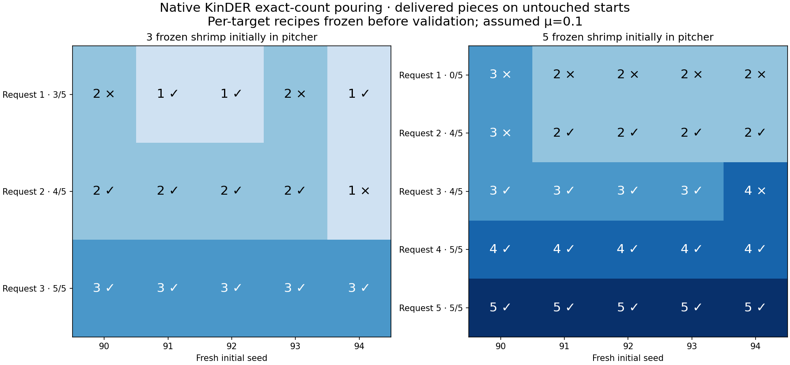

# Frozen-shrimp requested counts: three and five pieces · 2026-10-28

**TL;DR:** Native pouring can produce every requested count on selected starts, but the current partial-count controller is not consistently successful across new packings. On five untouched starts per request, three initial pieces score **3/5, 4/5, 5/5** for requests 1–3; five initial pieces score **0/5, 4/5, 4/5, 5/5, 5/5** for requests 1–5. Exact-one is the main unresolved case. These are observed counts, not population reliability estimates.

## Fixed recipes on untouched starts

Every row uses assumed sliding friction μ=0.1, centered aim, a fixed 1 Hz horizontal sideways wiggle, and the same mouth-crossing feedback controller. Tilt, peak amplitude and maximum feeding duration remain independent parameters. Each recipe was frozen before seeds 90–94; those outcomes were not used for further tuning.

| Initial pieces | Request | Tilt | Peak amplitude | Feed budget | Delivered on seeds 90/91/92/93/94 | Full success |
| --- | --- | --- | --- | --- | --- | --- |
| 3 | 1 | 90.5° | ±8mm | 30s | 2 / 1 / 1 / 2 / 1 | 3/5 |
| 3 | 2 | 90.5° | ±8mm | 30s | 2 / 2 / 2 / 2 / 1 | 4/5 |
| 3 | 3 | 92° | ±15mm | 30s | 3 / 3 / 3 / 3 / 3 | 5/5 |
| 5 | 1 | 89.75° | ±8mm | 30s | 3 / 2 / 2 / 2 / 2 | 0/5 |
| 5 | 2 | 90.5° | ±4mm | 30s | 3 / 2 / 2 / 2 / 2 | 4/5 |
| 5 | 3 | 90.5° | ±8mm | 30s | 3 / 3 / 3 / 3 / 4 | 4/5 |
| 5 | 4 | 90.5° | ±8mm | 30s | 4 / 4 / 4 / 4 / 4 | 5/5 |
| 5 | 5 | 92° | ±15mm | 30s | 5 / 5 / 5 / 5 / 5 | 5/5 |

Success requires the exact number in the tray, every remaining piece retained in the pitcher, all pieces settled, and physical pitcher placement completed. No floor spills or skill errors occurred in these 256 trials. A wrong count still fails.

## Actual native videos

[Three pieces: selected successes for requests 1/2/3](../figures/pouring3d-frozen-counts-three-success.mp4)

[Three pieces: fresh exact-one and exact-two failures](../figures/pouring3d-frozen-counts-three-failure.mp4)

[Five pieces: selected successes for requests 1/2/3/4/5](../figures/pouring3d-frozen-counts-five-success.mp4)

**The exact-one chapter in the five-piece success reel is a known-start calibration success, not a fresh-start success.** Its recipe scored 0/5 on the fresh starts. The remaining four chapters are selected fresh-start successes. Every chapter starts from a fresh pitcher reset. Native support motions are 4×, the entire Pour skill is 1×, and the clear pitcher reveals the rigid shrimp proxies.

[Five pieces: nearest-count failures for requests 1/2/3/4](../figures/pouring3d-frozen-counts-five-failure.mp4)

The request-four failure is from a known start; all five fresh request-four trials passed. No fresh request-five failure occurred. All 14 video replays exactly match their original initial, after-pour and final snapshots and every recorded motor-state hash.

## Was this only a shared-recipe problem?

The initial three-piece check reused the earlier successful request-two recipe for all targets. On seeds 80–84 this scored 1/5,5/5,3/5. Raising the all-three recipe to 92° and ±15 mm recovered 5/5 known starts and 5/5 untouched starts. The one-piece problem persisted across coarse and fine parameter searches.

The five-piece coarse search found all five requested counts on calibration seed 60. Two candidates per target were then checked on seeds 61–64, followed by finer checks at the problematic boundaries. Best chosen recipes scored 4/5,5/5,4/5,4/5,5/5 on the known starts. That tuning score did not predict the fresh exact-one result.

Allowing different parameters for each known start still left unsolved starts in the bounded search:

| Initial pieces | Request | Known starts with any successful tested parameters |
| --- | --- | --- |
| 3 | 1 | 1/5 |
| 3 | 2 | 5/5 |
| 3 | 3 | 5/5 |
| 5 | 1 | 4/5 |
| 5 | 2 | 5/5 |
| 5 | 3 | 4/5 |
| 5 | 4 | 4/5 |
| 5 | 5 | 5/5 |

Known starts were 80–84 for three pieces and 60–64 for five pieces. No tested success was found for three-piece exact-one on 80/82/83/84; five-piece exact-one on 63; five-piece exact-three on 64; or five-piece exact-four on 61. Search coverage differs by start. This does not prove no successful parameter setting exists.

## Why partial counts fail

The saved mouth observations show paired releases. On three-piece seed 80, one piece crossed the mouth and a second followed 0.1 s later during the physical return. On five-piece seed 63, two pieces entered the outbound set in the same 100 ms observation tick. Feedback cannot return an already escaping second piece to the pitcher.

Twenty finer three-piece settings on seed 80, spanning 90.30–90.45°,2–10mm amplitudes and a 60 s budget, all delivered 0 or 2. At90.5°/8mm, cutting the budget to 17–19.6s yielded 0;19.7–19.8s yielded 2. On five-piece seed 63, six shorter cutoffs from 0–1.8s also yielded 0 or 2. Changing time alone did not produce exactly one in these checks.

Other boundaries also skipped the requested count: on five-piece seed 64, amplitudes 5/6/7mm at 90.5° delivered 2/4/4 when requesting 3. On seed 61,90.5° with 9/10/12mm delivered 3/3/5 when requesting 4;90.6/90.65/90.7° with 8mm delivered 3/5/5. Parameters affect success and failure, but this evidence does not establish that every initialization admits a successful setting.

## Five-piece model and reset

The additive five_frozen module and five-frozen-shrimp-pour asset retain the same clear Winco pitcher, tray, robot, 3 g seven-capsule rigid shrimp and contact assumptions. Exact goals and readiness count all five bodies. Three pieces spawn on a 22 mm bottom ring; two spawn above them with a clear gap and settle under native gravity. Ten initial seeds passed containment, settling and raw reset non-penetration checks.

The earlier three-piece scene remains unchanged for comparison. Its 24 mm reset ring can initially intersect the pitcher wall by about 0.5 mm before settling, found during this packing audit. Fixing that older reset would be a new physical model and needs new validation. Neither reset artificially arranges pieces during robot execution.

The frozen designation assumes individually separated frozen cooked shrimp. It adds no thermal phase change, deformation, adhesion, ice bonds, glaze geometry or melting. μ=0.1 remains an unmeasured sensitivity assumption, not a calibrated frozen-food coefficient. Robot recovery and learning-provider integration are separate from this native feasibility study.

## Recommendation

Keep the environment experimental. Exact-count goals and three independent controls are implemented, and both successful and unsuccessful parameters exist, but fresh partial-count reliability and per-start feasibility remain open. Before calling the full task set ready for practice, repair/audit the reset distribution and validate a release-control policy that can separate paired departures. A fixed earlier observation/return rule could preserve the same three learnable parameters; that is a proposed next experiment, not a result here.

## Reproducibility

256 trials in 13 immutable batches; 268,956 trial motor rows; 14 exact native replays. Source hashes/copies, fixed plans, result snapshots, feedback observations, traces, worker logs and timing records are in artifacts/pouring3d-frozen-counts-20261028. Every quantitative trial completed once. No trial outcome was omitted or replaced.

The initial three-fixed batch included an unused five-piece source file whose reset ring was subsequently corrected from 24 mm to 22 mm; the three-piece executable dynamics and assets were unchanged and the original snapshot is retained. All later batches used an immutable copied runtime so first-class integration work and branch rebasing could proceed independently.

One queued video replay stopped before simulation because rebasing changed the launch wrapper hash. Inspection showed only temporary-directory setup and its diagnostic output changed. The original failed attempt and manifest are preserved; a separate amended replay protocol records the two wrapper hashes and diff. That replay must still reproduce every original physical state/trace exactly, and did. No physical source or model change was accepted.

The user authorized bypassing run-heavy. SweepRunner used memory-capped workers in the shared agents.slice, single-thread BLAS/OpenMP, at most 24 concurrent simulation workers across batches. Eleven targeted five-piece, frozen-label, feedback and geometry tests pass; the new module and tests pass Ruff/format checks, and the 247-source-file pre-integration typecheck passed.

[All trial outcomes, per-seed validation, reset audit and replay receipts](data/pouring3d-frozen-counts.json)
