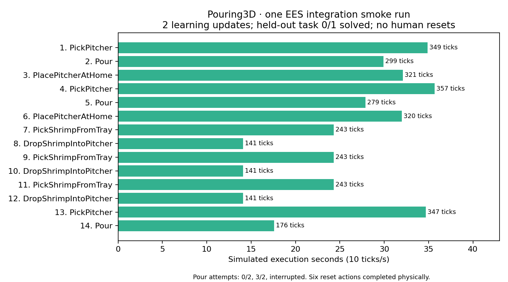

# Frozen-shrimp pouring: practice integration · 2026-10-28

**TL;DR:** The native environment now runs through the normal practice and evaluation pipeline with typed skills, three independent pour controls, physical robot recovery, separately priced human reset, and native motion replay. This is an experimental environment. Neither reliable partial counts nor learning improvement is established.

## Implemented contract

The task requests exactly k of N frozen-shrimp rigid proxies, N=3 or 5. The robot grasps the clear pitcher's handle, pours toward the tray center, and places the pitcher at home. The learned parameters are tilt, peak sideways wiggle amplitude, and maximum feeding time. Count is supplied by the task. Feedback observes distinct mouth departures at 10 Hz and initiates physical return; it cannot stop a second already-escaping piece.

The [complete API and run instructions](../../src/hitl_pmp/environments/pouring3d/practice/README.md) list skills, predicates, parameter bounds, costs and limits. The new adapter is additive; old cube and native diagnostic interfaces remain available. Practice never silently resets after a failure. Human reset respawns only payload and preserves robot/vessel state and simulation time; intervention cost belongs to the practice protocol.

Robot recovery pinches the curved body and physically drops it into the pitcher. Explicit shrimp–rubber-pad contacts use μ=0.6, matching the native lower-pad declaration. The previous priority override incorrectly applied the low plastic-contact coefficient to those pads too. This is a contact-model assumption, not measured shrimp friction. Pitcher/tray contacts remain μ=0.1 in these checks. The seed-70 pick/pour/place sequence is byte-identical across this change for 965 joint states; that is a single-seed regression, not general reliability evidence.

## Integration checks

| Check | Observation | Scope |
| --- | --- | --- |
| Native successful pour and placement | Seed 70 delivers 2 of 3 with 90.5°/8 mm/30 s | Selected deterministic start |
| Physical tray recovery | First selected piece picked/dropped successfully | Accessible placement |
| Physical floor recovery | Pick/drop succeeds from an explicitly initialized open-floor fixture | Not an arbitrary spill distribution |
| Human reset | Only payload moves; robot, vessels, time and motor ticks unchanged | Caller charges intervention separately |
| Interrupted skill | Three completed ticks retained; state is adopted without reset | Budget handling |
| Recorded motion | Each skill groups its ticks; replay restores exact qpos/qvel/time | Physics is not rerun for rendering |
| EES smoke | 3600 robot ticks, 2 learning updates, 1 evaluation, 0 human resets | Pipeline check, not efficacy study |
| Held-out evaluation | 0/1 solved | Overpour, recovery-drop failure, then no plan |

The smoke run sampled two completed pours: zero and three delivered when requesting two. It then physically returned all three pieces through six successful pickup/drop actions, picked the pitcher again, and was interrupted in its third Pour by the declared 3600-tick budget. Execution-completion flags in generic recording action rows do not mean exact-count success; native skill traces and measured predicates carry that outcome.

[Actual complete three-piece robot reset from EES practice, 4×](../figures/pouring3d-practice-robot-reset.mp4)

This reel is a selected successful recovery sequence from the actual practice recording. A separate seed-70 recovery attempt lost a near-wall grasp and subsequent floor pickups were blocked by the tray. That trial retained the displaced state and finished with an explicit human reset. General robot-reset reliability remains unresolved.

## Count feasibility and remaining work

The [separate frozen-count study](2026-10-28-frozen-shrimp-counts.md) contains 256 trials and 14 exact native video replays. Fresh-start success was 3/5, 4/5, 5/5 for requests 1–3 with three initial pieces, and 0/5, 4/5, 4/5, 5/5, 5/5 for requests 1–5 with five. Those trials used the frozen pre-integration native runtime. They do not validate every new recovery-generated packing or the rubber-pad correction across all seeds.

The benchmark can now support experiments, but promotion to a reliable full-count task set needs a reset-distribution audit (including the old three-piece pre-settling overlap), release control that separates paired departures, robust recovery near tray walls, and a held-out learning comparison. Frozen shrimp remain rigid separated proxies with uncalibrated contact coefficients; freezing, deformation and adhesion are not simulated.

## Reproducibility

Artifact root: artifacts/pouring3d-practice-integration-20261028. The runner-rebased smoke completed under the rebased integration code. Its original recording wrote full motor states before action labels; a regression test exposed this association defect. The recording hook was corrected without changing physics, and runner-final repeats the same declared configuration with the corrected hook. The final run completed with the same two learning updates and 0/1 held-out result; all 3601 recorded physical states match the prior run exactly. Original outputs are retained. The reset reel groups the original motor states by the following action boundary, without rerunning policy or physics.

All trials use SweepRunner; the final smoke has a 6 GB memory cap. The user explicitly authorized bypassing run-heavy. No default human duration is claimed as measured: the example cost file assumes 100 control-tick equivalents at 10 Hz.

[Integration outcomes, action records and source hashes](data/pouring3d-practice-integration.json)
