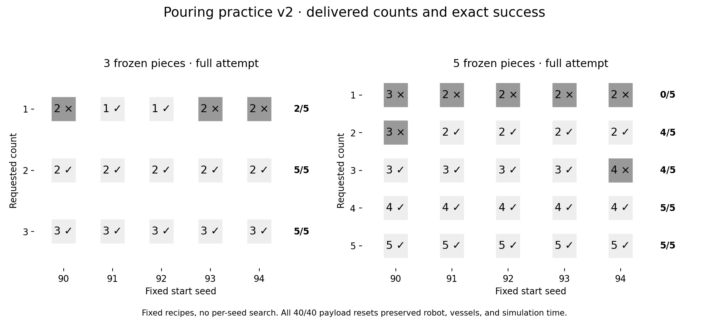
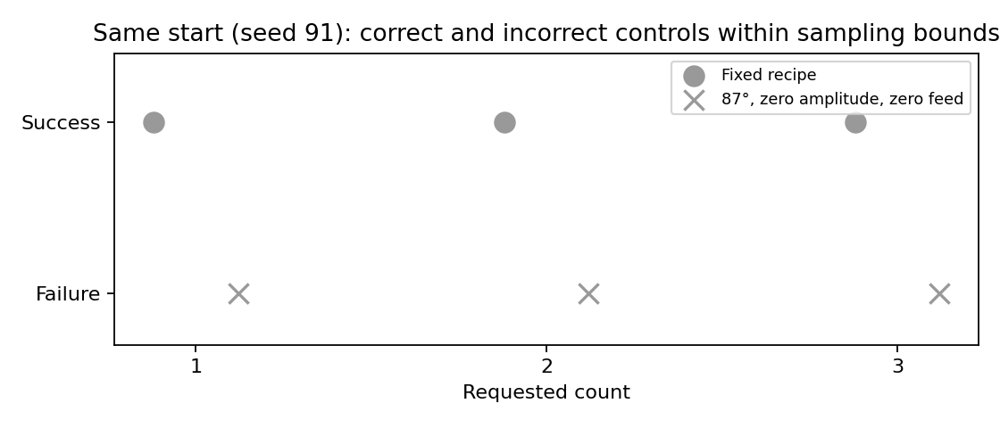
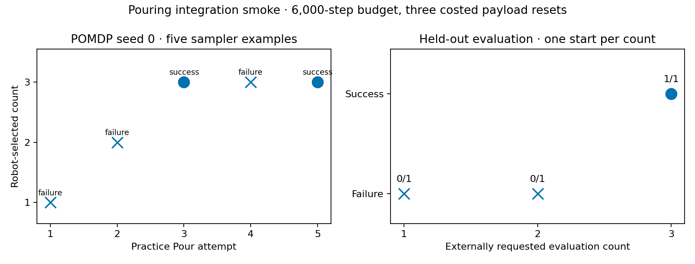

# Pouring practice integration: robot-selected counts

**Later interface update:** the shared-sampler/count-conditioned learner below is
historical. The final interface uses independent Pour1/Pour2/Pour3 skills; see
[the separate-skill integration](2026-10-28-pouring-separate-skills.md). These
recorded outcomes are retained unchanged; the physical controller is unchanged.

The native environment now supports the standard POMDP practice runner with one
shared Pour sampler and count-conditioned competence beliefs. The robot selects
`Pour(k)` during practice; each held-out task fixes `Goal(request_k)`. A wrong
count can be successful for the attempted skill but cannot satisfy another task.
No round-robin count curriculum is imposed on practice.

## Current fixed-recipe feasibility

Practice physical model version 2 removes the three-piece spawn's initial wall
intersection by using the audited 22 mm ring. Both initial and human-reset
packings preserve variation. Native physics, friction hypotheses and the pour
law otherwise remain as documented in the [practice README](../../src/hitl_pmp/environments/pouring3d/practice/README.md).

Five fixed starts (90–94) per request; the existing recipes were not retuned.
Success requires the exact split, settled pieces, no spills and physical pitcher
placement. These are current integrated results, not a learned-policy evaluation.

| Starting pieces | Request 1 | Request 2 | Request 3 | Request 4 | Request 5 |
| --- | --- | --- | --- | --- | --- |
| 3 | 2/5 | 5/5 | 5/5 | — | — |
| 5 | 0/5 | 4/5 | 4/5 | 5/5 | 5/5 |



All 40/40 payload resets succeeded, preserved robot/vessel positions, and consumed
no simulator ticks. Human reset has an explicitly charged cost and duration in
the experiment runner; zero native ticks does not mean free intervention.
Raw-reset collision checks separately cover ten resets for each payload count.

Historical pre-integration scores remain in the earlier experiment logs. They
are not estimates of this repaired three-piece distribution.

## Correct and incorrect controls exist within the sampling bounds

On the same start (seed 91), the fixed recipes succeed for requests 1, 2 and 3.
Changing to 87 degrees, zero amplitude and zero feeding duration delivers zero
pieces for all three requests. Both choices lie within the default sampler
bounds. This is a joint control comparison, not an isolated sensitivity estimate
for each parameter. Three additional 60-degree diagnostic trials also fail but
lie outside the default tilt sampling range.

| Request from three | Existing recipe | 87 degrees / zero wiggle / zero feed |
| --- | --- | --- |
| 1 | 1/1 | 0/1 |
| 2 | 1/1 | 0/1 |
| 3 | 1/1 | 0/1 |



## Actual native videos

- [Three-piece successes, requests 1/2/3](../figures/pouring3d-practice-v2-three-success.mp4)
- [Three-piece exact-one failure](../figures/pouring3d-practice-v2-three-failure.mp4)
- [Five-piece successes, requests 2/3/4/5](../figures/pouring3d-practice-v2-five-success.mp4)

These reconstruct recorded native joint states. Support motions run at 4x, the
complete Pour at 1x. Chapters include the explicit human payload reset. There is
no current five-piece request-one success among these five starts.

## End-to-end POMDP check

One seed, 6,000 practice-budget steps, nine learning updates, three costed human
payload resets. The robot chose counts **1, 2, 3, 3, 3**. The single Pour sampler
received five examples: two successes and three failures. Counts are sampler
inputs; theta, amplitude and duration remain the three continuous outputs.

| Evaluation request | Held-out successes | Termination |
| --- | --- | --- |
| 1 of 3 | 0/1 | no plan after failed recovery |
| 2 of 3 | 0/1 | no plan after failed recovery |
| 3 of 3 | 1/1 | exact goal achieved |



The charged budget comprises 5,691 robot ticks, 300 human-duration equivalents,
and nine STOP steps. Human monetary cost is 3 units, under the explicitly
uncalibrated preset. The run exits successfully and writes its timing, snapshot,
state recordings and per-task results. This verifies training plumbing, not
learning improvement: only one training seed and one evaluation per count were
used, with no initial-policy comparison.

The POMDP deployment-value surrogate is one Pick-Pour-Place attempt averaged over
the evaluation counts. It forecasts neither cross-count transfer in the shared
sampler nor recovery after a wrong split. Real evaluation executes the physical
skills and can replan within its separate 2,500-tick task budget.

A separate EES diagnostic exposed a baseline limitation: with no assigned-goal
phase it can repeatedly practice Wait. Random bootstrap discovers Pour, but does
not prevent a later Wait loop after failed recovery. Its two Pour examples were
both failures; favorable evaluation outcomes are not evidence of learning. The
POMDP integration above supplies the demonstrated autonomous count selection.

## Reproduction and provenance

Use the committed `pouring3d-balanced` preset. The smoke overrides the larger
benchmark defaults as follows:

```bash
scripts/with_env.sh python -m scripts.run_sweep \
  --env pouring3d --methods pomdp --num-seeds 1 --max-workers 1 \
  --results-root results/pouring3d-smoke \
  --shared-args '--preset pouring3d-balanced --practice-step-budget 6000 --measurement-interval-steps 6000 --num-test-tasks 3 --no-initial-measurement --record-motion all --no-scene-bg --pomdp-search-depth 4'
```

Implementation commit: `8e695cee4`; native dependency:
`c85dbbc50ddac6eb59e8b5e00d7cc942cdd691fe`. The current integration's Python AST
matches the frozen runtime used for the reported POMDP run. Fixed-recipe physics
was frozen separately before the learner addition, with the same physical model.

Local immutable source snapshots, launch commands, traces and NPZ motion live
under `artifacts/pouring3d-full-environment-20261028`. The first experimental
launcher used `runpy` in a way that broke the sweep timing writer after child
completion; it was corrected and the POMDP run was repeated successfully in
`learning-final/pomdp/0`. The report uses that clean run.

[Raw count and reset results](data/pouring3d-practice-v2.json) ·
[Clean learning-run results and timing](data/pouring3d-practice-learning.json)

Validation includes 649 learner regression checks, 84 CLI/task checks, the native
cross-count rollout and robot/human reset invariants, and lint/type/architecture
checks. Full hosted checks are tracked on the draft PR.

## Remaining scientific limits

Exact-one release is packing-sensitive; five-piece exact-one remains 0/5 here.
Recovery near the tray wall can fail or displace a vessel. The payload-only human
reset does not silently repair a displaced robot or vessel. A longer multi-seed
learning curve and validation on robot-generated packings are still needed to
establish useful learning gains. Those limits do not prevent running the declared
experimental environment through the standard practice/evaluation pipeline.
