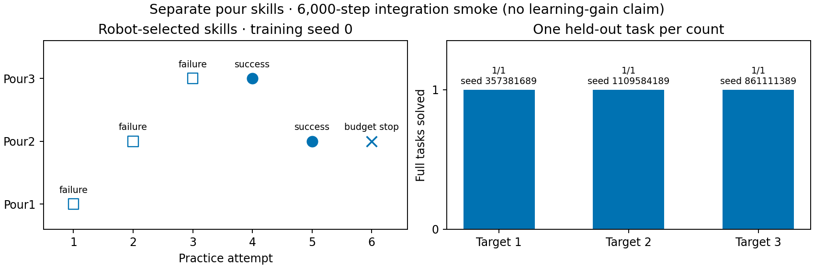

# Separate pouring skills with the existing practice algorithm

The three-piece environment exposes `Pour1`, `Pour2`, and `Pour3`. Each has an
independent parameter sampler and competence belief, and all use the same native
feedback controller. Tilt, horizontal wiggle amplitude, and maximum feeding time
remain learned parameters. Practice chooses a skill; evaluation specifies the
required exact count. The optional five-piece variant follows the same naming
rule through `Pour5`.

The previous count-conditioned belief lookup and `PouringPracticeDomain` were
removed. The existing POMDP observation, forecast, search, and cost rules now
handle every sampler declared by the skill contracts rather than one designated
sampler. Deployment value uses a generic configured distribution of fixed skill
plans (PickPitcher, PourN, PlacePitcherAtHome), with no pouring-specific belief
class. This retains the prior single-attempt value approximation; it does not
forecast recovery or transfer between independently trained skills.

Static CountN predicates restrict each skill to its fixed request object. Action
encoding also rejects mismatched bindings. Native action IDs and physics remain
unchanged, while recording names identify the public PourN skill.

## Native integration smoke

One training seed (0), 6,000 budgeted control-step equivalents, persistent
practice, three charged human payload resets, and one held-out evaluation for
each count. This is an integration check, not a learning-gain experiment.
There was no initial-policy measurement or multi-seed comparison.

| Skill | Completed training labels | Held-out full task | Evaluation seed | Control ticks |
| --- | --- | --- | --- | --- |
| Pour1 | failure | 1/1 | 357381689 | 1608 |
| Pour2 | failure, success | 1/1 | 1109584189 | 850 |
| Pour3 | failure, success | 1/1 | 861111389 | 819 |

Practice selected Pour1, Pour2, Pour3, Pour3, Pour2, then Pour2. The final
attempt was interrupted at the budget and contributed no training label. The
saved checkpoint contains three distinct samplers with label arrays `[0]`,
`[0, 1]`, and `[0, 1]`. Pour1 therefore has no successful training example and
its sampler is still uninformative.

**The count-one evaluation is full-task success after recovery, not successful
Pour1 execution.** Its pour failed; later robot recovery changed the physical
split until the task goal held. Counts two and three succeeded on their first
pour. No human actions were available during evaluation. Placement terminates
when the task goal holds, so an interrupted placement action is not a failed
full task.

[All three native evaluation tasks, including count-one recovery](../figures/pouring3d-separate-skills.mp4)

The replay preserves every pour at 1x and support motion at 4x, with a task reset
between chapters. It uses recorded native states with the usual lab background;
it does not rerun dynamics or select only successful actions.

## Validation and provenance

The learner, CLI, pouring-contract, task-stream, and native-reset regression
suite passed 751/751 checks. Generic two-sampler tests check independent training,
competence updates, and imagined search branches. Existing tossing and sweeping
tests are included. The additional preset/prototype suite passed 20/20 checks. Type checking, Ruff, formatting, and architecture checks pass.

The prior draft's CI exposed a preset-list assertion missing the two new presets
and a historical cube test that assumed every contact-rich recovery grasp always
succeeds. The preset assertion now includes the new presets. The cube test still
requires physical pickup/drop recovery and verifies that a failed lift remains a
reported failure with the cube unrecovered; restoring readiness then requires an
explicit human intervention. This does not change the prototype's physics.

Immutable source hashes, selected parameters, training labels, per-task outcomes,
run timing, and status are in [the raw data](data/pouring3d-separate-skills.json).
The source snapshot is under
`artifacts/pouring3d-separate-skills-20261028/runtime`, and the completed run is
`learning-checked/pomdp/0` under that artifact root. The initial launch used an
invalid CLI flag and exited before training; its output remains separately in
`learning/pomdp/0`. The corrected run completed through SweepRunner under a
12 GiB memory cap, one worker.

Historical [practice-v2 feasibility](2026-10-28-pouring-practice-v2.md) and
[earlier onboarding](2026-10-28-pouring-practice-integration.md) results are
preserved. Their learning policies differ from this separate-skill version.
The native contact hypotheses and physical model version remain unchanged.
