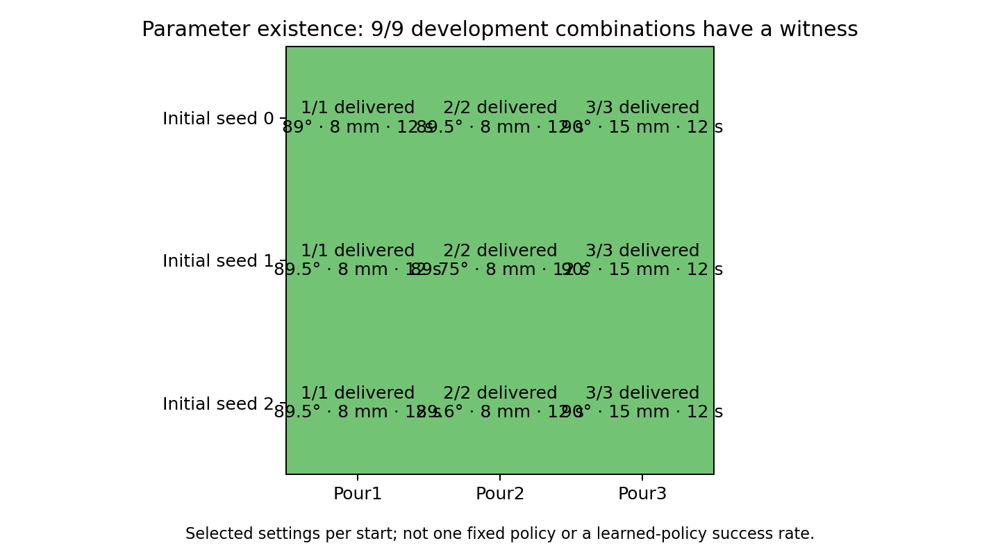

# Three-potsticker environment: parameter existence and launch gates

## TL;DR

Selected joint-feedback recipes achieve every requested count on development seeds
0, 1 and 2: **9/9 seed/target combinations have an existence witness**. This is not
an empirical success rate for one fixed policy and is not a learning result.
Individual physical recovery witnesses exist; uninterrupted recovery and six method
pilots still determine launch readiness.

## Question / goal

Validate that the ordinary three-dumpling practice environment has feasible and
infeasible parameter settings, physical recovery, and payload-only human reset.

## Background

Three rigid frozen-potsticker proxies start in the clear handled pitcher on a prep
table. The receiver is a heavy cast-iron skillet on a separate stovetop. Motion uses
native TidyBot motors and contact dynamics. These results supersede neither the old
shrimp evidence nor the earlier ten-piece feasibility investigation.

## Hypothesis

The same timed controller can support three separately learned skills, with correct
settings depending on the initial arrangement. The learning algorithms need no
pouring-specific competence or sampler class.

## Guidance given

Use Pour1/Pour2/Pour3, joint feedback, separate tilt/amplitude/duration parameters,
fixed center aim, and the existing EES/Curtis/expectimax methods. Human reset must
respawn payload only. Check the whole practice loop before overnight experiments.

## Methods

The pour uses joint tracking and a fixed initial full-load calibration, with no
food-count cutoff or simulated lookahead. Bounds are 87–95 degrees, 0–25 mm
horizontal sideways peak amplitude, and 0–30 s feeding. The selected settings below
are diagnostic witnesses and are not injected into pilot samplers. Seeds 1/2 were
searched from saved states after physical pickup and transport; seed 0 witnesses
run from the initial scene through placement. Searches use development seeds only.

## Results

| Initial seed | Requested count | Tilt (degrees) | Peak amplitude (mm) | Feeding (s) | Delivered |
| --- | ---: | ---: | ---: | ---: | ---: |
| 0 | 1 | 89 | 8 | 12 | 1 |
| 0 | 2 | 89.5 | 8 | 12 | 2 |
| 0 | 3 | 90 | 15 | 12 | 3 |
| 1 | 1 | 89.5 | 8 | 12 | 1 |
| 1 | 2 | 89.75 | 8 | 12 | 2 |
| 1 | 3 | 90 | 15 | 12 | 3 |
| 2 | 1 | 89.5 | 8 | 12 | 1 |
| 2 | 2 | 89.6 | 8 | 12 | 2 |
| 2 | 3 | 90 | 15 | 12 | 3 |

The [witness manifest](2026-10-30-potsticker-readiness.json) records the native artifact
paths and source fingerprints. The fixed seed-zero recipes underpour targets 1 and 2
on seeds 1/2; tuning the tilt supplies the witnesses above. Repeated human resets
also change the packing, so this table does not define a universal controller.

The original seed-zero target-2 sensitivity check additionally found incorrect
settings with tilt 89 degrees, with zero wiggle amplitude, and with zero feeding
duration. Each differed from the successful setting on the same prepared state.
Those checks are in `artifacts/potsticker-joint-only-v1/parameter-sensitivity.json`.

Integration/shared-method/planning checks: 199/199 passed. Native shape, reset and
joint-only feedback checks: 9/9 passed. These software checks do not substitute for
physical sequence validation. The current force-regulated recovery check passes all three naturally landed pan
poses, each tested separately from the same post-pour checkpoint, with zero forbidden
contacts. Pick/drop costs are 801, 797 and 933 control ticks. These selected pose
witnesses are not a 3/3 reliability estimate across randomized starts. The force target
is a minimum, not a force cap: recorded normal forces range from about 1.9 to 14.3 N
across these grasps. Friction and actuator limits are unchanged. Raw evidence is in
`artifacts/potsticker-readiness-v25/`. The following joint-settling fix and uninterrupted
cycles are being validated separately; pilot outcomes remain pending.

## Recommendation / remaining gates

Keep the environment draft until uninterrupted robot recovery, repeated cycles and
the six EES/Curtis/expectimax pilots pass their operational checks. Pilots must report
initial/final exact-count scores separately from full tasks with recovery, every seed,
training labels by skill, robot ticks, human resets, interrupted attempts, and
STOP/Wait/crash reasons. No ranking or generalization claim follows from this search.
