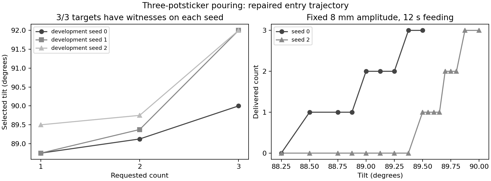
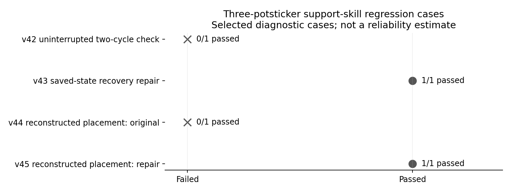

# Three-potsticker pouring after the entry-trajectory repair

## TL;DR

The repaired entry trajectory has **9/9 selected development seed/count existence
witnesses**. Seed zero additionally has **3/3 full-scene demonstrations**, from
pickup through pitcher placement. These are selected settings, not a fixed-policy
success rate. Repeated robot recovery and the six learning pilots remain launch gates.

## Question / goal

Check the current three-potsticker environment after correcting unintended contacts
on food transport and the next pitcher pickup. Preserve the
[earlier results](2026-10-30-potsticker-readiness.md); their selected recipes precede
the changed entry trajectory and must not be silently transferred to this revision.

## Methods

The joint-feedback pour uses tilt, horizontal sideways amplitude and feeding duration.
It has no food-count cutoff and no simulated lookahead. Seeds 1/2 use checkpoints
after physical pickup and transport; seed zero runs from the initial scene through
placement. No witness is injected into a learned sampler. The
[manifest](2026-10-30-potsticker-repaired-entry.json) records result paths, hashes and
source fingerprints. Recovery-only changes after preparation do not change the
fresh-scene entry branch: its initial hand-to-pitcher XY distance is 0.450 m, above
the 0.25 m threshold for the new post-recovery aisle reorientation.

## Results

| Development seed | Requested | Tilt (degrees) | Amplitude (mm) | Feeding (s) | Delivered |
| --- | ---: | ---: | ---: | ---: | ---: |
| 0 | 1 | 88.75 | 8 | 12 | 1 |
| 0 | 2 | 89.125 | 8 | 12 | 2 |
| 0 | 3 | 90 | 15 | 12 | 3 |
| 1 | 1 | 88.75 | 8 | 12 | 1 |
| 1 | 2 | 89.375 | 8 | 12 | 2 |
| 1 | 3 | 92 | 15 | 12 | 3 |
| 2 | 1 | 89.5 | 8 | 12 | 1 |
| 2 | 2 | 89.75 | 8 | 12 | 2 |
| 2 | 3 | 92 | 15 | 12 | 3 |

On the same seed-zero Pour2 prepared state, changing tilt from 89.125 to 88.75
degrees delivers one; changing feeding duration from 12 to zero seconds delivers
zero. Both are incorrect settings. Zero amplitude and 25 mm amplitude each still
deliver two at the successful tilt/duration. Thus this state demonstrates sensitivity
to tilt and duration, but does not establish that amplitude is necessary.

The v35 follow-up also tests zero and 25 mm amplitude at the selected Pour2 tilt
on seeds 1 and 2: **4/4 deliver two**. Across all three development states, those
extreme-amplitude probes succeed **6/6**. This is evidence of tolerance at these
selected tilts, not evidence that amplitude never affects the outcome elsewhere.

The v28 human-reset checks pass **6/6 ready-state returns**: two consecutive attempts
for each requested count, zero audited unintended contacts, and exact preservation
of non-payload positions, velocities, simulation time and controller ticks during
reset. Only **2/6 pours** are exact with those fixed recipes; these are different
metrics. Delivered pairs are 2/1 for target 1, 3/1 for target 2 and 3/1 for target 3.

The v30 robot run returned all three pieces, then failed at the next pitcher pickup:
the right gripper coupler contacted the pitcher during arm reorientation. The new
entry branch backs into the aisle before reorientation. The v34 uninterrupted
two-cycle check is testing that repair. The v33 individual retry diagnostic recovered
the remaining pan piece with zero audited contacts, but its starting pan was already
displaced; this is not a full ready-state recovery witness.

### Subsequent repeat-cycle finding

The completed v34 run failed: the second pickup succeeded but its descending finger
spring linkage touched the prep table (2,466 audited substeps; maximum penetration
0.609 mm). During the second reset, a dumpling left the fingers before commanded
release and landed in the pitcher; the controller reported grasp loss and stopped.
An isolated next pickup after floor recovery also brushed the pitcher during approach
and failed the handle-contact check. The corresponding tabletop-start pickup passed
without audited contacts. These are retained failures, not clean repeated-cycle passes.

Before those next-pickup diagnostics, the latest v36 floor/tabletop physical pick/drop
fixtures passed **2/2**, both returning ready with zero audited unintended contacts.
The v38 repair partially closes the open gripper linkage in the aisle before the next
handle approach, includes the pitcher in those approach clearance checks, and accepts
an early drop only if the piece is measured inside the pitcher during final centering.
It still rejects spills or losses elsewhere in transport. Physical validation is pending.

### Outward handle approach and fresh pilot candidate

The v38 tabletop-start next pickup passed, but the floor-start pickup still brushed
the rim. The v40 six-centimeter outward hover was rejected before arm motion because
it fell inside the arm's reachable workspace boundary. The v41 controller searches
three bounded geometric hover offsets (6, 4, 2 cm), retaining the first feasible
path. Both saved recovery starts then complete the next handle grasp and lift:
**2/2 pass, zero audited unintended contacts**. No body pose or velocity is edited.

Current software validation is **202/202** integration/shared-method/planning checks,
plus **9/9** legacy station/placement regressions; mypy and tracked-source lint pass.
A fresh six-run diagnostic pilot batch and a final two-cycle physical check will use
this frozen controller. The overnight study remains gated on their completed results.

The v39 short-duration sensitivity check adds a matched amplitude counterexample:
seed zero, tilt 89.125 degrees, feeding 3 seconds, target two. Zero amplitude delivers
two settled pieces; 25 mm also delivers two but fails the settling requirement after
the fixed observation window. This is an amplitude-dependent skill success/failure,
not evidence that amplitude changed the delivered count in that pair.

Current targeted integration/shared-method/planning tests: **200/200 passed**.
Typechecking passes for 269 source files. Full CI passed on the preceding pushed
revision; the final recovery changes require their own CI run.

## Recommendation

### October 30 follow-up: aborted candidate and retreat repair

The v42 uninterrupted check on `660a0200a` failed during the second cycle's pan
recovery, with two pieces inside the pitcher and one in the pan. It recorded zero
audited unintended contacts. The supervisor stopped the six diagnostic pilots at
04:07 EDT; none had completed an evaluation checkpoint. Their original outputs are
preserved under `artifacts/potsticker-pilots-20261030-660a020` and must not be reported
as completed learning results.

The failed approach was still moving the base and arm together. The retreat trace
omitted that phase and stored only arm joints, so retry requested an infeasible
vertical Cartesian retreat. The repair records measured base and arm configurations
from the start of that motion and retraces both. A regression test reproduces the
missing trace; the saved-state v43 check and a fresh uninterrupted two-cycle check
are in progress. These are not yet physical passes.

The same candidate's CI native shard encountered an IKFast extension import failure.
Its upstream lazy installer writes a shared library without synchronization. CI now
builds and imports the Kinova solver before starting parallel test workers; the next
CI run must establish whether this resolves all failures.

### October 30 follow-up: recovery replay and placement dead end

The saved v42 pre-pick integration state now completes recovery on `b222b4de5`:
**1/1 returned to ready**, with zero audited unintended contacts. The native video
is retained under `artifacts/potsticker-recovery-v43/replay/`. CI is fully green on
that commit. Della native preflight job 16477662 passed with matching source and
dependency pins; a node-local `XDG_RUNTIME_DIR` is required for its Mesa allocation.
The first preflight without that directory failed and is preserved as job 16477558.

Inspection of the aborted Curtis seed-2 practice trace found another failure: the
gripper palm clearance prevented seating a centered, upright pitcher about 17 mm
above home. Repeated placement attempts then remained blocked. Reconstructing its
recorded post-failure pose reproduces that refusal; reconstructing the earlier
pre-placement pose does not. These reconstructions lack saved solver warm starts
and commanded joint targets and are explicitly diagnostic, not exact continuations.
An uninterrupted action-sequence replay is also retained separately.

The placement repair permits physical release only within 20 mm above home,
6 mm horizontally, 3 degrees upright, 50 mm/s translation and 0.1 rad/s rotation.
It preserves the collision margins. It then verifies landing within 3 mm vertically,
10 mm horizontally and 5 degrees before withdrawing. From the same reconstructed
stranded state, the original retry fails **0/1**, while production repair passes
**1/1**, with zero audited unintended contacts. Food is already in the pan, so this
is a placement success, not a full ready-state reset. Artifacts are under
`artifacts/potsticker-placement-v44/` and `artifacts/potsticker-placement-v45/`.

The production/guard/launch tests pass **30/30**. The combined controller still
requires its own uninterrupted physical check, CI and the paired learning pilots.

Freeze and launch a new six-run pilot batch only after inspecting the repeated-cycle
result. Preserve the aborted `cd40854a0` batch separately. Report first-pour exact
counts separately from full-task success after robot recovery, and inspect STOP,
Wait, interruptions, labels, resets and costs before launching the overnight study.
