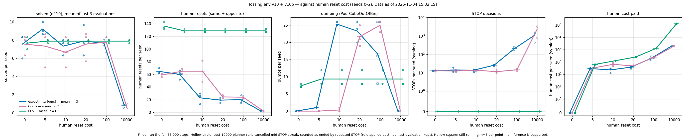
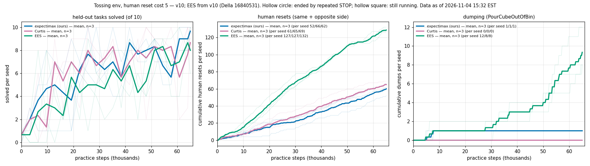
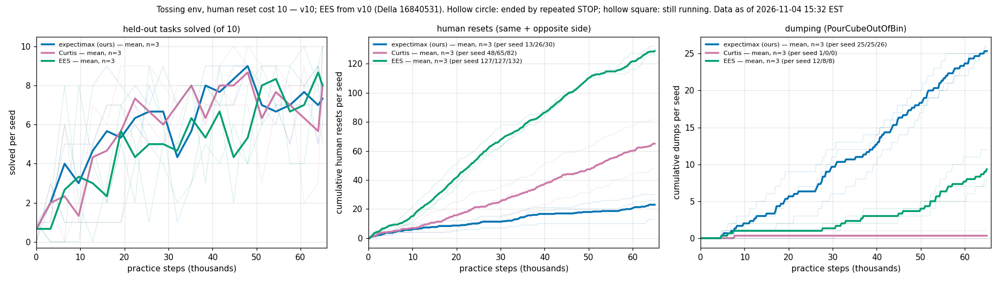
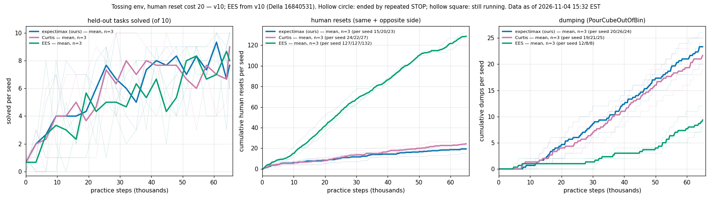
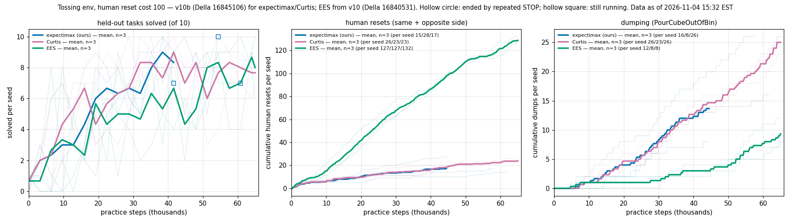
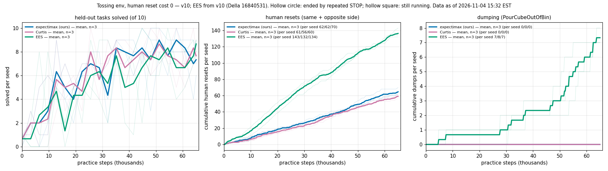
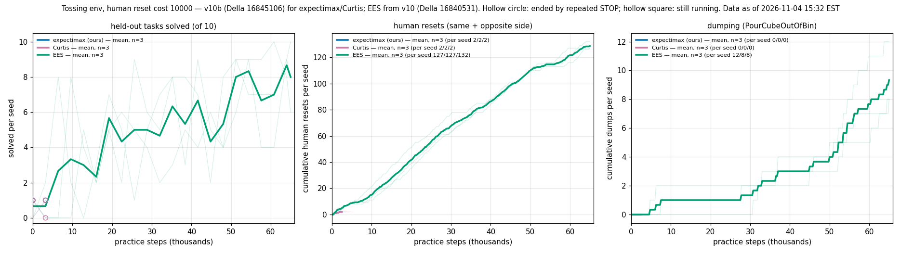

# Tossing env v10 + v10b: human-reset-cost sweep (seeds 0–2)

> **PROVISIONAL — data as of 2026-11-04 15:32 EST.** At that time 51/54 runs had ended.
> The three expectimax runs at reset cost 100 (v10b rows 1, 7 and 13) were still running,
> at 61,803, 44,611 and 57,775 of 65,000 practice steps. Their rows, the cost-100
> expectimax points and the cost-100 paired tests will be refreshed once those runs
> finish, and this note will then say so. Every other number on this page is final for
> its run.

## TL;DR

- **54 runs:** 3 arms × human reset costs {0, 5, 10, 20, 100, 10000} × seeds 0–2, on
  the tossing env (`kitchen_recycling3d`), 65,000 practice steps each.
- **Final solved (mean of the last 3 evaluations) shows no difference between arms**
  at any cost from 0 to 100. With n=3 a paired Wilcoxon cannot go below p = 0.25, and
  no paired test reached that floor on solved except at cost 5 (expectimax vs EES) and
  cost 10000. **No inference is supported.**
- **What does change with cost is how the planners practise.** Expectimax and Curtis
  both replace human resets with dumping as the price rises. Expectimax switches between
  cost 5 and cost 10, Curtis between 10 and 20. EES does not change at all: its runs are
  identical at every cost from 5 to 10000.
- **At cost 10000 both planners stop practising.** After paying for one reset of each
  kind (20,000 in human cost), all 6/6 planner runs went into an unbroken STOP streak
  (436–3,246 STOPs) and never resumed. Josh had them cancelled. They count as **ended by
  repeated STOP**, with the last evaluation (0–1 of 10) as the final score. That rule was
  applied post hoc.
- **Recommendation:** v11 with #675 (search caches), `--repeated-stop-limit 100`
  (#682), at least 6 seeds (ideally 10), and a solved metric fixed before launch.

## Question / goal

On the tossing env, how do the three arms trade human resets against their own practice
as the price of a human reset rises? Does final performance or human cost differ between
the arms at any price? The arms are expectimax (ours), Curtis and EES.

## Background

- **The tossing env** is `kitchen_recycling3d`, a re-flavour of the original Tossing3D.
  The robot tosses a cube into a bin. It can recover the cube itself by **dumping**
  (`PourCubeOutOfBin`), or ask a human to reset the cube and bin, either on the same
  side (`ResetCubeBinSameSide`) or on the opposite side (`ResetCubeBinOppositeSide`).
- **How each arm sees the price.** This is read from the launch notes; the code was read
  on main `746f77732` before launch.
  - EES prices both resets from the cost file from its first decision.
  - Expectimax and Curtis forecast a reset at the mean of the charges they have
    observed. Before the first reset to a destination, that forecast is
    1 step × the robot price 0.01 = 0.01, whatever the swept cost. **The planners learn
    the price by paying it.** Josh chose to keep this ("Keep, matches Tossing3D").
- **v10** (Della array 16840531) launched all 54 rows. 12/54 failed at start-up:
  expectimax and Curtis at costs 100 and 10000, all three seeds. Each failed in 10–26 s
  on `POMDP cost observations must be at most 20.0`. The launch passed the swept cost
  as `--human-reset-practice-cost C`, and the POMDP method asserts every skill's
  practice cost is at most `COST_MAX = 20`.
- **#676** fixed the packaging: the swept cost lives only in the cost file, and the flag
  stays at its default of 5. **v10b** (Della array 16845106) reran those 12 rows from v10's
  source plus #676's launch-script change. `src/` is identical to v10's.
- **A paired check** (expectimax, seed 0, cost file at 20, flag 5 vs 20, 1,600 steps)
  found the flag changes no decision. Taken from the v10b launch notes; not re-run here.
- **The v10b smoke audit** first failed because it did not allow a `STOP` action. No
  earlier smoke had run above cost 5 or chosen STOP. This was a gap in the audit's
  allow-list, not a defect in the run. Josh chose to fix the audit and resubmit; the
  re-gate passed.
- **A planner STOP** charges one practice step at the robot price (0.01) and ends the
  interaction. Under `--no-early-stop` the next cycle starts and the planner decides
  again, so a planner that keeps choosing STOP spins without ending the run. #682 adds
  `--repeated-stop-limit` for v11.

## Hypothesis

Stated before the runs:

- As the human price rises, the two planners shift from human resets to dumping, because
  they learn the price.
- EES, which prices resets from the start, keeps a fixed policy because its scoring does
  not trade reset cost against practice.

No prediction was registered about final solved.

## Guidance given

- Josh fixed the design on 2026-11-04:
  - costs 0, 5, 10, 20, 100 and 10000 on both resets;
  - 3 seeds, 65,000 steps, 4 evaluation workers, Della genoa, 12 GB per job;
  - rows ordered seed first, then cost, then arm.
- He kept the learned reset price for the planners ("Keep, matches Tossing3D").
- He approved the v10b rerun ("sure, go for it.") and the audit fix ("Fix audit,
  resubmit").
- At about 14:55 he had the six cost-10000 planner runs cancelled ("yep cool, do both
  please"). They count as ended by repeated STOP, with the last evaluation as the
  final score.

## Methods

- **Arms:**
  - expectimax (ours), search depth 6;
  - Curtis, determinized A* with surprise penalty w = 0.01;
  - EES.
- **Grid:** costs {0, 5, 10, 20, 100, 10000} × seeds {0, 1, 2} × 3 arms = 54 runs.
- **Budget:** 65,000 practice steps under `--no-early-stop`. Evaluations run every 3,200
  steps and at 65,000, each on 10 held-out tasks, with 4 evaluation workers and per-task
  RNG.
- **Where they ran:** every allocation in both arrays ran on a Della `genoa` node; this
  was checked with `sacct`.
- **Which root each run comes from:**
  - v10 supplies EES at every cost, and the planners at costs 0, 5, 10 and 20;
  - v10b supplies the planners at costs 100 and 10000.
- **Extraction:**
  - `analysis/kitchen_recycling3d_cost_sweep.py extract` ran with a bare `python3` on
    the Della login node, as a light read of `step_events.jsonl`,
    `evaluations/*/results.json` and `status.json`;
  - `report` then merged the two roots and wrote this page's figures and the data file
    [`2026-11-04-tossing-env-v10-reset-cost-sweep.json`](2026-11-04-tossing-env-v10-reset-cost-sweep.json).
    That file holds every run's raw series, the per-run summaries and the paired tests.
- **Metrics per run:**
  - **last solved:** the last completed evaluation;
  - **mean last 3:** the mean of the last three evaluations;
  - **human resets:** split into same side and opposite side;
  - **dumps:** `PourCubeOutOfBin` robot actions;
  - **STOPs:** planner STOP actions, and the longest run of STOPs on consecutive steps;
  - **human cost:** the sum of the charged reset costs.
- **Statistics:** arms share seeds, so each pair of arms at each cost is compared with
  an exact two-sided paired Wilcoxon signed-rank test. Zero differences are dropped and
  ties take average ranks; the enumeration is in `PairedTests`. With 3 pairs the
  smallest possible p is 2/8 = 0.25, and with 2 non-zero pairs it is 0.5.

## Results

### Final performance: no supported difference

| cost | expectimax (ours) | Curtis | EES |
|---:|---|---|---|
| 0 | 6.00, 8.33, 8.33 | 8.33, 8.00, 6.33 | 8.33, 7.67, 7.00 |
| 5 | 10.00, 9.00, 8.67 | 8.33, 5.00, 8.67 | 8.00, 7.67, 8.00 |
| 10 | 7.67, 6.33, 8.00 | 8.33, 5.00, 6.67 | 8.00, 7.67, 8.00 |
| 20 | 6.33, 7.67, 9.67 | 8.33, 5.67, 8.67 | 8.00, 7.67, 8.00 |
| 100 | 7.33, 7.67, 8.00 (*running*) | 6.67, 8.33, 8.33 | 8.00, 7.67, 8.00 |
| 10000 | 0.50, 1.00, 1.00 (*ended by STOP*) | 0.50, 1.00, 0.50 (*ended by STOP*) | 8.00, 7.67, 8.00 |

The table gives the mean of the last 3 evaluations, out of 10, for seeds 0, 1 and 2.

Paired Wilcoxon p on that metric:

- **Costs 0, 10 and 20:** every pair has p ≥ 0.5.
- **Cost 5:**
  - expectimax vs EES p = 0.25, the floor;
  - expectimax vs Curtis p = 0.5, with 2/3 non-zero pairs;
  - Curtis vs EES p = 1.0.
- **Cost 100 (provisional):** expectimax vs Curtis p = 0.75; the other two pairs
  p = 1.0.
- **Cost 10000:** both planners vs EES p = 0.25, the floor; expectimax vs Curtis
  p = 1.0.

**No p-value is below 0.25 anywhere, because none can be at n=3. No inference is
supported.** At cost 10000 the gap is large in raw numbers, 0–1/10 against 7.67–8.00/10.
But it compares two runs that stopped practising within about 5,400 steps against one
that ran all 65,000. That is a consequence of the STOP streak, not a measure of learning.

### Practice behaviour: resets give way to dumping as the price rises

Totals per seed, for seeds 0/1/2:

| cost | arm | human resets | dumps | STOPs | human cost |
|---:|---|---|---|---|---|
| 0 | expectimax | 62/62/70 | 0/0/0 | 13/12/13 | 0 |
| 5 | expectimax | 52/66/62 | 1/1/1 | 12/19/11 | 260/330/310 |
| 10 | expectimax | 13/26/30 | 25/25/26 | 11/15/15 | 130/260/300 |
| 20 | expectimax | 15/20/23 | 20/26/24 | 25/24/27 | 300/400/460 |
| 100 | expectimax (*running*) | 15/28/17 | 16/8/26 | 182/248/181 | 1,500/2,800/1,700 |
| 0 | Curtis | 61/56/60 | 0/0/0 | 12/14/12 | 0 |
| 5 | Curtis | 61/65/69 | 0/0/0 | 12/14/11 | 305/325/345 |
| 10 | Curtis | 48/65/82 | 1/0/0 | 12/14/15 | 480/650/820 |
| 20 | Curtis | 24/22/27 | 19/21/25 | 10/14/10 | 480/440/540 |
| 100 | Curtis | 26/23/23 | 26/23/26 | 16/15/12 | 2,600/2,300/2,300 |
| 0 | EES | 143/132/134 | 7/8/7 | 0 | 0 |
| 5–10000 | EES | 127/127/132 | 12/8/8 | 0 | 127, 127, 132 × cost |

- **The two planners differ in where they switch.** Expectimax goes from about 60 human
  resets and 1 dump per run at cost 5 to about 25 resets and 25 dumps at cost 10. Curtis
  makes the same switch one step later, between 10 and 20. This is raw counts from 3
  seeds; no test of the threshold is supported.
- **The planners use the same-side reset almost exclusively** (e.g. 59 same, 3 opposite
  for expectimax seed 0 at cost 0). EES uses the opposite side almost exclusively
  (6 same, 121 opposite for seed 0 at cost 5).
- **Human cost paid.** At costs 5–100 the planners paid 0.10–0.62 times EES's human cost on the same seed:
  - expectimax 130–2,800;
  - Curtis 305–2,600;
  - EES 635–13,200.

  Paired Wilcoxon p = 0.25, the floor, for both planners vs EES at every cost from 5 to
  100, with all 3 seeds in the same direction. That is the strongest result this design
  can produce, and it is still not significant. This number largely restates the design:
  EES's reset count does not depend on cost (see caveats).

### Cost 10000: the planners stop practising

All 6/6 planner runs paid for exactly one same-side and one opposite-side reset, 20,000
in total, at steps 268–506 and 1,076–1,923. Each then entered one unbroken STOP streak
that never resumed:

| run | streak (practice steps) | STOPs | last evaluation |
|---|---|---:|---|
| expectimax s0 | 2,260–3,731 | 1,472 | 1/10 at 3,200 |
| expectimax s1 | 1,883–2,318 | 436 | 1/10 at 0 |
| expectimax s2 | 1,401–2,820 | 1,420 | 1/10 at 0 |
| Curtis s0 | 2,260–5,409 | 3,150 | 1/10 at 3,200 |
| Curtis s1 | 1,872–2,663 | 792 | 1/10 at 0 |
| Curtis s2 | 1,401–4,646 | 3,246 | 0/10 at 3,200 |

STOPs are counted inclusively, so a streak from step 1,883 to 2,318 is 436 STOPs.

**Cost 100 is different.** Expectimax chose STOP 181–248 times per run, in bursts: the
longest so far are 22, 21 and 19 consecutive STOPs. Every burst so far has been followed
by more practice. Curtis at cost 100 never went beyond 3 consecutive STOPs.

### All runs

The "mean last 3" column is out of 10. For runs with fewer than three evaluations, it
averages those they have.

| cost | arm | seed | end | steps | last solved | mean last 3 | resets same | resets opp. | dumps | STOPs | longest STOP streak | human cost |
|---:|---|---:|---|---:|---:|---:|---:|---:|---:|---:|---:|---:|
| 0 | expectimax (ours) | 0 | budget | 65,000 | 6/10 (at 65,000) | 6.00/10 | 59 | 3 | 0 | 13 | 1 | 0 |
| 0 | expectimax (ours) | 1 | budget | 65,000 | 9/10 (at 65,000) | 8.33/10 | 59 | 3 | 0 | 12 | 1 | 0 |
| 0 | expectimax (ours) | 2 | budget | 65,000 | 7/10 (at 65,000) | 8.33/10 | 62 | 8 | 0 | 13 | 1 | 0 |
| 0 | Curtis | 0 | budget | 65,000 | 8/10 (at 65,000) | 8.33/10 | 61 | 0 | 0 | 12 | 1 | 0 |
| 0 | Curtis | 1 | budget | 65,000 | 8/10 (at 65,000) | 8.00/10 | 56 | 0 | 0 | 14 | 1 | 0 |
| 0 | Curtis | 2 | budget | 65,000 | 7/10 (at 65,000) | 6.33/10 | 60 | 0 | 0 | 12 | 1 | 0 |
| 0 | EES | 0 | budget | 65,000 | 8/10 (at 65,000) | 8.33/10 | 6 | 137 | 7 | 0 | 0 | 0 |
| 0 | EES | 1 | budget | 65,000 | 9/10 (at 65,000) | 7.67/10 | 6 | 126 | 8 | 0 | 0 | 0 |
| 0 | EES | 2 | budget | 65,000 | 9/10 (at 65,000) | 7.00/10 | 9 | 125 | 7 | 0 | 0 | 0 |
| 5 | expectimax (ours) | 0 | budget | 65,000 | 10/10 (at 65,000) | 10.00/10 | 49 | 3 | 1 | 12 | 1 | 260 |
| 5 | expectimax (ours) | 1 | budget | 65,000 | 9/10 (at 65,000) | 9.00/10 | 60 | 6 | 1 | 19 | 1 | 330 |
| 5 | expectimax (ours) | 2 | budget | 65,000 | 10/10 (at 65,000) | 8.67/10 | 59 | 3 | 1 | 11 | 1 | 310 |
| 5 | Curtis | 0 | budget | 65,000 | 8/10 (at 65,000) | 8.33/10 | 61 | 0 | 0 | 12 | 1 | 305 |
| 5 | Curtis | 1 | budget | 65,000 | 10/10 (at 65,000) | 5.00/10 | 64 | 1 | 0 | 14 | 1 | 325 |
| 5 | Curtis | 2 | budget | 65,000 | 8/10 (at 65,000) | 8.67/10 | 68 | 1 | 0 | 11 | 1 | 345 |
| 5 | EES | 0 | budget | 65,000 | 6/10 (at 65,000) | 8.00/10 | 6 | 121 | 12 | 0 | 0 | 635 |
| 5 | EES | 1 | budget | 65,000 | 10/10 (at 65,000) | 7.67/10 | 5 | 122 | 8 | 0 | 0 | 635 |
| 5 | EES | 2 | budget | 65,000 | 8/10 (at 65,000) | 8.00/10 | 9 | 123 | 8 | 0 | 0 | 660 |
| 10 | expectimax (ours) | 0 | budget | 65,000 | 10/10 (at 65,000) | 7.67/10 | 12 | 1 | 25 | 11 | 1 | 130 |
| 10 | expectimax (ours) | 1 | budget | 65,000 | 5/10 (at 65,000) | 6.33/10 | 25 | 1 | 25 | 15 | 1 | 260 |
| 10 | expectimax (ours) | 2 | budget | 65,000 | 7/10 (at 65,000) | 8.00/10 | 28 | 2 | 26 | 15 | 1 | 300 |
| 10 | Curtis | 0 | budget | 65,000 | 8/10 (at 65,000) | 8.33/10 | 47 | 1 | 1 | 12 | 1 | 480 |
| 10 | Curtis | 1 | budget | 65,000 | 10/10 (at 65,000) | 5.00/10 | 64 | 1 | 0 | 14 | 1 | 650 |
| 10 | Curtis | 2 | budget | 65,000 | 6/10 (at 65,000) | 6.67/10 | 81 | 1 | 0 | 15 | 1 | 820 |
| 10 | EES | 0 | budget | 65,000 | 6/10 (at 65,000) | 8.00/10 | 6 | 121 | 12 | 0 | 0 | 1,270 |
| 10 | EES | 1 | budget | 65,000 | 10/10 (at 65,000) | 7.67/10 | 5 | 122 | 8 | 0 | 0 | 1,270 |
| 10 | EES | 2 | budget | 65,000 | 8/10 (at 65,000) | 8.00/10 | 9 | 123 | 8 | 0 | 0 | 1,320 |
| 20 | expectimax (ours) | 0 | budget | 65,000 | 7/10 (at 65,000) | 6.33/10 | 14 | 1 | 20 | 25 | 3 | 300 |
| 20 | expectimax (ours) | 1 | budget | 65,000 | 6/10 (at 65,000) | 7.67/10 | 19 | 1 | 26 | 24 | 3 | 400 |
| 20 | expectimax (ours) | 2 | budget | 65,000 | 10/10 (at 65,000) | 9.67/10 | 22 | 1 | 24 | 27 | 2 | 460 |
| 20 | Curtis | 0 | budget | 65,000 | 10/10 (at 65,000) | 8.33/10 | 23 | 1 | 19 | 10 | 1 | 480 |
| 20 | Curtis | 1 | budget | 65,000 | 8/10 (at 65,000) | 5.67/10 | 21 | 1 | 21 | 14 | 1 | 440 |
| 20 | Curtis | 2 | budget | 65,000 | 9/10 (at 65,000) | 8.67/10 | 26 | 1 | 25 | 10 | 1 | 540 |
| 20 | EES | 0 | budget | 65,000 | 6/10 (at 65,000) | 8.00/10 | 6 | 121 | 12 | 0 | 0 | 2,540 |
| 20 | EES | 1 | budget | 65,000 | 10/10 (at 65,000) | 7.67/10 | 5 | 122 | 8 | 0 | 0 | 2,540 |
| 20 | EES | 2 | budget | 65,000 | 8/10 (at 65,000) | 8.00/10 | 9 | 123 | 8 | 0 | 0 | 2,640 |
| 100 | expectimax (ours) | 0 | running | 61,803 | 7/10 (at 60,800) | 7.33/10 | 14 | 1 | 16 | 182 | 22 | 1,500 |
| 100 | expectimax (ours) | 1 | running | 44,611 | 7/10 (at 41,600) | 7.67/10 | 27 | 1 | 8 | 248 | 21 | 2,800 |
| 100 | expectimax (ours) | 2 | running | 57,775 | 10/10 (at 54,400) | 8.00/10 | 16 | 1 | 26 | 181 | 19 | 1,700 |
| 100 | Curtis | 0 | budget | 65,000 | 7/10 (at 65,000) | 6.67/10 | 25 | 1 | 26 | 16 | 1 | 2,600 |
| 100 | Curtis | 1 | budget | 65,000 | 8/10 (at 65,000) | 8.33/10 | 22 | 1 | 23 | 15 | 1 | 2,300 |
| 100 | Curtis | 2 | budget | 65,000 | 8/10 (at 65,000) | 8.33/10 | 22 | 1 | 26 | 12 | 3 | 2,300 |
| 100 | EES | 0 | budget | 65,000 | 6/10 (at 65,000) | 8.00/10 | 6 | 121 | 12 | 0 | 0 | 12,700 |
| 100 | EES | 1 | budget | 65,000 | 10/10 (at 65,000) | 7.67/10 | 5 | 122 | 8 | 0 | 0 | 12,700 |
| 100 | EES | 2 | budget | 65,000 | 8/10 (at 65,000) | 8.00/10 | 9 | 123 | 8 | 0 | 0 | 13,200 |
| 10000 | expectimax (ours) | 0 | ended by repeated STOP | 3,731 | 1/10 (at 3,200) | 0.50/10 | 1 | 1 | 0 | 1472 | 1472 | 20,000 |
| 10000 | expectimax (ours) | 1 | ended by repeated STOP | 2,319 | 1/10 (at 0) | 1.00/10 | 1 | 1 | 0 | 436 | 436 | 20,000 |
| 10000 | expectimax (ours) | 2 | ended by repeated STOP | 2,821 | 1/10 (at 0) | 1.00/10 | 1 | 1 | 0 | 1420 | 1420 | 20,000 |
| 10000 | Curtis | 0 | ended by repeated STOP | 5,409 | 1/10 (at 3,200) | 0.50/10 | 1 | 1 | 0 | 3150 | 3150 | 20,000 |
| 10000 | Curtis | 1 | ended by repeated STOP | 2,663 | 1/10 (at 0) | 1.00/10 | 1 | 1 | 0 | 792 | 792 | 20,000 |
| 10000 | Curtis | 2 | ended by repeated STOP | 4,646 | 0/10 (at 3,200) | 0.50/10 | 1 | 1 | 0 | 3246 | 3246 | 20,000 |
| 10000 | EES | 0 | budget | 65,000 | 6/10 (at 65,000) | 8.00/10 | 6 | 121 | 12 | 0 | 0 | 1,270,000 |
| 10000 | EES | 1 | budget | 65,000 | 10/10 (at 65,000) | 7.67/10 | 5 | 122 | 8 | 0 | 0 | 1,270,000 |
| 10000 | EES | 2 | budget | 65,000 | 8/10 (at 65,000) | 8.00/10 | 9 | 123 | 8 | 0 | 0 | 1,320,000 |

## Caveats

- **n = 3.** No paired test can go below p = 0.25, so this sweep cannot support any
  claim of a difference between arms, in either direction. All comparisons above are
  raw numbers.
- **The cost-10000 rule was applied post hoc.** The six planner runs were cancelled
  mid-streak. "Ended by repeated STOP, last evaluation is the final score" was decided
  after seeing them. #682 makes the rule part of the protocol for v11.
- **"Final solved" is noisy.** Each evaluation has 10 tasks, and after 48,000 steps a
  single seed's score moves by up to 7 between consecutive evaluations. For example,
  Curtis seed 1 at cost 5 scored 8, 2, 3 and then 10/10 at 65,000, so its last value is
  10/10 while its mean of the last 3 is 5.00/10. This page
  reports both the last value and the mean of the last 3. Neither was fixed as the
  primary metric before launch.
- **EES is identical across costs 5–10000.** For each seed, its evaluations, dumps and
  reset sequence (step and skill) are exactly equal at costs 5, 10, 20, 100 and 10000;
  only the charged cost scales. Cost 0 differs. So in this sweep EES's choices do not
  depend on the reset price above 0, and its human cost is its reset count × the price.
  Whether that is intended EES behaviour or a defect in how the price reaches its
  scoring was not investigated.
- **Some planner runs also coincide across costs.** Curtis seed 0 is identical at costs
  0 and 5, and Curtis seed 1 at costs 5 and 10 (same evaluations and reset sequence).
  This is consistent with the planners not knowing the price before they first pay it,
  but it was not investigated.
- **Expectimax STOP bursts at cost 100** (up to 22 in a row so far) are long enough that
  a repeated-STOP limit of K would end those runs if K were at most 22. K = 100 is
  proposed in #682.
- **Comparability with the original Tossing3D cost sweep is open.** The committed
  original-Tossing3D cost sweep is
  [`2026-10-08-human-cost-sweep.md`](2026-10-08-human-cost-sweep.md). It ran on
  2026-10-08, before #565 (merged 2026-10-23), which made the planners estimate human
  costs from observed charges. If that is the sweep meant by "matches Tossing3D", its
  planners knew the reset price up front, while v10's learn it. The two sweeps are then
  not the same experiment. Not resolved here.
- **Search results are not bit-reproducible across CPU types.** This comes from #675's
  investigation. All of v10 and v10b ran on genoa, so the runs here are comparable with
  each other. A rerun on another CPU type may not reproduce them exactly.
- **v10 and v10b are separate launches.** They come from the same `src/`, and differ only
  in #676's packaging and the planner flag (5 instead of C). The paired flag check that
  supports pooling them covered expectimax, seed 0, cost 20 only. Curtis and EES were
  not checked; per the code read, both read the cost file.

## Recommendation

Run v11 with:

- **#675 (search caches)**, to cut wall-clock;
- **`--repeated-stop-limit 100` (#682)**, so a STOP streak ends a run by rule rather than
  by cancellation;
- **at least 6 seeds, ideally 10.** At n=6 the exact paired floor is 0.03125;
- **a primary solved metric fixed before launch**: for example the mean of the last 3
  evaluations, or more tasks per evaluation.

Before v11 it is also worth settling two things:

- whether EES's indifference to price above 0 is intended;
- which original-Tossing3D sweep v10 is meant to match.
