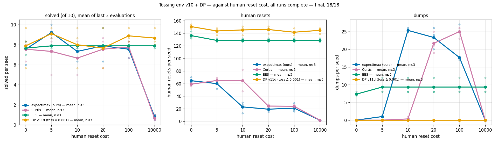
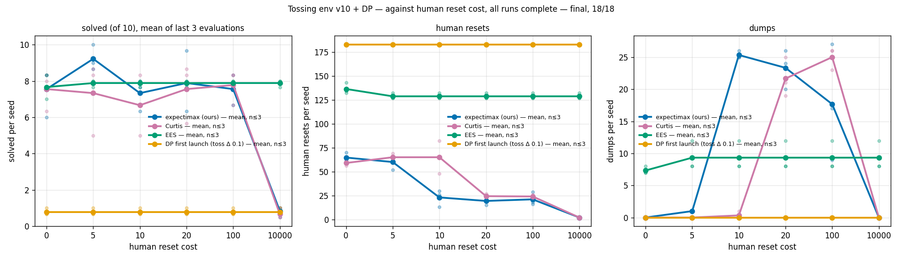
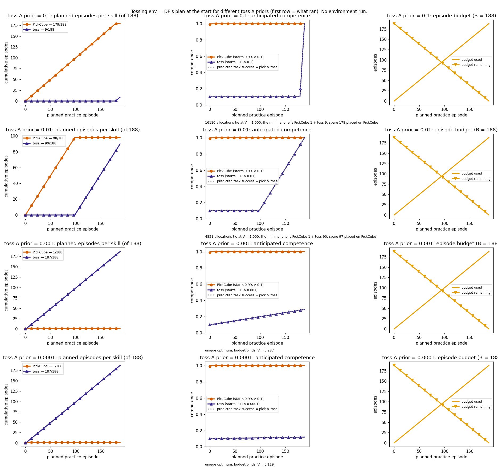
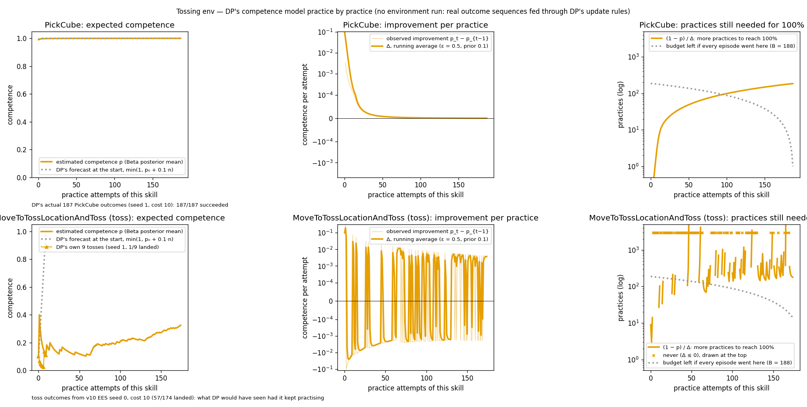
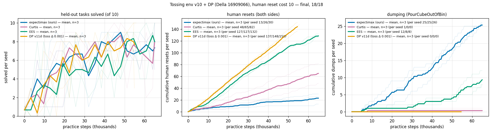

# Tossing env: Deliberate Practice (DP) baseline against the v10 arms (seeds 0–2)

> **Final:** both DP launches ran 18/18 rows to completion. Data as of 2026-11-05 14:44 EST.
> Compared against the v10 + v10b expectimax, Curtis and EES runs in
> [the v10 log](2026-11-04-tossing-env-v10-reset-cost-sweep.md).

## TL;DR

- **DP was added as a fourth arm** on the v10 grid: human reset costs {0, 5, 10, 20, 100,
  10000} × seeds 0–2, 18 runs per launch, on the tossing env (`kitchen_recycling3d`).
- **The first launch was a bad baseline (1–2/10 solved).** DP's prior on the toss's
  learning rate was the code default, Δ = 0.1 per attempt. Under that prior DP predicts the
  toss is mastered after 9 attempts, so its one allocation was PickCube 179/188 and toss
  9/188. The spare budget is a tie the paper does not break. DP spent most of each run
  in a PickCube → human reset → OpenGripper loop.
- **With a toss Δ prior of 0.001, DP matches the other arms on tasks solved.** The
  measured average toss gain under EES is about 0.0013 per attempt. Its one allocation
  became PickCube 1/188 and toss 187/188, a unique optimum with no tie. Mean of the last 3
  evaluations: 7.7–9.1/10 at every cost, against 7.7–7.9 for EES. n=3: **no inference is
  supported.**
- **DP pays the most human cost of any arm.** It makes 142–151 human resets per run at
  every cost and never dumps: about 1.1× EES and 4–12× expectimax at costs 10–100. DP's
  allocation has no cost term. Its setup planner prices a reset, but plans one attempt at
  a time, so it never chooses the reset that would make later dumps possible.
- **At cost 10000, DP and EES keep practising** and pay 1.3–1.5M in human cost.
  Expectimax and Curtis stop after 2 resets.

## Question / goal

How does DP (Vats et al., *Deliberate Practice*), configured as the paper describes,
compare with expectimax, Curtis and EES on the v10 grid? If it does badly, is that a bug,
a configuration choice, or the algorithm?

## Background

- **DP** (`--method dp`, `docs/dp-baseline.md`) allocates a practice budget across skills
  by solving the paper's bilinear program, Eqs. 1–3, with Gurobi. It predicts that
  practising skill *u* for *b* attempts gives competence

  $$f_{\text{improv}}(u,b)=\min(1,\ p_u+\Delta_u\,b)$$

  and maximises predicted task success subject to $\sum_u b_u \le B$. Competence $p_u$
  and the rate $\Delta_u$ start from priors and are updated online. The objective has no
  cost term.
- **What was launched** follows the paper as written:
  - the budget is counted in episodes (each attempt costs 1);
  - DP allocates once, before practice (the paper describes no re-solve);
  - Gurobi solves the allocation;
  - `--repeated-stop-limit 100`, so a run that has spent its budget ends.
  - B = 188, the mean number of completed practice-target attempts per run in v10's EES
    runs (3376/18).
- **Arm PR:** #694 adds the DP arm to the tossing-env launcher and two prior flags:
  - `--dp-initial-competence SKILL=P`: a skill's starting competence, held as a
    Beta(2P, 2(1−P)) prior;
  - `--dp-initial-learning-rate-for SKILL=D`: a skill's Δ prior.
- **The two launches differ only in their priors.**
  - The first launch was Della array 16889252, at 9a4db58.
  - The relaunch was Della array 16909066, at 227e4e3.

| Prior | First launch | Relaunch |
|---|---|---|
| Toss starting competence | 0.10 | 0.10 |
| Toss Δ | 0.1 (code default) | **0.001** |
| PickCube, OpenGripper, dumping starting competence | 0.99 | 0.909 (EES default) |
| Every other Δ | 0.1 | 0.1 |

- **Provenance of the priors.**
  - Toss starting competence 0.10 = 3/30, from v10 EES's first 10 non-random toss
    attempts on seeds 0–2. **These are also DP's evaluation seeds.** They are early
    practice rates, not evaluation outcomes, but the overlap is disclosed.
  - The first launch's 0.99 values were rebuilt from logged atoms. That rebuild
    disagrees with the logged toss outcomes in 1008/3118 cases, so those values are
    approximate. The relaunch drops them.
  - Toss Δ = 0.001 was chosen by Josh after the offline plan analysis below. It is close
    to v10 EES's measured average toss gain: seed 0 went from 0.10 to 0.33 over 174
    tosses.

## Hypothesis

None for the first launch: it was set up as an implementation of the baseline, not as a
test. Before the relaunch, the offline plan analysis below predicted that a toss Δ prior
of 0.001 would remove the tie and give an allocation of PickCube 1, toss 187.

## Guidance given

- Josh: run DP "the paper's way inside our step budget", without heavy calibration.
- Josh: take starting competences from v10 EES's early attempts, with the seed overlap
  disclosed.
- While Josh slept, the coordinator launched the first run despite a 179/188 PickCube
  allocation. The allocation was the paper-faithful outcome of the approved settings.
- After the results, Josh asked for the plan math and the competence model to be graphed.
  He chose the relaunch priors himself: toss competence 0.1, toss Δ 0.001, and everything
  else at 0.909 / 0.1.

## Methods

- **Grid and protocol:** v10's settings. Step protocol; 65,000 practice steps;
  evaluations at fixed step intervals; 10 held-out tasks; Della genoa.
- **Equivalence guard:** each launch's smoke run was checked against v10. EES, expectimax
  and Curtis matched, after the guard was taught to ignore exactly the three decision-log
  fields #681 removed. DP was waived, since v10 has no DP reference.
- **Allocation check:** before each array, the smoke run's single Gurobi allocation was
  read and checked: OPTIMAL, with the expected counts.
- **Offline analysis, with no environment run:**
  - the start-of-run plan for several toss Δ priors, by exact enumeration of the
    allocation;
  - DP's own update rules applied to real outcome sequences: DP's 187/187 PickCube
    outcomes, and v10 EES seed 0's 174 toss outcomes.
- **Metric:** "solved" is the mean of each run's last 3 evaluations. Human cost is summed
  from the step-event charges.

## Results

### First launch: the toss Δ prior saturates the objective

Under DP's model, predicted task success is the product of PickCube's and the toss's
predicted competence:

$$V(b)=\min(1,\,0.99+0.1\,b_{\text{pick}})\cdot\min(1,\,0.10+0.1\,b_{\text{toss}})$$

That reaches its maximum of 1 at only $b_{\text{pick}}\ge 1$ and $b_{\text{toss}}\ge 9$.
Every allocation that meets those bounds ties: 16,110 of them. The paper's budget is an
inequality with no tie-break. Gurobi put the spare 178 episodes on PickCube. DP practises
earlier skills first, so all 179 PickCube episodes came before any toss. Each one needed a
human reset, because after OpenGripper the operator model leaves the cube's position
unknown.

Result: 182–183 human resets per run, 9 tosses at the very end, and 1–2/10 solved at every
cost.

The tie disappears only once the toss cannot reach 1.0 within the budget, i.e. when
$187\,\Delta_{\text{toss}} < 1-p_{\text{toss}}$.

DP's update rules, fed real outcome sequences, show two more things:

- **PickCube never counts as mastered.** Its estimate creeps towards 1 while Δ shrinks
  just as fast, so the linear model always forecasts about as many more attempts as it
  has already had.
- **The toss's online Δ is very noisy.** It changes sign with nearly every hit or miss.

### Relaunch: toss Δ prior 0.001

The single allocation was PickCube 1/188 and toss 187/188, Gurobi OPTIMAL, with predicted
success 0.287 and no tie.

Means over seeds 0–2: solved / human cost / human resets / dumps.

| Reset cost | Expectimax (ours) | Curtis | EES | DP (relaunch) |
|---|---|---|---|---|
| 0 | 7.6 / 0 / 65 / 0 | 7.6 / 0 / 59 / 0 | 7.7 / 0 / 136 / 7 | 7.9 / 0 / 151 / 0 |
| 5 | 9.2 / 300 / 60 / 1 | 7.3 / 325 / 65 / 0 | 7.9 / 643 / 129 / 9 | 9.1 / 718 / 144 / 0 |
| 10 | 7.3 / 230 / 23 / 25 | 6.7 / 650 / 65 / 0 | 7.9 / 1,287 / 129 / 9 | 8.0 / 1,453 / 145 / 0 |
| 20 | 7.9 / 387 / 19 / 23 | 7.6 / 487 / 24 / 22 | 7.9 / 2,573 / 129 / 9 | 7.7 / 2,920 / 146 / 0 |
| 100 | 7.6 / 2,100 / 21 / 18 | 7.8 / 2,400 / 24 / 25 | 7.9 / 12,867 / 129 / 9 | 8.9 / 14,167 / 142 / 0 |
| 10000 | 0.8 / 20,000 / 2 / 0 | 0.7 / 20,000 / 2 / 0 | 7.9 / 1.29M / 129 / 9 | 8.7 / 1.45M / 145 / 0 |

- **Tasks solved:** DP is in the same range as the other arms. With n=3, a paired
  Wilcoxon cannot go below p = 0.25, so no difference can be asserted either way.
- **Human resets:** DP's choices do not depend on the reset price. Its allocation counts
  episodes and has no cost term.
- **Dumps:** DP never dumps. Its setup planner (`EesMethod.plan_to`) does price a human
  reset at C plus −log(competence). But dumping needs the bin on the robot's side, and
  DP chose `ResetCubeBinOppositeSide` 183/183 times in the first launch, which puts the
  bin out of reach. The two resets tie on immediate cost. Choosing the robot-side reset
  would make every later recovery a cheap dump, but a planner that plans one attempt at a
  time cannot see that. Expectimax plans over future resets and dumps, so it can.
- **Run length:** every relaunch run ended at about 54–56k steps, through the
  repeated-STOP limit, once its 188 episodes were spent.

### Caveats

- n = 3 seeds, so no inference is supported, as in v10.
- The relaunch's toss Δ prior was chosen after the first launch's results and close to a
  rate measured on DP's evaluation seeds. It is a tuned prior, not a blind one.
- DP allocates once. The paper's online Δ and competence updates are computed but never
  used to re-plan. Re-planning each period is an interpretation the paper does not state.
  The offline analysis shows that, on its own, re-planning would not have fixed the first
  launch: PickCube never counts as mastered, so it keeps absorbing the spare budget.

## Recommendation

- Use the relaunch (toss Δ 0.001) as the DP baseline in v11 and any later sweep, and state
  its prior provenance beside every DP number.
- Report DP's human cost next to its solved rate. DP solves as much as EES but pays the
  most human cost, because it has no reset lookahead. That is the comparison that matters
  for this project.
- If a stronger DP is wanted, the next variant is re-planning plus a mastery threshold,
  labelled as our interpretation of §5.3. More seeds come first.
