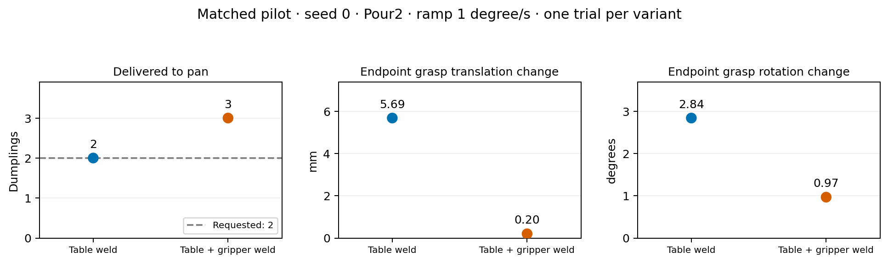

# Jug gripper weld: paired pour-performance check

The gripper weld changes pour performance in the first matched pilot. With seed 0,
Pour2 and a 1 degree/s ramp, the table-weld baseline delivered exactly two dumplings;
the table-plus-gripper-weld candidate delivered all three. Both pickups and placements
succeeded, and both outcomes settled. This is a measured overshoot, not a setup failure.
The candidate remains an uncalibrated draft; the learning sweep uses the table-weld baseline.

## Frozen versions and protocol

- Baseline: `fb217820056873797918e23651c7e06633c3eeeb` (parked jug weld).
- Candidate: `c669e6e229c6a78c27cb5b2ed89c7f1dd5f7c8f1` (parked plus held jug weld).
- Both: kindergarden `c85dbbc50ddac6eb59e8b5e00d7cc942cdd691fe` and
  kinder-baselines `032b42634a015c7f710667b3a791836fa839f6ff`.
- [Probe harness](../../scripts/probe_kitchen_pour.py): public kitchen actions in fresh,
  isolated processes, identical seeds and requested counts. Imports resolve within each
  frozen checkout. No planner, cost, reset probability or pour-controller tuning changed.
- The controller keeps its existing 80-degree fast approach, 95-degree ceiling,
  40 mm sideways wiggle, 45 degree/s return and 30-second settlement window.
- Pour success uses the native exact split, retained count, settlement and controller-error
  checks. Setup success, pour success and post-pour placement are recorded separately.
- Grasp drift below is the change from immediately after pickup to immediately after Pour,
  including carry and preparation. It is an endpoint measurement, not peak transient drift.

## Local paired pilot (completed)

One seed and one setting cannot establish a success rate or select a calibrated recipe.
It does demonstrate that welding changes this setting's result.

| Measure | Table weld | Table + gripper weld |
| --- | ---: | ---: |
| Setup / pour / placement successful | yes / yes / yes | yes / no / yes |
| Delivered to pan / retained in jug | 2 / 1 | 3 / 0 |
| Spilled outside pan and jug | 0 | 0 |
| Settled | yes | yes |
| Commanded cutoff tilt | 91.90 degrees | 91.00 degrees |
| Endpoint grasp translation change | 5.690 mm | 0.200 mm |
| Endpoint grasp rotation change | 2.844 degrees | 0.969 degrees |
| Pour controller ticks | 930 | 884 |

Both variants triggered cutoff after detecting two dumplings outside the jug. The candidate
ended with a third in the pan; cutoff cannot recover a dumpling already departing.
Improved grasp retention therefore does not imply unchanged food motion or unchanged success.

Raw evidence: [baseline](2026-11-10-pouring-jug-gripper-performance/local-baseline-pilot.json)
and [candidate](2026-11-10-pouring-jug-gripper-performance/local-candidate-pilot.json).
These local pilots are separate from the Della matrix and will not be counted twice.

## Della paired matrix (running)

The [fixed cases](2026-11-10-pouring-jug-gripper-performance/cases.json) comprise:

- 27 fresh starts per variant: seeds 0, 1 and 2; requested counts 1, 2 and 3;
  ramp rates 0.25, 1 and 5 degrees/s.
- Three additional robot-reset cases per variant: seed 0, each requested count, rate 1.
  Each first pours three, places the jug and returns each displaced dumpling with native
  robot pick/drop actions. A setup failure is reported separately from a pour failure.

Baseline array `17260868` and candidate array `17261239` each allow ten concurrent jobs,
one CPU and 6 GB per case. The 3-hour Slurm reservation selects the short QOS; each process
has a strict 55-minute timeout. Two entirely unstarted submissions were replaced because
Della assigned them to the two-job test QOS. Other experiment jobs were not changed.
See the [launch manifest](2026-11-10-pouring-jug-gripper-performance/manifest.json).

Only completed matched cases will enter comparisons. The analyzer checks every record's
main SHA, dependency pins, harness hash and case values; no missing outcome is imputed.
Full results and per-seed ramp plots will be appended here when available. No retuning or
promotion of the held-jug candidate has been performed.
