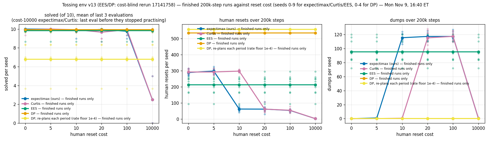
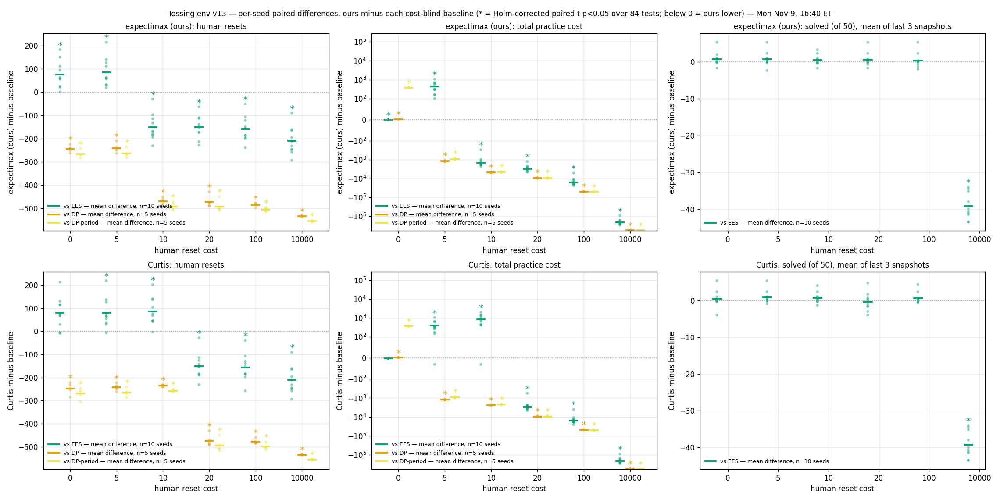
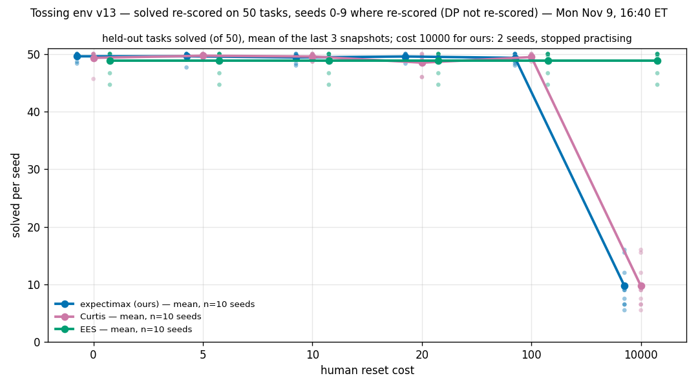
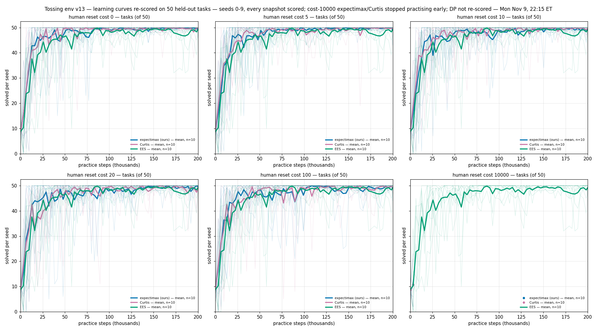

# Tossing simulation v13: ten-seed reset-cost results

Local review record, prepared 2026-11-10. Environment: `kitchen_recycling3d` (the
kitchen tossing simulation). Results and figures were produced on 2026-11-08–09;
this record packages that evidence without running a new experiment or analysis.

Review update, 2026-11-10: Josh subsequently authorized publishing this record
and its 43-file bundle. The paper-figure renderer
[#805](https://github.com/joshnroy/human-in-the-loop-practice-makes-perfect/pull/805)
has merged, so this documentation layer now targets `main` at `3f7da5606`.
The earlier holds on experiments, statistical tests, algorithms and real-robot
work remain in force.

**TL;DR:** The existing paired tests support fewer human resets than EES for
expectimax at costs 10–100 and Curtis at costs 20–100, with lower resets in 10/10
paired seeds in those cells (Holm paired-t p-values in the table below). The
50-task solved comparisons detect no difference at costs 0–100 (Holm p = 1);
they do not establish equivalence. At cost 10000 both methods stop practising
early, so the low reset count comes with substantially lower measured success.
DP comparisons have only five paired seeds and no 50-task scores.

## Question / goal

How do expectimax, Curtis, EES and DP trade human resets, practice cost and
held-out task success as the charged human-reset cost changes? Preserve the
completed v13–v13d evidence in a reviewable experiment record, including the
existing statistical family, per-seed figures and known reporting limitations.

## Background

The v13 kitchen tossing environment uses a narrow standoff range of 1.445–1.455 m,
per-side bin placement regions, and a toss classifier that learns speed and
release time without standoff. This is the kitchen simulation change, distinct
from the original `Tossing3D` benchmark's classifier. The original paper sampler
was retained; the weight-decay side arm was not run.

The first v13 EES/DP implementation exposed the configured reset price to the
setup planner. The retained baseline results come from the cost-blind rerun,
v13b, and its extensions. Josh's rule was that expectimax and Curtis learn human
cost by observation, while EES and DP do not plan with the configured price.
Actual human cost is still charged to every run. The deprecated baseline runs
are excluded. Each cost column uses its own run; no results were back-calculated.

DP allocates once in its primary arm. A separately reported DP-period variant
reallocates each session with a minimum learning rate of 1e-4. The handoff
attributes its poor toss practice to pick-first ordering and growing pick
allocation; the floor did not rescue it. This is an implementation variant,
not an additional independent replication of DP. Historical explanation and
authorization are preserved in the
[decision excerpts](data/2026-11-10-tossing-v13/provenance/DECISIONS-excerpts.txt)
and [domain handoff](data/2026-11-10-tossing-v13/provenance/HANDOFF-20261110.md).

## Hypothesis

None added for this documentation task. The completed sweep's existing tests
compare reset counts, total practice cost and solved-task scores. The apparent
early-learning advantage is a visual observation only: Josh's 2026-11-10
09:45 ET “Not now” on the first-50k AUC test remains in force.

## Guidance given

- Simulation only. Do not change hardware or real-robot files, planners,
  learning algorithms, sampler behavior or cost visibility.
- Reuse the completed read-only audit. No additional simulations, rescoring,
  hypothesis tests, changes to the statistical family or monitoring schedules.
- DP seeds 5–9 and DP 50-task rescoring remain held. The Wilcoxon family stays
  unchanged. No new sweeps are authorized.
- Preserve published numbers and figures. Add explicit annotations where a
  shorthand claim or caption disagrees with its underlying evidence.
- No public repository mutation, push, PR promotion, merge or deletion is
  authorized by this record. Della maintenance was reserved through 18:00 ET
  on November 10; its return is unconfirmed.

## Methods

### Retained runs and provenance

| Component | Seeds | Costs | Retained output tree in the mirror | Della jobs / source |
|---|---|---|---|---|
| Expectimax and Curtis, initial set | 0–4; cost 10000 initially 0–1 | 0, 5, 10, 20, 100, 10000 | `results` | 17111067; row-30 fix 17127002; frozen `source/src`, row-30 `row30-fix/src` |
| EES and DP, cost-blind rerun | 0–4 | same six costs | `results-v13b` | 17141758; `baselines-fix/src` |
| DP-period, rate floor 1e-4 | 0–4 | same six costs | `results-v13c-dp-period-floor` | 17146362; `baselines-fix-dpfloor/src` |
| Extension: expectimax, Curtis, EES | 5–9; also cost-10000 expectimax/Curtis 2–4 | same six costs | `results-v13d` | 17165853; expectimax/Curtis `row30-fix/src`, EES `baselines-fix/src` |

The assembled dataset has 240 run summaries: 10 seeds for expectimax, Curtis and
EES at each cost, and 5 seeds for each DP arm at each cost. Superseded leaky EES/DP
rows and the cancelled negative-rate DP-period launch are not comparison arms.

The Della experiment root is
`/scratch/gpfs/TSILVER/jr2860/kitchen-recycling/kitchen-recycling-20261108-v13-nostandoff`.
Its local mirror is
`/home/josh/Documents/repos/research/hitl-pmp-results/della-v13-mirror`.
The source analysis directory is
`/home/josh/Documents/repos/research/hitl-pmp-results/tossing-v13-progress`.
These locations are provenance, not dependencies needed to read this record.

Frozen evidence includes the
[initial manifest](data/2026-11-10-tossing-v13/provenance/launch/manifest.json),
[bound authorization](data/2026-11-10-tossing-v13/provenance/launch/authorization.json),
[source snapshot](data/2026-11-10-tossing-v13/provenance/launch/snapshot.json),
[runtime lock](data/2026-11-10-tossing-v13/provenance/launch/runtime-lock.json),
[v13d task argv](data/2026-11-10-tossing-v13/provenance/v13d-tasks.json), and
[baseline launch commit](data/2026-11-10-tossing-v13/provenance/baselines-fix/LAUNCH_COMMIT).
The manifest's historical `PROPOSAL_ONLY_NOT_AUTHORIZED` status is retained as
written; the separate bound authorization and submission receipt record the
initial launch. None of these historical artifacts authorizes a new launch.
The original documentation assembly base, `c507b7976`, is not the source revision
for every run; the table and archived per-run argv identify those sources. The
review stack changes only the record's parent, not any frozen evidence file.

### Practice and evaluation

The practice budget is 200,000 counted steps, with an initial measurement and
measurements every 3,200 steps. The runs use 10 held-out tasks, 500 evaluation
control steps per task, per-task evaluation RNG and four evaluation workers.
Snapshot index `i` corresponds to `min(3200*i, 200000)` counted steps.
DP uses a 600-episode allocation budget and Gurobi; its toss competence prior
is 0.1 and toss learning-rate prior is 0.001. DP-period exhausted its episode
budget at roughly 161k steps according to the handoff.

Every saved expectimax/Curtis/EES measurement snapshot was separately scored on
50 held-out tasks using its own run's code. These scores extend the original
evaluation: the first ten tasks use the same seeds. They are not 50 additional
tasks independent of the original ten. The existing
[rescorer source](data/2026-11-10-tossing-v13/provenance/rescore.py.txt) re-parses
manifest argv because `config_snapshot.json` stores argument values as strings.

Cost 10000 is an early-stop condition in the observed runs, not a completed
200k-step practice comparison. Expectimax and Curtis stop taking practice
actions after one session. Seeds 0–1 were cancelled manually; seeds 2–9 were
ended by the [stopwatch](data/2026-11-10-tossing-v13/provenance/stopwatch.py.txt)
after at least 50 consecutive STOP-only sessions and a measurement since the
last action. The latter stops interrupted 16 final original ten-task scorings;
their corresponding 50-task rescoring results are present. Cached `running`
status strings in those stopped runs are historical file contents, not evidence
of active jobs.

### Metrics and the existing test family

- Human resets: length of each run's retained reset-event list.
- Total practice cost: the final measurement's `robot_cost + human_cost`.
  The handoff describes the charging rule as `0.01 * robot steps + c * resets`;
  this record retains the logged totals rather than rebuilding charges.
- Solved on 50 tasks: per-seed mean of the last **up to** three available
  rescored snapshots. At cost 10000, expectimax/Curtis have only snapshots 0
  and 1, so the published 9.7/50 includes the initial policy. It is not solely
  the final trained policy's score. No replacement endpoint is calculated here.

The existing
[paired analysis source](data/2026-11-10-tossing-v13/analysis-sources/paired_tests10.py.txt)
contains 84 two-sided paired t-tests: two methods × six costs ×
{three baselines on resets and total cost, EES alone on solved50}. Comparisons
against EES pair seeds 0–9; DP comparisons pair only seeds 0–4. Holm correction
is applied across all 84 t-tests. The same rows also have Wilcoxon signed-rank
p-values and a separate Holm correction across those 84 p-values. The record
uses the saved [results](data/2026-11-10-tossing-v13/analysis/paired_tests10.json),
without executing the analysis source or altering the family.

The seed is the paired statistical unit. Tasks and repeated snapshots are not
independent seed replicates. Matching EES and DP trajectories across reset costs
are expected under cost blindness and do not add independent baseline seeds.

## Results

### Published reset means, preserved

These are the rounded means in the domain handoff, copied without replacing them
with newly rounded values. Expectimax/Curtis/EES have ten seeds; both DP arms
have five. Counts below are mean resets per run.

| Reset cost | Expectimax | Curtis | EES | DP | DP-period |
|---|---|---|---|---|---|
| 0 | 289 | 292 | 212 | 536 | 558 |
| 5 | 298 | 293 | 212 | 536 | 558 |
| 10 | 62 | 298 | 212 | 536 | 558 |
| 20 | 61 | 61 | 212 | 536 | 558 |
| 100 | 53 | 54 | 212 | 536 | 558 |
| 10000 | 2 (early stop) | 2 (early stop) | 212 | 536 | 558 |

**Figure annotation:** the summary title refers to finished 200k-step runs,
but includes the deliberately stopped cost-10000 arms and the episode-limited
DP-period arm. Its solved panel is on ten tasks; it is not the 50-task endpoint.
The original image and title are preserved.

### Statistical evidence and limits

The table below transcribes the existing JSON's Holm t-test p-values, displayed
to six significant figures. “Lower” is the number of paired seeds with fewer
resets than EES. All comparisons here have ten paired seeds.

| Cost | Expectimax lower / paired seeds | Expectimax Holm p | Curtis lower / paired seeds | Curtis Holm p |
|---|---|---|---|---|
| 0 | 0/10 | 0.0398217 | 2/10 | 0.0524483 |
| 5 | 0/10 | 0.0305181 | 1/10 | 0.0490996 |
| 10 | 10/10 | 0.000434249 | 1/10 | 0.0305181 |
| 20 | 10/10 | 0.000171732 | 10/10 | 0.000361250 |
| 100 | 10/10 | 0.000249568 | 10/10 | 0.000387388 |
| 10000 | 10/10 | 0.0000735258 | 10/10 | 0.0000735258 |

**Annotations beside the published shorthand:**

- The handoff says “p ≤ 0.0004.” Expectimax at cost 10 has saved adjusted
  p = 0.0004342491447420629; the headline is a rounded shorthand, not an exact
  upper bound. The JSON remains unchanged.
- The blanket cheap-reset significance claim does not hold for Curtis at cost 0:
  its saved Holm p = 0.052448290278625846. At cost 5 both methods have more resets
  than EES with adjusted p < 0.05; Curtis also does at cost 10.
- The handoff's “10/10 seeds” applies to the EES comparisons. DP and DP-period
  comparisons use five paired seeds; reset differences favor our methods in
  5/5 pairs at every cost. Their exact p-values remain in the saved JSON.
- The published approximate reset ratios (“about 4×” versus EES and “about 9×”
  versus DP) describe the higher-cost practising regime. They do not describe
  the cheap-reset cells or establish a ten-seed DP result.

For total cost the handoff reports expectimax/EES examples of 7,320 versus
23,218 at cost 100 and 3,489 versus 3,059 at cost 5. Those published rounded
values are retained here as written. **Annotation:** the statement that total
cost gives “the same verdicts” has an exception at cost 0. The saved JSON has
expectimax mean total cost below EES despite more resets (Holm p = 0.0398217);
free resets and robot charges make the two directions differ. Curtis's cost-0
total comparison has Holm p = 0.0524483. No charge reconstruction or revised
published mean is substituted.

The handoff reports unadjusted Wilcoxon p = 0.002 for 10/10 same-direction pairs,
and adjusted p about 0.16. The JSON stores `holm_w = 0.1640625` for these
comparisons. The corrected rank test does not carry the claimed significance;
the significant claims above depend on the paired t-tests. At five seeds the
smallest two-sided exact Wilcoxon p is 0.0625 before correction. No smaller
post hoc family is selected here.

### Held-out success and learning curves

The handoff reports 48.5–49.7/50 solved for our methods at costs 0–100 versus
48.9/50 for EES, with Holm p = 1 for every existing solved50 comparison there.
This is a null result, not evidence of equivalence or non-inferiority. At cost
10000 the published statistic is 9.7/50 for both methods versus 48.9/50 for EES
(saved Holm paired-t p = 5.611582546797513e-09). The two-snapshot definition and
unequal practice durations above apply. DP has no 50-task rescoring, so this
success comparison cannot be extended to DP.

**Figure annotation:** its subtitle says “cost 10000 for ours: 2 seeds,” but
the plotted data and legend use ten seeds for all three methods. Each stopped
run currently has two snapshots; that does not make the subtitle's seed count
correct. The source retains a stale subtitle; neither caption nor image bytes
have been silently corrected. The plotted 9.7/50 averages those two snapshots.

The suggestion that our methods rise faster early in practice remains untested.
No AUC, new time-window contrast or significance claim is added. The cost-10000
curves show only the two saved measurements for our methods; the x-axis extending
to 200k is not evidence of continued practice.

Additional unchanged figures:
[original ten-task learning curves](2026-11-10-tossing-v13-curves-10.png),
[50-task curves restricted to seeds 0–4](2026-11-10-tossing-v13-curves-50-seeds0-4.png),
and per-cost curves for
[0](2026-11-10-tossing-v13-cost-0.png),
[5](2026-11-10-tossing-v13-cost-5.png),
[10](2026-11-10-tossing-v13-cost-10.png),
[20](2026-11-10-tossing-v13-cost-20.png),
[100](2026-11-10-tossing-v13-cost-100.png), and
[10000](2026-11-10-tossing-v13-cost-10000.png).
The original ten-task curve title's “5–9 partial” is also historical wording;
use the complete 50-task curves and the audit for current coverage. In the
per-cost ten-task solved panels, stopped runs are held flat by the plotting
code; these are not later measurements. Summary legends and paired-difference
colors also retain their historical presentation rather than a new restyling.

### Existing audit and preservation checks

The completed read-only audit is archived as
[audit.json](data/2026-11-10-tossing-v13/audit/audit.json) and
[audit source](data/2026-11-10-tossing-v13/audit/audit.py.txt).
It reports no errors and verifies:

- 10,280/10,280 run snapshot scores and policy hashes across 180/180 curves.
  **Correction beside the historical headline:** the domain handoff's 9,760
  is stale; 10,280 is the audited count. The separate rescoring smoke-test
  result is not part of these run snapshots.
- 240/240 cached reset counts and 960/960 final measurement fields.
- Original first-ten-task parity for 10,264/10,264 available evaluations;
  the other 16 original evaluations were intentionally interrupted as described
  above. Their 50-task rescoring is present.
- Reproduction of the existing 84/84 paired tests and both Holm corrections.
  This audit was not repeated while assembling the record.

The [PR status snapshot](data/2026-11-10-tossing-v13/audit/pr-status.json) is
historical, read-only evidence: seven relevant PRs were open drafts with
successful CI when audited. This record makes no claim about later live status.

The [bundle manifest](data/2026-11-10-tossing-v13/manifest.json) lists original
paths, byte counts and SHA-256 hashes for all 41 evidence files. Existing figures,
data, scripts and audit files were copied byte-for-byte. The only extracted
source is the explicitly identified decision-log excerpt. Script copies use
`.py.txt` to distinguish archived analysis from newly maintained repository
code. The archived scripts write outputs when run; they were inspected, not
executed, during this documentation task.

Packaging validation passed: 41/41 manifest hashes matched their packaged files,
all byte-for-byte copies matched their sources, and 28/28 links in this record
resolved. The repository document-link check, `ruff check`, `ruff format --check`,
`mypy src` and `lint-imports` passed in the isolated checkout through its own
`scripts/with_env.sh`. No simulator tests were needed for this documentation-only
change; no experiments or statistical tests were executed.

## Recommendation

Use the existing reset/cost evidence with its paired-t and seed-count limits,
and describe costs 0–100 solved performance as no detected difference. Treat
cost 10000 separately because stopping practice changes both exposure and the
available-snapshot endpoint. Keep DP-period visibly identified as a variant.

Review the annotations before reusing a headline or figure in a paper. Preserve
the original artifacts alongside those annotations. Additional DP runs,
rescoring, early-learning tests, a different test family, algorithm changes and
public repository actions remain pending scoped human authorization. This local
record is ready for review without any of those actions.
