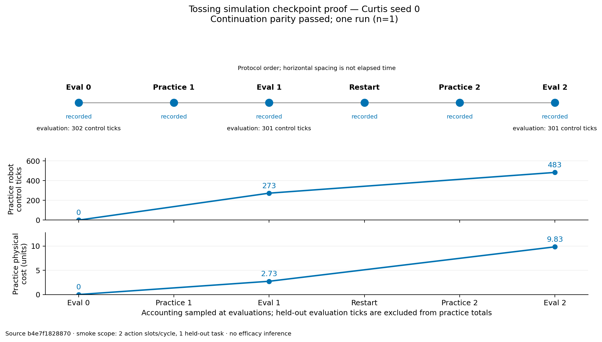

TL;DR: One Curtis seed-0 Tossing simulation completed eval 0 → practice 1 → eval 1,
exited, resumed in a separate process, and completed practice 2 → eval 2. Its final
state matched an uninterrupted two-cycle reference in **20/20 semantic comparisons**
and **8/8 structural checks**. This validates bounded continuation for this run.

## Question / goal

Save complete simulation practice state, resume at the next cycle without repeating
learning or evaluation, preserve recorder history, and evaluate the deployment policy
valued during practice.

## Background

Historical v13 pickles retained deployment samplers, shared competence estimates and
RNG state, then reconstructed EES for every method's evaluation. They did not retain
Curtis's complete practice beliefs or resumable simulator state. The new stack is
#810, method-specific deployment snapshots, followed by #811, complete simulation
checkpointing and continuation.

EES retains its competence-weighted planner. DP executes its absorbing-failure task
MDP using its cumulative competence posterior. Curtis and expectimax execute the
finite-horizon pick/open/toss policy valued by their practice objective: recover a
failed pick by opening, and end after one toss. Curtis's practice A* search is not
rerun at evaluation. All three evaluations in this smoke record
`tossing_canonical`, source `curtis/determinized_astar`, horizon 4. Historical
unversioned snapshots retain shared EES replay. The smoke is a new evaluation
condition and does not revise v13 results.

## Hypothesis

None — implementation validation. One seed and one held-out task support a bounded
continuation check; no hypothesis test, efficacy estimate, seed sweep, or rescoring
of existing results was performed.

## Guidance given

Josh requested full resumable simulation state and deployment consistent with each
method's practice objective, then authorized a Della check through eval 0 →
practice 1 → eval 1, followed by resume → practice 2. The uninterrupted two-cycle
run supplies the deterministic continuation control. Hardware and real-robot work
were outside scope.

## Methods

The domain is `kitchen_recycling3d`, the Tossing v13 domain, with Curtis, seed 0,
human reset cost 5, two action slots per practice cycle, one fixed held-out task
(scene seed 357381689), and a 500-control-tick evaluation cap. The configured
practice budget remains 200,000 steps across processes; a cycle-boundary pause
limits this smoke. Recorded method settings include local_trend with grid inference (25 competence
bins and 16 learning-rate bins), 100 search iterations, epsilon 0.5, and 10,000
sampler-fitting iterations. Evaluations run after learning updates 1 and 2, with one evaluation
worker and per-task RNG. Reduced action/task counts are smoke-only deviations.

Final source is `b4e7f182887087ad125b06a1cf3afbbc62dea7ac`. The source archive
verified 5,489/5,489 file hashes and has SHA-256
`0aa6c3b2ea6ab05fc384c9210932b9996f4604cf1a442b6bd4d9b5d76428354f`.
Exact dependency pins are kindergarden
`c85dbbc50ddac6eb59e8b5e00d7cc942cdd691fe` and kinder-baselines
`032b42634a015c7f710667b3a791836fa839f6ff`.
[Provenance](data/2026-11-11-tossing-resume-validation/provenance.json) records
source/runtime identity and previous attempts;
[stage records](data/2026-11-11-tossing-resume-validation/stages.json) preserve
the exact commands and exit codes. The [launch record](data/2026-11-11-tossing-resume-validation/launch.json)
and [smoke settings](data/2026-11-11-tossing-resume-validation/smoke-deviations.json)
record the allocation and protocol conditions.
[Execution tools](data/2026-11-11-tossing-resume-validation/execution-tools.tar.gz)
contain the exact batch wrapper, orchestrator, comparator and plotting tools.

The first process paused cleanly after cycle 1 and eval 1. A second invocation
restored the full method, learned sampler, simulator/task state, counters, accounting,
RNGs and recorder continuation, then paused after cycle 2 and eval 2. A third
invocation ran two cycles uninterrupted. Every Python phase used the packaged
checkout's `scripts/with_env.sh`; experiment invocations used
`scripts/run_sweep.py`.

Two earlier checks exposed fixes:

- Attempt 1, source `6573eb5072c93b731352ee6b973c727b4753f1bf`, reached the first
  boundary but refused resume before practice because `kitchen_config_resolved`
  was compared before derived metadata had been resolved. Source
  `775a29c2225fedb9a2a11363478550fe601dc1df` corrected configuration identity.
- Attempt 2 completed both paths and matched actions, physics, evaluations and
  recorder rows. Its original comparison remained false for method and global RNG
  fingerprints. Method differences were process-specific cost-key representations
  and external planner logs. The global RNG difference was real: independent fresh
  processes lacked an explicit initial global seed. Final source initializes
  independent NumPy, Python and Torch global streams from the run seed for fresh
  simulations opting into cycle checkpoints. Resume restores saved streams.
  Historical/default and real-robot RNG initialization remain unchanged. Original
  attempt-2 [failed comparison](data/2026-11-11-tossing-resume-validation/attempt2-original-comparison.json),
  [semantic comparison](data/2026-11-11-tossing-resume-validation/attempt2-semantic-diagnosis.json),
  [method diagnosis](data/2026-11-11-tossing-resume-validation/attempt2-method-diagnosis.json)
  and [RNG diagnosis](data/2026-11-11-tossing-resume-validation/attempt2-rng-diagnosis.json)
  remain preserved.

Semantic comparison retains beliefs, learned weights, action/cost values, RNG state,
cache inputs and exact translated SAS payloads. It canonicalizes each serialized
cost forecast key by safely parsing quoted skill and bound-object names/types/features
with regex and `ast.literal_eval`; it requires a bijection with the method's ground
skills and rejects missing, duplicate, malformed or unmatched keys. No cost is
dropped. Cached external Fast Downward `fd_output` text contains temporary paths,
timings and peak-memory diagnostics; that text is excluded from semantic hashes,
while its raw hashes remain explicit in the
[comparison report](data/2026-11-11-tossing-resume-validation/comparison.json).
Existing normalization also removes documented timestamps, output paths, recorder/log
handles and policy-file hashes. Changed cost values, sampler weights and SAS payloads
still fail local regression checks.

For reproduction, restore the recorded source/dependency pins and frozen runtime,
extract the execution tools into the isolated validation root, and use the recorded
batch entrypoint. This submits a new bounded job:

```console
sbatch --export=ALL,VALIDATION_ROOT=/absolute/path/to/new-validation-root tools/validation.sbatch
```

Use a new output directory for a new run. The orchestrator records separate fresh,
resumed and uninterrupted argv. For local figure regeneration from fetched records:

```console
scripts/with_env.sh python tools/plot_validation.py --input-root ATTEMPT_ROOT --output-dir FIGURE_DIRECTORY
```

## Results

Della job **17330575** completed with exit **0:0** in **00:03:21**, from 10:37:52
to 10:41:13 ET on November 11, 2026, on `della-h16n4`. It requested 4 CPUs,
16 GB and 20 minutes; recorded batch peak memory was **2,488,428 K**.
[Slurm receipt](data/2026-11-11-tossing-resume-validation/slurm-accounting.psv)

All 20/20 semantic state comparisons matched: method/beliefs/samplers, global RNGs,
simulation/environment state, accounting, metrics, counters, recorded actions,
evaluations, and sampler draw/proposal streams. All 8/8 structural checks passed:
two cycles, two learning updates, eval 0 exactly once, complete evaluations,
canonical deployment, the first-cycle checkpoint boundary, and preservation of both
sampler recorder prefixes. The separate
[resumed evaluations](data/2026-11-11-tossing-resume-validation/evaluations.json),
[reference evaluations](data/2026-11-11-tossing-resume-validation/reference-evaluations.json)
and [events](data/2026-11-11-tossing-resume-validation/events.jsonl) retain the evidence.

| Boundary | Learning updates | Practice clock ticks | Robot control ticks | Human calls | Physical cost |
|---|---:|---:|---:|---:|---:|
| Eval 0 | 0 | 0 | 0 | 0 | 0.00 |
| Eval 1 | 1 | 273 | 273 | 0 | 2.73 |
| Eval 2 after resume | 2 | 484 | 483 | 1 | 9.83 |

These are cumulative practice counters; held-out evaluation ticks are excluded.
The final clock includes 483 robot ticks and one human tick. The final physical
cost is 4.83 robot cost plus one reset charged 5.00; displayed costs are rounded
to two decimals, with original values retained in JSON. Each held-out evaluation
completed with 0/1 tasks solved. The passing criterion is continuation parity.



[Vector figure](2026-11-11-tossing-resume-validation.svg). Filled stages have recorded
evidence. Horizontal stage spacing expresses protocol order rather than elapsed time.
The accounting panels use the measured evaluation-boundary counters. This is one
Curtis run, not evidence about learning efficacy or other seeds.

## Recommendation

Review #810 → #811 with this bounded proof record. The Della check validates
Curtis continuation and its valued deployment policy through two practice cycles.
DP and EES deployment behavior have implementation tests; this smoke did not run
those methods on Della. Broader simulation experiments, additional DP seeds/rescoring
and held statistical analyses retain their existing scope and authorization.
